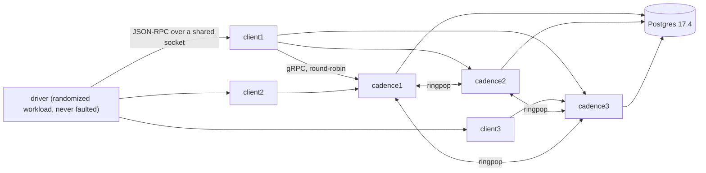

# Cadence master under Antithesis: ten bugs found, five of them lose, duplicate or reorder acknowledged signals

**Prepared for:** Uber · **Tested:** 2026-11-18 to 2026-11-19 · **System:** Cadence master ([`572e7e2c`][c-master])
**Document version:** second edition, written on 2026-11-19 after the deadline. It replaces the first edition: every failure of the long runs has now been traced, which added four findings. Two confirmation runs were still running when it was written; their results are not in this edition.

## Summary

We ran Cadence master, built from source, as a three-node cluster on Postgres under Antithesis. Antithesis repeatedly crashed, paused and cut off servers, the database and clients while a randomized workload drove workflows through the official Go client (fault injection). The two long runs on master lasted about 12.5 hours each. Ten bugs were found, and each one survived an adversarial review. Eight are in the Cadence server and two are in the Go client. In order of severity:

- [a reset retried by the client is applied a second time](#retried-reset-applied-twice), which discards the first reset run and the acknowledged signals it held;
- [an acknowledged signal is lost when the workflow is reset while a decision is in flight](#acked-signal-lost-on-reset);
- [a signal retried by the client across a continue-as-new is applied twice](#retried-signal-duplicated-after-continue-as-new);
- [signals that arrive during a decision are written to history out of order after the workflow is reloaded from Postgres](#buffered-signals-reordered-on-reload);
- [a completed workflow is read back as running, with a shorter history, from a host that lost its shard](#stale-history-after-shard-steal);
- in the Go client (`go.uber.org/cadence` v1.4.0): [a parent workflow that cancels its children gets stuck when a child closes before the cancel is acknowledged](#child-cancel-ack-after-close);
- [a signal retried by the client during a reset is applied twice](#retried-signal-duplicated-after-reset);
- in the Go client: [a workflow with a long local activity stops making progress after a retried decision heartbeat](#retried-decision-heartbeat-stalls-workflow);
- [stopping a server while it is still starting crashes it with a nil-pointer panic](#sigterm-during-startup-panics);
- [a server crashes at startup when closing its schema-check database connection fails](#sql-admin-conn-close-panic).

Five findings break [Guarantee 2](#guarantee-2) (acknowledged signals exactly once, in order); one breaks [Guarantee 3](#guarantee-3) (history consistency); the two Go-client findings stall workflows ([Guarantee 4](#guarantee-4)). The test setup also caught a known Cadence bug ([PR #8595][pr8595]) on the build from before its fix. Patches or proposed fixes exist for seven findings. Two of them are verified end to end and one partly; a run with the complete patch set was still running when this edition was written. The other failures of the long runs were traced to known consequences of these findings or to errors in our own test code, as set out in [What the long runs showed](#what-the-long-runs-showed).

## What we tested

- **Uber's system:** Cadence is Uber's workflow orchestration engine. Services start long-running workflows, send them signals and read their results, and Cadence promises that this state survives crashes of workers and of Cadence itself. Many of Uber's services rely on it as their control plane.
- **Under test:** Cadence master ([`572e7e2c`][c-master]) from [cadence-workflow/cadence][repo], unmodified apart from Antithesis coverage instrumentation, with the Go client `go.uber.org/cadence` v1.4.0. This is Cadence itself, not a stand-in. A separate report covers the v1.4.5 release.
- **How long:** 8 test runs on master: 6 short runs to get the tests right, and 2 long runs of about 12.5 hours each ([`3e9720ca`][r-3e97] and [`c26baba5`][r-c26b]). Also 3 runs on the build from before a known bug's fix, and 3 runs checking proposed fixes, with a fourth still running. All from 2026-11-18 to 2026-11-19. [Runs](#runs) lists them all.

## Guarantees

The promises Cadence makes to the services that run workflows on it, as we checked them. Details: [guarantees.md](../antithesis/scratchbook/guarantees.md).

| Guarantee | Statement | Source | Result on master |
|---|---|---|---|
| [Guarantee 1](#guarantee-1) | At most one run of a workflow ID is open at a time; a start for an ID with an open run is rejected, and a start on a closed ID follows its reuse policy | [Workflows doc][doc-wf], [IDL][idl] | ✅ held: every failure of its checks was traced to our test code ([details](#what-the-long-runs-showed)) |
| [Guarantee 2](#guarantee-2) | A signal acknowledged to the client is applied exactly once, even when the client retries, and is never lost | [Go client signals doc][doc-sig], [IDL][idl] | ❌ broken ([reset applied twice](#retried-reset-applied-twice), [signal lost on reset](#acked-signal-lost-on-reset), [signal duplicated after continue-as-new](#retried-signal-duplicated-after-continue-as-new), [signals reordered](#buffered-signals-reordered-on-reload), [signal duplicated after reset](#retried-signal-duplicated-after-reset)) |
| [Guarantee 3](#guarantee-3) | A workflow's history is well formed and append-only: a later read returns the earlier read as a prefix | [Timers doc][doc-timers], [PR #8595][pr8595] | ❌ broken ([stale history after a shard steal](#stale-history-after-shard-steal); [signal duplicated after reset](#retried-signal-duplicated-after-reset) also records a signal twice) |
| [Guarantee 4](#guarantee-4) | Every started workflow closes with the result its inputs determine; timers never fire early; a closed run stays closed | [Workflows doc][doc-wf], [Timers doc][doc-timers] | ❌ broken in the Go client ([parent stuck after child cancel](#child-cancel-ack-after-close), [stalled workflow](#retried-decision-heartbeat-stalls-workflow)); the [stale history](#stale-history-after-shard-steal) finding also shows a closed run as open |
| [Guarantee 5](#guarantee-5) | Once faults stop, a new workflow completes within 120 s and every client is served again | [Workflows doc][doc-wf] (window inferred) | ✅ held on the server: a new workflow always completed; the "every client is served again" failures appear to come from the test environment ([details](#what-the-long-runs-showed)). The [Go-client stall](#retried-decision-heartbeat-stalls-workflow) breaks progress for one workflow |
| [Guarantee 6](#guarantee-6) | Visibility converges: once faults stop, every closed run is listed as closed | [visibility interface][vis] | ✅ held (checked in part: closed runs are listed) |

### Guarantee 1: single open run per workflow ID

"There could be only one workflow (across all workflow types) with a given ID open per domain at any time" ([Workflows doc][doc-wf]). The tests start a second run on the ID of an open workflow, which must be rejected as already started, and start new runs on closed IDs with a drawn reuse policy, which must be accepted or rejected as the policy says. Both checks failed in the long runs, but every failure was our test's own doing: a late request from an earlier run of a reused workflow ID, or two of our own starts racing on one ID. Cadence behaved as documented in every case checked. Retried starts returning the same run ID were not checked separately. Commands: [test commands](#test-commands).

### Guarantee 2: acknowledged signals exactly once

"When a signal is received for a running workflow, Cadence persists the event and the payload in the workflow history ... without the risk of losing the information" ([Go client signals doc][doc-sig]). Every signal carries a unique ID. The counter workflow returns the list of signals it applied, and the tests check that every acknowledged signal appears in it exactly once, in acknowledgement order, and that nothing appears that was never sent. Workflows that were reset report through their own checks, so that each bug stays visible apart from the others. Five findings break this guarantee: three around a reset (`ResetWorkflowExecution`), one across a continue-as-new, and one that reorders signals. Commands: [test commands](#test-commands).

### Guarantee 3: history is well formed

"Timers can have a single resolution event, either canceled or fired" ([PR #8595][pr8595]). After a workflow closes, the tests read its history and check: contiguous event IDs, exactly one close event, at most one resolution per timer, activity and child, and no signal recorded twice. A history read right after the server reported the workflow closed must contain the close event. The general well-formedness check held on master in both long runs. Two findings break the guarantee. Commands: [test commands](#test-commands).

### Guarantee 4: started workflows complete correctly

"The workflow code is completely oblivious to any failures and downtime of workers or even the Cadence service itself" ([Workflows doc][doc-wf]). Workflows are small deterministic programs (signals, activities with retries and heartbeats, local activities, timers, child workflows, continue-as-new). The tests compute each expected result from the inputs and check it, check that no timer fires early, that a closed run is still closed with the same status when read again, and, after faults stop, that every started workflow closes. Two Go-client findings break this guarantee, and the [stale history](#stale-history-after-shard-steal) finding makes a closed run read back as open. The timer check failed too: it allowed no tolerance for the clock jumps Antithesis injects, which the guarantee allows, and every example examined was explained by such a jump. Commands: [test commands](#test-commands).

### Guarantee 5: recovers after faults

Cadence documents no recovery time, so the 120 s window is our inference. Once faults stop, the tests check that each client container can start a workflow again within 3 minutes, and that a fresh workflow with activities completes within 120 s. The fresh workflow completed every time on master. The "every client is served again" check failed only after something other than the fault injector had stopped the client containers, and then the servers, near the end of a timeline, with no fault event logged; it looks like the test environment tearing the timeline down, but the cause was not confirmed. The check was then testing stopped containers. Commands: [test commands](#test-commands).

### Guarantee 6: visibility converges

"This is a secondary store that is eventually consistent with the main executions store" ([visibility interface][vis]). Once faults stop, the tests list each closed workflow ID and check that every closed run they know of is listed as closed within 2 minutes. This held on master. The check does not compare close status or look for runs wrongly listed as open. Commands: [test commands](#test-commands).

## How we tested

### Environment

*Each cadence box is one `cadence-server` running all four services (frontend, history, matching, worker). Each client box is the Go client plus a workflow worker. Every client talks to all three frontends in turn (only some arrows are drawn). Postgres holds both the default store and visibility. Antithesis injects faults into every container except the driver.*

- **Software under test:**
  - **Cadence** master: [`572e7e2c`][c-master] ([cadence-workflow/cadence][repo]), built from source with Antithesis coverage instrumentation ([Dockerfile](../antithesis/server/Dockerfile)).
  - **Go client** `go.uber.org/cadence` v1.4.0 ([cadence-go-client v1.4.0][go-client]), used as a released module.
  - Every build that ran is listed in [Builds](#builds).
- **Faults:** container kills, stops and pauses, network partitions and degraded links, CPU throttling and clock jitter (Antithesis `high_availability`), on all Cadence nodes, Postgres and the client containers. A small supervisor restarts `cadence-server` after it exits, as Kubernetes would ([entrypoint.sh](../antithesis/server/entrypoint.sh)).
- **Workload:**
  - five workflow types: counter (signals, queries, continue-as-new, cancel, reset), chain (activities with retries, heartbeats, parallel and local activities), timer, parent (child workflows), and race (timers racing long local activities, with a 4 s decision timeout so the client sends decision heartbeats);
  - random concurrent operations: start, signal-with-start, signal, query, cancel, terminate, reset, a second start of an open ID, reuse of a closed ID, result and history reads;
  - every outcome is checked against a model of what was sent and acknowledged, as it arrives;
  - now and then the workload stops faults and checks recovery, completion and visibility (an "eventually" check);
  - the two long runs used different settings: [`3e9720ca`][r-3e97] the tuning below, [`c26baba5`][r-c26b] 16 shards, the default history cache and one task-list partition.

**How the tested setup differs from a default install** ([dynamicconfig.yaml](../antithesis/config-master/dynamicconfig.yaml), [cadence.yaml](../antithesis/config-master/cadence.yaml)):

| Setting | Test value | Production default | Why |
|---|---|---|---|
| `numHistoryShards` | 8 (second long run: 16) | set per cluster | small cluster |
| `history.cacheMaxSize` | 20 (second long run: default) | 512 | reload workflow state from the database often |
| `history.cacheTTL` | 30s (second long run: default) | 1h | same |
| `matching.numTasklistWritePartitions` / `ReadPartitions` | 3 (second long run: 1) | 1 | exercise task-list partition forwarding |
| `matching.idleTasklistCheckInterval`, `matching.updateAckInterval` | 20s, 5s | 5m, 1m | more frequent task-list unloading and ack writes |
| `history.shardUpdateMinInterval` | 1s | 5m | more frequent shard writes |
| `history.timerProcessorUpdateAckInterval`, `history.transferProcessorUpdateAckInterval` | 5s | 30s | more frequent queue ack writes |
| `frontend.shutdownDrainDuration`, `history.shutdownDrainDuration` | 0s | 0s (set explicitly) | a stopped node does not wait to drain traffic |
| `history.decisionHeartbeatTimeout` | 1m | 30m | added after the [Go-client stall](#retried-decision-heartbeat-stalls-workflow), which was found with the default, so one stalled workflow can't hide others |
| `system.minRetentionDays` | 0 | 1 | allow short retention in tests |
| Postgres `idle_in_transaction_session_timeout`, TCP keepalives | 30s; 10/5/3 s | off; OS default | without them, a killed server's open transaction held shard row locks for hours ([analysis](../antithesis/scratchbook/rca/shard-unavailable-after-faults.md)) |

### Test commands

The workload is one randomized driver: 11 operations (rules) that run concurrently, up to 6 at a time, while Antithesis injects faults, plus one rare rule that stops faults and checks recovery. It makes 22 checks that must hold every time (`Always` and `Unreachable` assertions: 21 in the driver, 1 in the server's supervisor script) and 19 checks that an interesting case happened at least once (`Sometimes` assertions). **How each one works, every check it makes, and where in the code: [How the tests work](speedrun-tests.md).**

| Guarantee | What the commands do | Commands |
|---|---|---|
| [Guarantee 1](#guarantee-1) | Start a second run on an open ID (must be rejected as already started); start on a closed ID with a drawn reuse policy (must follow the policy) | [`RuleDuplicateStart`](speedrun-tests.md#ruleduplicatestart), [`RuleReuseClosed`](speedrun-tests.md#rulereuseclosed) |
| [Guarantee 2](#guarantee-2) | Send uniquely numbered signals, query, reset and finish counter workflows; every acknowledged signal must be applied once, in order, and nothing unsent may appear | [`RuleStart`](speedrun-tests.md#rulestart), [`RuleSignal`](speedrun-tests.md#rulesignal), [`RuleQuery`](speedrun-tests.md#rulequery), [`RuleReset`](speedrun-tests.md#rulereset), [`RuleFinish`](speedrun-tests.md#rulefinish), [`RuleResult`](speedrun-tests.md#ruleresult) |
| [Guarantee 3](#guarantee-3) | Read the history of every closed run; it must be well formed and, when the server just reported the run closed, contain the close event | [`RuleResult`](speedrun-tests.md#ruleresult) |
| [Guarantee 4](#guarantee-4) | Read results and compare with the model; re-read closed runs; after faults stop, every started workflow must close | [`RuleResult`](speedrun-tests.md#ruleresult), [`RuleDescribeClosed`](speedrun-tests.md#ruledescribeclosed), [`RuleCancel`](speedrun-tests.md#rulecancel), [`RuleTerminate`](speedrun-tests.md#ruleterminate), [`RuleEventually`](speedrun-tests.md#ruleeventually) |
| [Guarantee 5](#guarantee-5) | After faults stop, each client must start a workflow and a fresh workflow must complete within 120 s | [`RuleEventually`](speedrun-tests.md#ruleeventually) |
| [Guarantee 6](#guarantee-6) | After faults stop, every closed run must be listed as closed | [`RuleEventually`](speedrun-tests.md#ruleeventually) |

Before any rule runs, [the driver's setup](speedrun-tests.md#setup) waits for every client, registers the domain, starts the workers and runs one workflow end to end.

## Known-bug check

To check that these tests can catch a real bug of this kind, we ran them on the build from just before a known fix. The bug: [duplicate timer resolution after decision heartbeating (PR #8595)][pr8595]. A timer that fired during a decision heartbeat, and that the same decision canceled, is later recorded as both canceled and fired once the workflow state is reloaded. It breaks [Guarantee 3](#guarantee-3). The build: [`c889f831`][c-prefix], the parent of the fix [`976d08c2`][c-fix], with the same test setup.

**Reproduced.** In run [`ccd99ed4`][r-ccd9] the check "a workflow history is well formed" failed in 201 examples, and every one in a sample of 50 had the bug's signature, "timer N resolved twice: TimerCanceled then TimerFired". One failing example is at 63 s of simulated time ([log][log-known]). An earlier run with an older version of the tests (`0dc3db5a`, cancelled, so it has no report) showed the same signature in about 19 examples. The same check passed in all four long runs on master and v1.4.5, which contain the fix, and in fix-check run [`1a0d055c`][r-1a0d]. It did fail in several short iteration runs on both versions and in fix-check run [`41bf0672`][r-41bf], which ran earlier test code or other builds; those failures were not compared with this bug's signature. While setting this up we found and fixed a gap in our history check, which at first did not record which timer a `TimerCanceled` event refers to.

## Findings

Ten findings, each confirmed by root-cause analysis and an adversarial review, in order of severity. Eight are in the Cadence server and two are in the Go client. The server findings' code paths are identical on master and v1.4.5; each was compared with the build where it was first analyzed.

**How often they were seen:** Antithesis counts the failing examples of each check. One timeline that goes wrong is usually counted many times, once for each later branch that Antithesis explores from it, so a count measures how often a failure was reached, not how many independent incidents there were. Several checks are dedicated to one finding, but a check counts every failure of its kind; where two findings share a check, the entries say so. The counts are from the two long runs on master, [`3e9720ca`][r-3e97] / [`c26baba5`][r-c26b], and the fix-check run [`1a0d055c`][r-1a0d] (v1.4.5 plus three patches). The test setup provokes some situations far more often than production does; where the adversarial review judged that a count overstates production frequency, the entry says so.

**Fix checks:** the fix-check runs ran on v1.4.5 plus patches (master has identical code on each finding's path, and the patches apply to master unchanged). The run with three patches, [`1a0d055c`][r-1a0d], was analyzed in full ([fix-check analysis](../antithesis/scratchbook/rca/fixverify-residuals.md)); each entry gives its result. A run with the complete patch set ([combined-fixverify3.patch](../antithesis/fixes/combined-fixverify3.patch) on top of the earlier patches), `fc87ca1b`, was still running when this edition was written.

| Finding | Component | Severity | Failing examples on master (`3e9720ca` / `c26baba5`) | Fix |
|---|---|---|---|---|
| [reset applied twice](#retried-reset-applied-twice) | server | medium-high | no dedicated check; feeds "an acknowledged signal survives a reset" (957 / 1.0k, shared) | patch; in the running fix check |
| [signal lost on reset](#acked-signal-lost-on-reset) | server | medium | "an acknowledged signal survives a reset" (957 / 1.0k, shared) | patch, verified |
| [signal duplicated after continue-as-new](#retried-signal-duplicated-after-continue-as-new) | server | medium | 192 / 253 | proposed diff, not run |
| [signals reordered after reload](#buffered-signals-reordered-on-reload) | server, Postgres | medium | 151 / 171 | proposed one-line change, not run |
| [stale history after a shard steal](#stale-history-after-shard-steal) | server | medium | 52 / 116 (plus 60 / 62 on a second check) | no patch |
| [parent stuck after child cancel](#child-cancel-ack-after-close) | Go client | medium | 104 / 59 | no patch |
| [signal duplicated after reset](#retried-signal-duplicated-after-reset) | server | low-medium | 277 / 701 (shared) | patch, partly verified; complete version in the running fix check |
| [stalled workflow after a decision heartbeat retry](#retried-decision-heartbeat-stalls-workflow) | Go client | medium-low | not seen on master (one occurrence on v1.4.5) | no patch |
| [shutdown panic during startup](#sigterm-during-startup-panics) | server | low | 1.1k / 1.1k | patch, verified |
| [startup panic on a failed connection close](#sql-admin-conn-close-panic) | server | low | not counted separately (seen on v1.4.5 and in the fix check) | proposed diff; in the running fix check |

### A reset retried by the client is applied a second time, discarding the first reset run

**Full analysis:** [root cause](../antithesis/scratchbook/rca/fixverify-reset-dup.md) ([second occurrence](../antithesis/scratchbook/rca/retried-reset-applied-twice-2nd.md)) · [adversarial review](../antithesis/scratchbook/adversarial/retried-reset-applied-twice.md) · **Patch:** [retried-signal-duplicated-after-reset.v2.patch](../antithesis/fixes/retried-signal-duplicated-after-reset.v2.patch), plus [reset-dedup-across-can.diff](../antithesis/fixes/reset-dedup-across-can.diff)

- **What broke:** one `ResetWorkflowExecution` call was committed twice. The second reset threw away the run created by the first one, together with the signals acknowledged to it.
- **Guarantee:** [Guarantee 2](#guarantee-2), "an acknowledged signal is never lost".
- **Impact:** `ResetWorkflowExecution` is not idempotent under client retry. A reset whose reply is lost, followed by the Go client's standard retry, resets the workflow again, silently losing work and acknowledged signals since the first reset, and can lead to duplicate signals. It happens with default configuration, on SQL stores, and without strong idempotency enabled. Severity: medium-high.
- **How it happened:**
  1. The client asks to reset run A to an earlier point. Cadence commits the reset and creates run B, but the reply is lost.
  2. Run B accepts and acknowledges new signals.
  3. The Go client retries the reset with the same request ID.
  4. Cadence's check for a repeated reset request never matches, so it resets run A again, creating run C and terminating run B.
  5. The second reset copies signals only from run A, so the signals acknowledged to run B are gone.
- **Seen in:** first in fix-check run [`41bf0672`][r-41bf] (v1.4.5 plus two earlier patches, signal dedup v1 and the shutdown nil guards, neither of which covers this bug; workflow counter-182, signals s617, s620 and s621 lost) ([log][log-resetdup]). Confirmed a second time, with full histories, on unpatched v1.4.5 (run [`bba4d2f0`][r-bba4], workflow counter-115: one reset request created two reset runs, and signal act-s286, accepted by the discarded run, was not carried into the new run; whether it was later re-sent was not checked). On master, run [`c26baba5`][r-c26b] shows the same log signature (workflow counter-50; histories not fetched). There is no check dedicated to it: its lost signals are counted by "an acknowledged signal survives a reset of its workflow", together with the [next finding](#acked-signal-lost-on-reset). In the fix-check run [`1a0d055c`][r-1a0d], which did not contain this patch, it caused every sampled failure of that check (362 of 373 examples). A search of the long runs' logs found dozens of candidate cases per run.
- **Root cause:** the reset deduplicates by comparing the current run's `CreateRequestID` with the reset request ID ([reset_workflow_execution.go:124-133][m-reset124]). But rebuilding the reset run always overwrites `CreateRequestID` with the original start request's ID ([mutable_state_builder_methods_started.go:192-198][m-started192]), so the check never matches. This override came in with [#5821][pr5821] ([`baac6218`][c-5821], April 2024): a regression.
- **Proposed fix:** after rebuilding the reset run, set its `CreateRequestID` to the reset request ID, which restores the behaviour from before #5821 (the v2 patch, which passes `go test ./service/history/reset/`). The fix-check analysis found one more case: when the first reset run has already continued as new before the retry arrives, the check must also look at the run's continue-as-new predecessors ([reset-dedup-across-can.diff](../antithesis/fixes/reset-dedup-across-can.diff), with a unit test that fails without it). Both are in the fix check that was still running. [Proposed fix](../antithesis/scratchbook/rca/fixverify-reset-dup.md#proposed-fix), [the continue-as-new case](../antithesis/scratchbook/rca/fixverify-residuals.md#2-an-acknowledged-signal-survives-a-reset-of-its-workflow-373-examples).
- **Already known upstream?** Not that we found; not yet reported.

### An acknowledged signal is lost when the workflow is reset while a decision is in flight

**Full analysis:** [root cause](../antithesis/scratchbook/rca/signal-lost-at-reset-master.md) ([second case, on v1.4.5](../antithesis/scratchbook/rca/acked-signal-lost-on-reset-v145.md)) · [adversarial review](../antithesis/scratchbook/adversarial/acked-signal-lost-on-reset.md) · **Patch:** [acked-signal-lost-on-reset.patch](../antithesis/fixes/acked-signal-lost-on-reset.patch) ([notes](../antithesis/scratchbook/rca/acked-signal-lost-on-reset-fix.md))

- **What broke:** a signal that Cadence acknowledged to the client was never applied by any run of the workflow.
- **Guarantee:** [Guarantee 2](#guarantee-2), "an acknowledged signal is never lost".
- **Impact:** an external event, such as a payment callback, is silently dropped. It needs a reset (by an operator, or by tooling such as batch reset or bad-binary auto-reset) to race live signal traffic. No faults are needed, and it happens with default configuration. Severity: medium.
- **How it happened:**
  1. A decision task is running for the workflow.
  2. A signal arrives. Cadence holds it as a buffered event, because a decision is in flight, and acknowledges it to the client.
  3. A few milliseconds later a reset of the same run starts. It notes the run's next event ID, which does not count buffered events. The reset completes about 8 ms after the signal was acknowledged.
  4. Terminating the old run fails the in-flight decision, and that writes the buffered signal into the terminated run.
  5. The reset copies signals into the new run only up to the event ID it noted, so the new run never sees the signal.
- **Seen in:** first in master run `75b0745b` (cancelled, so it has no report; workflow counter-19, signal s97; input_hash `-318482339591177353`, vtime `34.675`). Confirmed a second time with full histories on v1.4.5 (run [`f04f3907`][r-f04f], workflow counter-35, signal s134, with no faults on the path). The check "an acknowledged signal survives a reset of its workflow" failed 957 times in [`3e9720ca`][r-3e97] and 1.0k times in [`c26baba5`][r-c26b]. **These counts mix two findings:** the same check also counts the signals lost by the [retried reset applied twice](#retried-reset-applied-twice). On v1.4.5, a timing triage of further examples suggests that most are this finding and a minority the retried reset.
- **Root cause:** the reset reads `baseNextEventID` and `currentNextEventID` before it terminates the current run ([reset_workflow_execution.go:143][m-reset143], [resetter.go:130-147][m-resetter130]). Termination fails the open decision, which flushes buffered events into the terminated run ([mutable_state_util.go:106][m-msutil106]). The reapply step reads persisted history only up to the earlier event ID ([resetter.go:487-525][m-resetter487]), so the flushed signal is skipped.
- **Proposed fix:** after terminating the current run, collect the events that termination flushed and reapply their signals to the new run. The patch adds a unit test that fails without it. **Verified for its own mechanism:** in the fix-check run [`1a0d055c`][r-1a0d] the check still failed 373 times, but none of the 362 sampled examples was a flushed buffered signal; all of them were the [retried reset applied twice](#retried-reset-applied-twice), which that run did not patch. An absence in a sample is weaker evidence than a positive result; the running fix check with both patches should bring the check close to zero. [How it was checked](../antithesis/scratchbook/rca/acked-signal-lost-on-reset-fix.md#results), [fix-check analysis](../antithesis/scratchbook/rca/fixverify-residuals.md#patch-verdicts).
- **Already known upstream?** Not that we found; not yet reported.

### A signal retried by the client across a continue-as-new is applied twice

**Full analysis:** [root cause](../antithesis/scratchbook/rca/hunt-signal-once-nonreset.md#s2-duplicate-across-continue-as-new-cadence-not-a-driver-bug) · [adversarial review](../antithesis/scratchbook/adversarial/retried-signal-duplicated-after-continue-as-new.md) · **Proposed fix:** [signal-dedup-across-can.diff](../antithesis/fixes/signal-dedup-across-can.diff) (a change of semantics; see below)

- **What broke:** one `SignalWorkflowExecution` call was applied in a run, and then applied again in the run that continued it (continue-as-new). No reset was involved.
- **Guarantee:** [Guarantee 2](#guarantee-2), "applied exactly once, even when the client retries".
- **Impact:** an acknowledged signal is delivered twice, and the second copy is a real history event, with no error to anyone. That matters for handlers that are not idempotent, such as counters, payments and state transitions. It needs a lost or late reply and a continue-as-new inside the client's retry window. Workflows that continue as new often and receive many signals (entity- or actor-style workflows) are the most exposed. Severity: medium.
- **How it happened:**
  1. The client sends a signal. Cadence records it in run A, but the reply is lost, and the Go client retries with the same request ID.
  2. Run A continues as new into run B, carrying the signal's effect in its state.
  3. The retry targets the current run, now B. B's record of request IDs is empty, because continue-as-new does not carry it over, so B records the signal again.
- **Seen in:** both long runs on master and every other long run: 192 failing examples in [`3e9720ca`][r-3e97] and 253 in [`c26baba5`][r-c26b], counted within the checks "an acknowledged signal is applied exactly once" and "a query shows each delivered signal once" (the rest of those checks' failures were our test code; see [What the long runs showed](#what-the-long-runs-showed)). Every example spans two or more runs of a continue-as-new chain, and none involves a reset. Example with full histories: master [`3e9720ca`][r-3e97], workflow counter-4, signal s19 recorded in two runs with the same request ID (input_hash `5552845235527353960`, vtime `24.357`). **The rates overstate production frequency:** our counter workflow continues as new every 3 or 10 signals (or never, drawn per workflow), far more often than a typical workflow. It is also the main cause of the duplicates left in the fix-check run, because no patch there covers it.
- **Root cause:** Cadence deduplicates signals by request ID within one run ([signal_workflow_execution.go:66-75][m-signal66], [:113][m-signal113]). The comment there says retries should be deduplicated even after the run has closed, but continue-as-new builds the successor ([mutable_state_builder.go:1223][m-can1223], [:1287][m-can1287]) without copying the predecessor's set of signal request IDs, so a retry routed to the successor is accepted again.
- **Proposed fix:** copy a bounded, recent part of the predecessor's signal request IDs into the successor at continue-as-new (and on the replication path), or document the limitation. The diff passes Cadence's existing tests but has no dedicated test, and grows the set without bound as written. It changes Cadence's semantics and is a design choice for the maintainers. It has not been run end to end. [Proposed fix and caveats](../antithesis/scratchbook/rca/fixverify-residuals.md#gap-b-known-unpatched-the-dominant-duplicate-cause-optional-diff).
- **Already known upstream?** Not that we found; not yet reported.

### Signals that arrive during a decision are written to history out of order after the workflow is reloaded from Postgres

**Full analysis:** [root cause](../antithesis/scratchbook/rca/hunt-signal-order.md#s1--new-buffered-signals-reordered-on-reload) · [adversarial review](../antithesis/scratchbook/adversarial/buffered-signals-reordered-on-reload.md) · **Proposed fix:** a one-line query change, shown in the root-cause file (no patch file)

- **What broke:** signals that Cadence acknowledged in one order were written to the workflow's history, and delivered to the workflow, in a different order.
- **Guarantee:** [Guarantee 2](#guarantee-2), checked as "signals are applied in the order they were acknowledged". Cadence does not state signal order as an explicit promise, but workflows rely on it.
- **Impact:** workflow logic that depends on signal order (state machines, last-writer-wins updates, "finish" after data) can compute a wrong result with no error, because replay agrees with the wrong history. It needs no faults: an ordinary failed decision, a shard move, a decision timeout or a cache eviction is enough. In practice only Postgres is affected: MySQL returns these rows in key order, and Cassandra stores the buffer as an ordered list. Severity: medium.
- **How it happened:**
  1. While a decision is in flight, signals arrive. Cadence buffers each one as a row in the `buffered_events` table and acknowledges it.
  2. The workflow's state is reloaded from the database, for example because the decision failed.
  3. The reload reads the buffered rows with no `ORDER BY`. Postgres returns them in the order they sit on disk, and rows reuse space freed by earlier deletes, so a later signal can come first.
  4. When the decision closes, the buffered signals are written to history in that order.
- **Seen in:** every long run, both versions, and the fix-check run: 151 failing examples (5 workflows) in [`3e9720ca`][r-3e97] and 171 (11 workflows) in [`c26baba5`][r-c26b]. Examples on master: [`c26baba5`][r-c26b], workflow counter-557, never reset (input_hash `3402323338086942580`, vtime `1267.38`); [`3e9720ca`][r-3e97], workflow counter-24 (input_hash `4272327629315203937`, vtime `619.35`). On v1.4.5, the Postgres rows were read at a moment before the flush, and their physical order matched the wrong history order exactly. Our setting of a small history cache (20 instead of 512) makes reloads more frequent, but the failed-decision reload happens with any cache size.
- **Root cause:** the buffered-events query has no `ORDER BY` ([postgres/execution.go:151][m-pgbuf151], read in [workflow_state_non_maps.go:149-171][m-bufread149]), and the buffered events are flushed in the order they were read ([mutable_state_builder.go:466-505][m-flush466]). Cadence's own code notes that buffered events can come back out of order ([mutable_state_builder.go:2440][m-reorder2440]), but reorders only activity and child-workflow events, not signals.
- **Proposed fix:** add `ORDER BY id` to the buffered-events query for Postgres (and MySQL, for safety). Not yet run end to end. [Proposed fix](../antithesis/scratchbook/rca/hunt-signal-order.md#s1--new-buffered-signals-reordered-on-reload).
- **Already known upstream?** The symptom is acknowledged in a code comment, for activity events only; not reported for signals.

### A completed workflow is read back as running, with a shorter history, from a host that lost its shard

**Full analysis:** [root cause](../antithesis/scratchbook/rca/stale-history-v145.md) ([first analysis](../antithesis/scratchbook/rca/history-missing-close-event.md), [long-run analysis](../antithesis/scratchbook/rca/hunt-closed-keeps-outcome.md)) · [adversarial review](../antithesis/scratchbook/adversarial/stale-history-after-shard-steal.md) · **Proposed fix:** no patch written; the approach is below.

- **What broke:** a client read a workflow's result as completed, and 0.6 ms later read its history and description as running, with 5 of its 11 events and no close event.
- **Guarantee:** [Guarantee 3](#guarantee-3), "a later read returns the earlier read as a prefix", and the "a closed run stays closed" part of [Guarantee 4](#guarantee-4).
- **Impact:** after a node restart, pause or rolling deploy, some frontends route reads to a history host that has silently lost the shard. Tools and services that poll describe or history to decide what to do next can act on a state that is already overwritten. The database stays correct, and no data is lost. The stale host heals only when it next writes to that shard, so the window can be long: it was seen for about 4 s in the first cases, and for at least 140 s on v1.4.5, where a paused host resumed with nothing to write for that shard. Severity: medium.
- **How it happened:**
  1. A node restarts and rejoins, or is paused while another host takes over its shards. For a while two history hosts both believe they own the same shard.
  2. Host A has the workflow in its cache. Host B takes the shard over and completes the workflow.
  3. Host A makes no write to the shard, so nothing tells it that it lost the shard.
  4. Some frontends still route reads to host A, which answers from its stale cache.
- **Seen in:** every long run, both versions, and the fix-check run. On master, "a history read after a workflow closed includes its close event" failed 52 times in [`3e9720ca`][r-3e97] and 116 times in [`c26baba5`][r-c26b] (an example: input_hash `3873568898649092660`, vtime `46.731`, moments after history hosts logged a stolen shard). "A closed workflow keeps its outcome" failed 60 / 62 times, all with the same cause: master examples (for instance [`c26baba5`][r-c26b] workflow counter-3, where three hosts claimed one shard within 2.2 s) were traced to it. First seen in fix-check run [`41bf0672`][r-41bf] ([log][log-stale]) and in the run before the known bug's fix (`22fa5e0b`, cancelled, so it has no report), with two different triggers: a partition, and with no faults at all, a node rejoining.
- **Root cause:** a history host answers reads from its cached workflow state without checking that it still owns the shard ([execution/context.go:357-372][m-context357], [poll_mutable_state.go:75-87][m-poll75]). The shard controller returns an existing shard without consulting membership ([shard/controller.go:301-307][m-controller301]) and never releases shards the ring no longer gives it ([acquireShards][m-controller430]). The shard's range ID fences writes, not reads.
- **Proposed fix:** check shard ownership on reads, for example by re-checking membership or the range ID on cache hits, or by releasing shards in `acquireShards` that the ring no longer assigns to this host. No patch was written, because the change is a design choice for Cadence's maintainers. [Suggested fix direction](../antithesis/scratchbook/adversarial/stale-history-after-shard-steal.md#severity-to-state-to-uber-engineers).
- **Already known upstream?** Not that we found; not yet reported. It is a separate issue from the timer bug used for the known-bug check.

### Go client: a parent workflow that cancels its children gets stuck when a child closes before the cancel is acknowledged

**Full analysis:** [root cause](../antithesis/scratchbook/rca/hunt-liveness.md#c2-new-real-go-client-child-cancel-ack-after-close) · [adversarial review](../antithesis/scratchbook/adversarial/child-cancel-ack-after-close.md) · **Proposed fix:** no patch written; the approach is below.

This finding is in the Go client library `go.uber.org/cadence` v1.4.0, not in the Cadence server. The server's behaviour is legitimate.

- **What broke:** a parent workflow was cancelled, cancelled its children, and then never closed. Every decision task failed with "unknown decision ... nondeterministic", on all three workers.
- **Guarantee:** [Guarantee 4](#guarantee-4), "every started workflow closes".
- **Impact:** any workflow that cancels a started child, including a cancelled parent with started children (a common pattern), can wedge until its execution timeout when the cancel call to the child times out after it committed, or a history host restarts mid-task; it then needs a manual reset or terminate. Without such a failure the server records the two events in an order the client handles. No data is lost. Severity: medium (liveness only).
- **How it happened:**
  1. The parent is cancelled, and the Go client asks Cadence to cancel each started child.
  2. Cadence delivers the cancel to the child, but the call's reply times out, so the server retries the step that records the acknowledgement in the parent.
  3. Meanwhile the child closes as canceled, and the parent records that first.
  4. The retry then records the acknowledgement in the parent, after the child's close event. Both events are legitimate.
  5. The Go client deleted its record of the child when the child closed, so the late acknowledgement looks unknown to it. It fails every decision from then on.
- **Seen in:** every long run and the fix-check run. On master, 104 failing examples in [`3e9720ca`][r-3e97] and 59 in [`c26baba5`][r-c26b] of "every started workflow closes once faults stop" are such stuck parents (workflow parent-2 in [`3e9720ca`][r-3e97]; parent-7, -35, -36 and -48 in [`c26baba5`][r-c26b]); the client logged the same "unknown decision" error in every run. Full history: v1.4.5 run [`f04f3907`][r-f04f], workflow parent-26.
- **Root cause:** in the client's decision state machine, a child's canceled event in state "cancellation decision sent" moves the child to completed and deletes its state machine ([internal_decision_state_machine.go:415-422][gc-dsm415], [:318-322][gc-dsm318]). A later "cancel requested" event for that child then finds no state machine and panics as nondeterministic ([:901-913][gc-dsm901], [:691-697][gc-dsm691]). A completion event in the same state keeps the machine ([:389-390][gc-dsm389]); a canceled event does not. On the server side, the acknowledgement is recorded by a transfer-task retry after the first cancel call committed but timed out, and the repeated cancel is answered as a no-op success ([request_cancel_workflow_execution.go:57-63][m-cancel57]). Upstream client master has the same code.
- **Proposed fix:** in the client, keep the child's state machine after a canceled event until the cancel outcome arrives (as for completion), or ignore an acknowledgement or failure for a child that is already closed. An optional server-side guard could skip recording the acknowledgement when the parent has no pending child for it. [Proposed fix](../antithesis/scratchbook/rca/hunt-liveness.md#c2-new-real-go-client-child-cancel-ack-after-close).
- **Already known upstream?** Not that we found; not yet reported.

### A signal retried by the client during a reset is applied twice

**Full analysis:** [root cause](../antithesis/scratchbook/rca/reset-duplicates-signal.md) ([second analysis](../antithesis/scratchbook/rca/query-shows-duplicate-signal.md)) · [adversarial review](../antithesis/scratchbook/adversarial/retried-signal-duplicated-after-reset.md) · **Patch:** [retried-signal-duplicated-after-reset.patch](../antithesis/fixes/retried-signal-duplicated-after-reset.patch), superseded by [v2](../antithesis/fixes/retried-signal-duplicated-after-reset.v2.patch) (which also fixes the [retried reset applied twice](#retried-reset-applied-twice)), plus [reset-copies-base-dedup-set.diff](../antithesis/fixes/reset-copies-base-dedup-set.diff)

- **What broke:** one `SignalWorkflowExecution` call was recorded twice in the same run's history, and the workflow applied it twice.
- **Guarantee:** [Guarantee 2](#guarantee-2), "applied exactly once, even when the client retries", and [Guarantee 3](#guarantee-3), which forbids a signal recorded twice.
- **Impact:** a callback or counter is applied twice, with no error to anyone. The caller can't prevent it, because the request ID is generated inside the Go client. It needs a reset to commit while a signal call is still retrying, which is likely during incident recovery. Severity: low to medium.
- **How it happened:**
  1. The client sends a signal; Cadence records it but the reply is lost, and the Go client keeps retrying with the same request ID.
  2. A reset to a point before the signal creates a new run and, as documented, copies the signal into it, but without its request ID.
  3. The client's retry reaches the new run, which has no record of that request ID, and records the signal again.
- **Seen in:** first in v1.4.5 run `89a272ed` (cancelled, so it has no report; workflow counter-34, signal s45; input_hash `-5028251366505688799`, vtime `70.427`), and on the build from before the known bug's fix. The check "a signal is applied at most once in a workflow that was reset" failed 277 times in [`3e9720ca`][r-3e97] and 701 times in [`c26baba5`][r-c26b]. That check counts every duplicate in a workflow that was reset, so it also counts duplicates from the [retried reset applied twice](#retried-reset-applied-twice) and from the [continue-as-new duplicate](#retried-signal-duplicated-after-continue-as-new); the master examples were not split between them.
- **Root cause:** Cadence deduplicates signals by request ID within one run ([signal_workflow_execution.go:66-75][m-signal66]). When a reset copies signals into the new run it drops their request IDs ([resetter.go:636][m-resetter636]) and never adds them to the new run's dedup set, so a retry of a copied signal is accepted again.
- **Proposed fix:** when a reset copies a signal, add its request ID to the new run's dedup set. **Partly verified:** in the fix-check run [`1a0d055c`][r-1a0d] the check still failed 168 times. Most sampled residuals were the [continue-as-new duplicate](#retried-signal-duplicated-after-continue-as-new), a separate finding. One incident (37 examples) showed a gap in the patch: after a second reset, a copied signal's request ID was lost again, because it is not recorded in history. An additional change carries the base run's dedup set into the reset run ([reset-copies-base-dedup-set.diff](../antithesis/fixes/reset-copies-base-dedup-set.diff), unit-tested). The complete version is in the fix check that was still running. [Proposed fix](../antithesis/scratchbook/rca/reset-duplicates-signal.md#proposed-fix-cadence), [fix-check analysis](../antithesis/scratchbook/rca/fixverify-residuals.md#new-gap-in-the-v1-patch-a-reapplied-signal-loses-its-dedup-id-on-the-next-reset-counter-150).
- **Already known upstream?** Not that we found; not yet reported.

### Go client: a workflow with a long local activity stops making progress after a retried decision heartbeat

**Full analysis:** [root cause](../antithesis/scratchbook/rca/race-workflow-stuck.md) ([search for a second case](../antithesis/scratchbook/rca/heartbeat-stall-2nd.md)) · [adversarial review](../antithesis/scratchbook/adversarial/retried-decision-heartbeat-stalls-workflow.md) · **Proposed fix:** no patch written; the approach is below.

This finding is in the Go client library `go.uber.org/cadence` v1.4.0, not in the Cadence server. The server did what the client asked.

- **What broke:** after one decision-heartbeat call needed a retry, a workflow stopped making progress. It sent an empty decision heartbeat every 3.2 s, about 93 of them over 5 minutes, after all faults had stopped. With default settings the server ends the loop only after `history.decisionHeartbeatTimeout` (30 min), and the local activity then runs again.
- **Guarantee:** [Guarantee 4](#guarantee-4) (workflows complete) and [Guarantee 5](#guarantee-5) (progress resumes once faults stop).
- **Impact:** a workflow whose local activity outlives the decision timeout (a supported use) can stall for up to 30 minutes after a transient error, silently dropping the local activity's result and adding about 1,700 history events per 30 minutes. No data loss. Severity: medium-low.
- **How it happened:**
  1. A local activity runs longer than about 80% of the decision timeout, so the client sends a decision heartbeat.
  2. A database outage of about a minute makes that call fail, and the Go client retries it.
  3. The first attempt changed the shared request, so every retry asks the server not to return a new decision task.
  4. The client treats the empty reply as done and keeps a cached workflow state that is waiting for a local-activity result that will never be delivered.
  5. Each later decision only heartbeats.
- **Seen in:** once, in one workflow of v1.4.5 run `6e868ff1` (cancelled, so it has no report; workflow race-1; input_hash `5337532354675634409`, vtime `401.211`). The same client v1.4.0 ran against master. The long runs used a 1-minute heartbeat timeout, which cuts this path off, and a check that flags 20 empty heartbeats in a row; that check never failed. A search of the histories of three long runs ([`c26baba5`][r-c26b] on master and the two v1.4.5 long runs; [`3e9720ca`][r-3e97] was not searched) found no second case, although the detector sees only histories read after a workflow closed. A run with the default 30-minute timeout, to look for one, was still running when this edition was written.
- **Root cause:** `handleDecisionTaskCompletedRequest` sets `StickyAttributes` on the shared request on the first attempt, so each `backoff.Retry` attempt takes the `else` branch and sends `ReturnNewDecisionTask=false` ([internal_task_pollers.go:507-514][gc-pollers507], [retry at :453-462][gc-pollers453]). A heartbeat reply with no decision task is treated as finished and the cached context is kept ([internal_task_pollers.go:372][gc-pollers372], [internal_task_handlers.go:857-859][gc-handlers857]); a local activity that was already dispatched is never dispatched again ([internal_task_handlers.go:1151-1173][gc-handlers1151]).
- **Proposed fix:** compute the sticky and `ReturnNewDecisionTask` fields once, outside the retry loop (or clone the request per attempt); and treat a heartbeat reply with no decision task as an error, or evict the cached context, so pending local activities are dispatched again. [Proposed fix](../antithesis/scratchbook/rca/race-workflow-stuck.md#proposed-fix--workarounds).
- **Already known upstream?** Not checked against newer client releases; not yet reported.

### Stopping a server while it is still starting crashes it with a nil-pointer panic

**Full analysis:** [root cause](../antithesis/scratchbook/rca/node-exits.md#history-preparetostop-nil-controller--real-low-severity-v145-and-master) · [adversarial review](../antithesis/scratchbook/adversarial/sigterm-during-startup-panics.md) · **Patch:** [sigterm-during-startup-panics.patch](../antithesis/fixes/sigterm-during-startup-panics.patch)

- **What broke:** a plain SIGTERM, as Kubernetes or systemd send, delivered while the history or frontend service is still starting makes `cadence-server` panic with a nil-pointer dereference and exit with code 2.
- **Guarantee:** none directly. This is a crash-safety finding.
- **Impact:** the node skips its graceful drain and shard hand-off, so peers notice it only through ringpop failure detection; noisy panics in crash loops and cancelled deploys; an unsynchronized Start/Stop data race. No data loss. Severity: low.
- **How it happened:**
  1. `cadence-server` starts its services in the background, so the signal handler is installed while a service is still starting.
  2. The service is blocked waiting for membership and the database.
  3. SIGTERM arrives, and `Stop` uses a field that `Start` has not set yet.
- **Seen in:** both master and v1.4.5, in several runs and timelines, in the history service (`handler.go:234`) and the frontend (`service.go:370`). On master, for example in iteration run `02612d74` (cancelled, so it has no report; input_hash `-8467436622163236132`, vtime `334.537`). The check "a cadence server process crashes" failed 1.1k times in each long run on master, all while the node was being stopped. Antithesis stops nodes during startup far more often than production does, so the counts overstate how often it happens in practice.
- **Root cause:** history `Stop` calls `h.controller.PrepareToStop()` ([handler.go:234][m-handler234]) and `h.replicationTaskFetchers.Stop()` ([handler.go:224][m-handler224]) before `Start` has assigned them ([handler.go:155][m-handler155]). Frontend `stopRatelimiters` calls `OnStop` on `s.ratelimiterCollections` ([service.go:370][m-fe370]) before `Start` saves it ([service.go:220][m-fe220]), which dereferences a nil receiver ([collection.go:255][m-coll255]). The daemon starts in a goroutine ([server.go:292][m-server292]), so a stop can arrive during `Start`.
- **Proposed fix:** guard these fields against nil in `PrepareToStop`, `Stop` and `stopRatelimiters`, or make `Stop` wait for `Start` to finish. **Verified:** in the fix-check run [`1a0d055c`][r-1a0d] there were no nil-pointer panics at all, against about 1.4k crash examples in each unpatched v1.4.5 long run; its 119 remaining crash examples are all one incident of a different panic, the [next finding](#sql-admin-conn-close-panic). [Recommendations](../antithesis/scratchbook/rca/node-exits.md#recommendations), [fix-check analysis](../antithesis/scratchbook/rca/fixverify-residuals.md#3-a-cadence-server-process-crashes-119-examples).
- **Already known upstream?** Not that we found; not yet reported.

### A server crashes at startup when closing its schema-check database connection fails

**Full analysis:** [root cause](../antithesis/scratchbook/rca/fixverify-residuals.md#3-a-cadence-server-process-crashes-119-examples) · [adversarial review](../antithesis/scratchbook/adversarial/sql-admin-conn-close-panic.md) · **Proposed fix:** [sql-conn-close-no-panic.diff](../antithesis/fixes/sql-conn-close-no-panic.diff)

- **What broke:** a restarting `cadence-server` panicked with `panic: cannot close connection` during its startup schema check, with no stop in progress.
- **Guarantee:** none directly. This is a crash-safety finding.
- **Impact:** one needless restart per occurrence, which can become a crash loop while the database link stays flaky during a rollout; services in the same process go down with it; and the crash message hides the real cause of a failed schema check. No data loss. Severity: low.
- **How it happened:**
  1. A server restarts and, on startup, opens a SQL admin connection to check the schema version.
  2. Network faults between the server and Postgres are active.
  3. Closing the one-shot connection returns an error, and Cadence turns that error into a panic.
- **Seen in:** one incident in the fix-check run [`1a0d055c`][r-1a0d] (node cadence3, input_hash `6152778289480475374`, vtime `404.70`; 119 failing examples of "a cadence server process crashes", all from that incident), and 8 times in a sample of 999 crash examples from v1.4.5 run [`f04f3907`][r-f04f]. On master it was not counted separately: the crash check there is dominated by the [shutdown panic](#sigterm-during-startup-panics). The code is identical on master.
- **Root cause:** `Connection.Close` panics on any close error ([tools/sql/conn.go:117-124][m-conn117]); it is called, deferred, from the schema-version check that the server runs at every start ([fx.go:163][m-fx163]).
- **Proposed fix:** ignore or log the close error instead of panicking; a failed close of a one-shot admin connection leaves nothing to clean up. It is in the fix check that was still running, so it is not yet verified end to end. [Proposed fix](../antithesis/scratchbook/rca/fixverify-residuals.md#3-a-cadence-server-process-crashes-119-examples).
- **Already known upstream?** Not that we found; not yet reported.

## What the long runs showed

Every check that failed in the long runs on master, and what explains it. The counts are failing examples in [`3e9720ca`][r-3e97] / [`c26baba5`][r-c26b]. Several failures were errors in our own test code, not in Cadence. Most come from one situation the test model did not handle: our workload reuses a workflow ID while a request it sent to the previous run is still in flight, and Cadence correctly delivers that request to the new run, which the model did not expect. These are listed so that the failing checks in the run reports are accounted for; they are not findings.

| Check | Failing examples | What explains it |
|---|---|---|
| an acknowledged signal survives a reset of its workflow | 957 / 1.0k | two findings: [signal lost on reset](#acked-signal-lost-on-reset) and [reset applied twice](#retried-reset-applied-twice) |
| a signal is applied at most once in a workflow that was reset | 277 / 701 | findings: [signal duplicated after reset](#retried-signal-duplicated-after-reset), with contributions from [reset applied twice](#retried-reset-applied-twice) and the [continue-as-new duplicate](#retried-signal-duplicated-after-continue-as-new) |
| a cadence server process crashes | 1.1k / 1.1k | finding: [shutdown panic during startup](#sigterm-during-startup-panics) |
| signals are applied in the order they were acknowledged | 151 / 171 | finding: [signals reordered after reload](#buffered-signals-reordered-on-reload) |
| a history read after a workflow closed includes its close event | 52 / 116 | finding: [stale history after a shard steal](#stale-history-after-shard-steal) |
| a closed workflow keeps its outcome | 60 / 62 | the same finding, seen through a describe call ([analysis](../antithesis/scratchbook/rca/hunt-closed-keeps-outcome.md)) |
| an acknowledged signal is applied exactly once; a query shows each delivered signal once | 254 and 266 / 284 and 180 | finding: [continue-as-new duplicate](#retried-signal-duplicated-after-continue-as-new) (192 / 253 of these); the rest our test code: signals in flight when the test reused the workflow ID or started a duplicate run ([analysis](../antithesis/scratchbook/rca/hunt-signal-once-nonreset.md)) |
| every started workflow closes once faults stop | 250 / 258 | finding: [parent stuck after child cancel](#child-cancel-ack-after-close) (104 / 59); the rest our test code (its own bookkeeping of resets and reused IDs), plus the [unconfirmed lost activity task](#lost-activity-task-after-shard-move) below ([analysis](../antithesis/scratchbook/rca/hunt-liveness.md)) |
| a workflow only applies signals that clients sent; a completed workflow returns the result its inputs determine | 487 / 447 each | our test code: a signal sent to the previous run of a reused workflow ID reached the new run, as documented ([analysis](../antithesis/scratchbook/rca/hunt-unknown-signals-result.md)) |
| a workflow ends only as completed, or as canceled or terminated on request | 158 / 42 | our test code: a late cancel or terminate for the previous run of a reused ID reached the new run ([analysis](../antithesis/scratchbook/rca/hunt-unexpected-close.md)) |
| a second start of an open workflow ID is rejected | 55 / 125 | our test code: a late close request for the previous run had already closed the new run ([analysis](../antithesis/scratchbook/rca/hunt-second-start.md)) |
| a start on a closed workflow ID follows its reuse policy | 72 / 62 | our test code: two of our own starts raced on the same ID, or a timed-out start took effect later; Cadence rejected each start correctly ([analysis](../antithesis/scratchbook/rca/hunt-reuse-policy.md)) |
| a timer never fires before its duration | 128 / 172 | our test code: the check allowed no tolerance for the clock jumps Antithesis injects, which the guarantee allows; every example examined (about 75% of the examples in `3e9720ca` and 90% in `c26baba5`; the rest were not checked one by one) coincided with a clock jump, backward or forward ([analysis](../antithesis/scratchbook/rca/hunt-timer-early.md)) |
| every client is served again once faults stop | 159 / 207 | the test environment, as far as we can tell: near the end of some timelines, something other than the fault injector stopped the client containers and then the servers (Postgres stayed up in one case examined), with no fault event logged, and the check then probed stopped containers; it looks like environment teardown, not confirmed ([analysis](../antithesis/scratchbook/rca/hunt-liveness.md#l1-the-whole-sut-is-shut-down-then-eventually-runs-against-dead-containers-harness)) |

The run reports also show our client containers, which run the test program and not Cadence, exiting with code 2 (19 / 22 times); these were not triaged further.

**Unconfirmed: a retried activity task is never delivered after shard moves.** In [`c26baba5`][r-c26b] only, one chain workflow (chain-57; 7 failing examples, one origin) stayed open after faults stopped, with its retried activity attempt scheduled but never started for more than 5 minutes, while every worker was polling and other workflows made progress. Cadence would recover it only at the activity's schedule-to-start timeout, 1 hour later. The shard holding the workflow had just moved twice. **The doubt:** the task may have been handed to a worker whose start call then failed, a case Cadence deliberately recovers only by that timeout; the data collected cannot tell the two apart. It has not had an adversarial review and is not counted as a finding. [Analysis](../antithesis/scratchbook/rca/hunt-liveness.md#c5-chain-57-master-b-only-7-examples-one-origin-suspect).

## Scope and limits

- **One cluster, one database.** Cross-cluster replication (XDC) was not tested. A two-cluster setup was built but not run in time.
- **Postgres only.** Cassandra and MySQL were not tested. The [signal reordering](#buffered-signals-reordered-on-reload) is specific to Postgres in practice. The [reset retry](#retried-reset-applied-twice) finding depends on strong idempotency being unavailable or off, which is the default and is always the case on SQL.
- **Black box.** Cadence ran unmodified apart from coverage instrumentation; we changed only configuration (see the tuning table). Some settings make events more frequent: small caches, frequent shard writes and immediate shutdowns.
- **Go client only.** The Java client and others were not tested. The client is a released module (v1.4.0); newer releases were not tested.
- **Checks narrower than the guarantee text:** retried starts returning the same run ID ([Guarantee 1](#guarantee-1)) and visibility close status ([Guarantee 6](#guarantee-6)) were not checked.
- **Test-code errors in the long runs:** several checks failed because of errors in our own test code, set out in [What the long runs showed](#what-the-long-runs-showed). While those checks were failing for that reason, they could not have flagged a real Cadence failure of the same kind in the affected workflows.
- **Fix checks ran on v1.4.5**, not master. The run with the complete patch set was still running when this edition was written, so the [retried reset](#retried-reset-applied-twice) patch, the complete [signal deduplication](#retried-signal-duplicated-after-reset) patch and the [connection-close](#sql-admin-conn-close-panic) change are not yet verified end to end. The proposed changes for the [continue-as-new duplicate](#retried-signal-duplicated-after-continue-as-new) and the [signal reordering](#buffered-signals-reordered-on-reload) were not run.

## Appendix

### Runs

Every run that contributed to these results. Report links carry an access token: anyone with the link can open the report. Log links open the Antithesis logs explorer, and need a tenant login. Short runs that were cancelled have no report and are written without a link, as are runs still in progress. Lengths are wall-clock time.

| Run | Purpose | Build | Length | Result |
|---|---|---|---|---|
| `0a677a01` | first run on master (cancelled) | [master](#builds) | 23 min | startup and harness problems found and fixed; [shutdown panic](#sigterm-during-startup-panics) seen |
| `90e135dd` | test iteration (cancelled before it started) | [master](#builds) | none | none |
| `02612d74` | test iteration (cancelled) | [master](#builds) | 4 min | [shutdown panic](#sigterm-during-startup-panics) seen with the supervisor in place |
| `815b813d` | test iteration (cancelled) | [master](#builds) | 13 min | test-code false positives found and fixed |
| `8dc5147c` | test iteration (cancelled) | [master](#builds) | 6 min | test-code fixes |
| `bc2c0321` | test iteration (cancelled) | [master](#builds) | under 1 min | replaced by the next run |
| `75b0745b` | test iteration (cancelled) | [master](#builds) | 15 min | [signal lost on reset](#acked-signal-lost-on-reset) first seen |
| [`3e9720ca`][r-3e97] | long run | [master](#builds) | 12 h 31 min | checks of eight findings failed; every failing check explained ([What the long runs showed](#what-the-long-runs-showed)) |
| [`c26baba5`][r-c26b] | long run, second settings | [master](#builds) (16 shards, default cache, 1 partition) | 12 h 32 min | the same, plus the [unconfirmed lost activity task](#lost-activity-task-after-shard-move) |
| `22fa5e0b` | known-bug check, first try (cancelled) | [before the fix](#builds) | 18 min | [stale history](#stale-history-after-shard-steal) first seen; harness gap found |
| `fc9ee8d0` | known-bug check (cancelled before it started) | [before the fix](#builds) | none | none |
| `0dc3db5a` | known-bug check (cancelled) | [before the fix](#builds) | 48 min | known bug reproduced (~19 examples), alongside older test-code false positives |
| [`ccd99ed4`][r-ccd9] | known-bug check with the final tests | [before the fix](#builds) | 3 h 08 min | known bug reproduced (201 examples) |
| `42ce02a1` | fix check (cancelled) | [fix check 1](#builds) | 5 min | first nil-guard patch was incomplete; completed |
| `ad86b559`, `5a1ac4c2` | fix checks (cancelled before they started) | [fix check 2](#builds) | none | none |
| [`41bf0672`][r-41bf] | fix check | [fix check 2](#builds) | 3 h 08 min | [reset applied twice](#retried-reset-applied-twice) found; [stale history](#stale-history-after-shard-steal) seen |
| [`1a0d055c`][r-1a0d] | fix check, three server patches | [fix check 3](#builds) | 8 h 21 min | [shutdown panic](#sigterm-during-startup-panics) and [signal lost on reset](#acked-signal-lost-on-reset) fixes verified, [signal dedup](#retried-signal-duplicated-after-reset) partly; [connection-close panic](#sql-admin-conn-close-panic) found |
| `fc87ca1b` | fix check, complete patch set (started 2026-11-19 15:56Z) | [fix check 4](#builds) | still running | not in this edition |
| `37b22144` | search for a second [Go-client stall](#retried-decision-heartbeat-stalls-workflow) (started 16:02Z) | v1.4.5 with the default 30-minute decision heartbeat timeout | still running | not in this edition |
| `89a272ed` | first run on v1.4.5 (cancelled) | v1.4.5 | 24 min | [signal duplicated after reset](#retried-signal-duplicated-after-reset) first seen |
| `6e868ff1` | test iteration on v1.4.5 (cancelled) | v1.4.5 | 4 min | [Go-client stall](#retried-decision-heartbeat-stalls-workflow) seen |
| [`f04f3907`][r-f04f], [`bba4d2f0`][r-bba4] | long runs on v1.4.5 (see the v1.4.5 report) | v1.4.5 | about 12.5 h each | second cases of [signal lost on reset](#acked-signal-lost-on-reset) and [reset applied twice](#retried-reset-applied-twice); history of [parent stuck after child cancel](#child-cancel-ack-after-close) |

### Builds

| Build | Component | Repository | Version | Commit | Changes on top |
|---|---|---|---|---|---|
| master | Cadence server | [cadence-workflow/cadence][repo] | master | [`572e7e2c`][c-master] | Antithesis coverage instrumentation only ([Dockerfile](../antithesis/server/Dockerfile)) |
| before the fix | Cadence server | same | parent of fix [`976d08c2`][c-fix] | [`c889f831`][c-prefix] | same |
| fix check 1 | Cadence server | same | v1.4.5 plus [signal dedup v1](../antithesis/fixes/retried-signal-duplicated-after-reset.patch) and a first, incomplete nil guard | [`ecd2b70c`][c-v145] | patches |
| fix check 2 | Cadence server | same | v1.4.5 plus [signal dedup v1](../antithesis/fixes/retried-signal-duplicated-after-reset.patch) and [shutdown nil guards](../antithesis/fixes/sigterm-during-startup-panics.patch) | [`ecd2b70c`][c-v145] | patches |
| fix check 3 | Cadence server | same | fix check 2 plus [signal lost on reset](../antithesis/fixes/acked-signal-lost-on-reset.patch) | [`ecd2b70c`][c-v145] | patches |
| fix check 4 | Cadence server | same | v1.4.5 plus [signal dedup v2](../antithesis/fixes/retried-signal-duplicated-after-reset.v2.patch), [signal lost on reset](../antithesis/fixes/acked-signal-lost-on-reset.patch), [shutdown nil guards](../antithesis/fixes/sigterm-during-startup-panics.patch) and [combined-fixverify3.patch](../antithesis/fixes/combined-fixverify3.patch) (reset dedup across continue-as-new, base dedup-set copy, connection close without panic) | [`ecd2b70c`][c-v145] | patches ([config-fixverify3/](../antithesis/config-fixverify3/)) |
| all | Go client | [cadence-go-client][go-client] | v1.4.0 (`go.uber.org/cadence`) | release | instrumented in the client image ([client/](../antithesis/client/)) |
| all | driver | this harness ([driver/](../antithesis/driver/)) | hegel v0.9.38, Antithesis Go SDK v0.9.0 | n/a | n/a |

Image digests, as recorded in the Antithesis container logs of the runs (they match the manifest-list digests in our local build logs): long runs on master: `cadence-server@sha256:b297d4fa752a5f8075583deae26bd242c76fb2804eb1180594aa41d0678e6df4`, `cadence-client@sha256:7f3fef47c6d8bc18900649dd32f7ec6d55eb61762bfe10d274b7e952683253d8`, `cadence-driver@sha256:a1c3a7e4205ffd417f70da7b3d4381a62de0a8dcffdd26d24d2140ad99b1b3ce`. Fix check 2: `cadence-server@sha256:5a6b940559693a89ed282e8bc23fa734e996d0e2640f24cd1ca1f5a5a644ea5a`; fix check 3: `cadence-server@sha256:32183f1618fdbaf7020455d5f2f813f6e4e90891716e9a78838188f63c57993c`; before the fix: `cadence-server@sha256:0233bb3b64a73fa03efccf8a9e13f98531cf61f124fabe33ea27593906b3b756` (from the build log only). Earlier iteration runs used earlier images of the same commits, with older versions of the harness. Released components used as is: Postgres 17.4 (`postgres@sha256:d4eceb7552a57997fff2e9ceb1a624210e61b6432a2a1f7934a418c27bfe1406` in the long runs; earlier runs used `sha256:304ab813518754228f9f792f79d6da36359b82d8ecf418096c636725f8c930ad`), Go toolchain image `golang:1.26-trixie`.

[repo]: https://github.com/cadence-workflow/cadence
[go-client]: https://github.com/cadence-workflow/cadence-go-client/tree/v1.4.0
[c-master]: https://github.com/cadence-workflow/cadence/commit/572e7e2c786999df887f73ae46e59c72897a223b
[c-prefix]: https://github.com/cadence-workflow/cadence/commit/c889f8319b9dffa8c8638c6679e8961070e0536d
[c-fix]: https://github.com/cadence-workflow/cadence/commit/976d08c25bbbb08b6c18023139454bc5eed2476b
[c-v145]: https://github.com/cadence-workflow/cadence/commit/ecd2b70caf1fe9921aca19b00eb0b2905a3cc602
[c-5821]: https://github.com/cadence-workflow/cadence/commit/baac621842aebc54e3e06b5fc68a73015c1b7afc
[pr5821]: https://github.com/cadence-workflow/cadence/pull/5821
[pr8595]: https://github.com/cadence-workflow/cadence/pull/8595
[doc-wf]: https://cadenceworkflow.io/docs/concepts/workflows
[doc-sig]: https://cadenceworkflow.io/docs/go-client/signals/
[doc-timers]: https://cadenceworkflow.io/docs/concepts/timers/
[idl]: https://github.com/cadence-workflow/cadence-idl/blob/master/thrift/cadence.thrift
[vis]: https://github.com/cadence-workflow/cadence/blob/v1.4.5/common/persistence/visibility_manager_interfaces.go#L41
[r-3e97]: https://orbitinghail.antithesis.com/report/7hhEamcFv0jBPyIrsJWLmBsG/Jeb3agMIb7xHXvXT9nGWM_0NZ11M5mTMqfMjiaAbdGk.html?auth=v2.public.eyJuYmYiOiIyMDI2LTExLTE5VDA5OjE4OjM5LjY0Mzg3MTU2M1oiLCJzY29wZSI6eyJSZXBvcnRTY29wZVYxIjp7ImFzc2V0IjoiSmViM2FnTUliN3hIWHZYVDluR1dNXzBOWjExTTVtVE1xZk1qaWFBYmRHay5odG1sIiwicmVwb3J0X2lkIjoiN2hoRWFtY0Z2MGpCUHlJcnNKV0xtQnNHIn19fZ1gkiwU1Kl8LZsAxyfNG66cLv07jhdY92GNtsGSJAI1SIU28W6K6kcS8AjgoNsNBipANRx7JKP41_2vPOY_dAY
[r-c26b]: https://orbitinghail.antithesis.com/report/wO_En085myHQmXR9je-NrxN_/WT_OG4On7fiNT5aGtjbH1FVwOWACRBMACZwaIMrfsCI.html?auth=v2.public.eyJuYmYiOiIyMDI2LTExLTE5VDA5OjE5OjEwLjYxODM1NTkxNloiLCJzY29wZSI6eyJSZXBvcnRTY29wZVYxIjp7ImFzc2V0IjoiV1RfT0c0T243ZmlOVDVhR3RqYkgxRlZ3T1dBQ1JCTUFDWndhSU1yZnNDSS5odG1sIiwicmVwb3J0X2lkIjoid09fRW4wODVteUhRbVhSOWplLU5yeE5fIn19fZ4rU75H0q7pN8z0HJ2A211sZYt1M0VJPLrh4EJLDGOnDVBiAFIXO2_0959rLaOrdeRu-KAuVTRoe0v0ErcjMQY
[r-41bf]: https://orbitinghail.antithesis.com/report/Ie4vOZxovWROfzayOSpNtShi/eLjnz7F_vDSB3n6eaOdMzCETUOyH1cFkim3NEWOkL8c.html?auth=v2.public.eyJuYmYiOiIyMDI2LTExLTE4VDIyOjQ4OjA2LjcyNjIyNTMyNFoiLCJzY29wZSI6eyJSZXBvcnRTY29wZVYxIjp7ImFzc2V0IjoiZUxqbno3Rl92RFNCM242ZWFPZE16Q0VUVU95SDFjRmtpbTNORVdPa0w4Yy5odG1sIiwicmVwb3J0X2lkIjoiSWU0dk9aeG92V1JPZnpheU9TcE50U2hpIn19fY73Z3acMhrO0ZzQOb-lafwX7od9KnJkzAZ2ve0NgdnhMnLUjQhh2GCLmMX42OqmG7mQRxDAW6a97al9AcRZTQs
[r-ccd9]: https://orbitinghail.antithesis.com/report/399LZ1zr5hmULQAkyWMx_-B7/T3vpaYJs2OtponHSuMcZrtf4_4hvrkASDmQ8kqS3Sbs.html?auth=v2.public.eyJzY29wZSI6eyJSZXBvcnRTY29wZVYxIjp7ImFzc2V0IjoiVDN2cGFZSnMyT3Rwb25IU3VNY1pydGY0XzRodnJrQVNEbVE4a3FTM1Nicy5odG1sIiwicmVwb3J0X2lkIjoiMzk5TFoxenI1aG1VTFFBa3lXTXhfLUI3In19LCJuYmYiOiIyMDI2LTExLTE4VDIyOjU4OjEzLjE0MTUyNjA4MFoifeOTb0xfLB2TQxBFfNkK2DuetkPWcT7r0qxpaiyICeTG5XIe1EFl6b8hck0OKLBHE6yBJzt3i08L2a8ps4C9qg8
[r-1a0d]: https://orbitinghail.antithesis.com/report/xN9Vj4U-36rrB2EGnmdrfioQ/QME7BrLqb1wMUqQZ_d7YrLxBhjYAnqTP7fAgJwKsiWQ.html?auth=v2.public.eyJuYmYiOiIyMDI2LTExLTE5VDA0OjI1OjQ3LjYyNzEwODc2M1oiLCJzY29wZSI6eyJSZXBvcnRTY29wZVYxIjp7ImFzc2V0IjoiUU1FN0JyTHFiMXdNVXFRWl9kN1lyTHhCaGpZQW5xVFA3ZkFnSndLc2lXUS5odG1sIiwicmVwb3J0X2lkIjoieE45Vmo0VS0zNnJyQjJFR25tZHJmaW9RIn19favCyE4Utz3UgFQMlJMfMxrcal1_ucEel2g_f4YLh39_8wiydLxDlENLSsMIlTBGXI-s1LdcuIRGnqjm8s8CbAk
[log-known]: https://orbitinghail.antithesis.com/search?search=v6veyJxIjp7Im4iOnsiciI6eyJoIjpbeyJoIjpbeyJjIjoibW9tZW50LnZ0aW1lIiwiZiI6ImdlbmVyYWwuY3VzdG9tIiwibyI6Im1hdGNoZXMiLCJ2IjoiNjIuOTk5MjIyMzAyODA5MzYifV0sIm8iOiJvciJ9LHsiaCI6W3siYyI6Im1vbWVudC5pbnB1dF9oYXNoIiwiZiI6ImdlbmVyYWwuY3VzdG9tIiwibyI6Im1hdGNoZXMiLCJ2IjoiLTU2NTM0NTU5ODM2MDU4NTM4MjgifV0sIm8iOiJvciJ9XSwibyI6ImFuZCJ9LCJ0Ijp7ImciOmZhbHNlLCJtIjoiIn0sInkiOiJub25lIn19LCJzIjoiZmQyMDVjMmI2NGJjNGM4OTA3NGQxY2ZjNjBjMTRjMWItNjctNiJ9
[log-resetdup]: https://orbitinghail.antithesis.com/search?search=v6veyJxIjp7Im4iOnsiciI6eyJoIjpbeyJoIjpbeyJjIjoibW9tZW50LnZ0aW1lIiwiZiI6ImdlbmVyYWwuY3VzdG9tIiwibyI6Im1hdGNoZXMiLCJ2IjoiNDc0LjU2NTY4OTg5MTExMTEifV0sIm8iOiJvciJ9LHsiaCI6W3siYyI6Im1vbWVudC5pbnB1dF9oYXNoIiwiZiI6ImdlbmVyYWwuY3VzdG9tIiwibyI6Im1hdGNoZXMiLCJ2IjoiNDI3Mjg5Mzg2NDIwNzc2ODU3OSJ9XSwibyI6Im9yIn1dLCJvIjoiYW5kIn0sInQiOnsiZyI6ZmFsc2UsIm0iOiIifSwieSI6Im5vbmUifX0sInMiOiJkNTdjMTgwZmFjMTAxNGFiM2M5MDRhNTkzYmIxZjZmZi02Ny02In0
[log-stale]: https://orbitinghail.antithesis.com/search?search=v6veyJxIjp7Im4iOnsiciI6eyJoIjpbeyJoIjpbeyJjIjoibW9tZW50LnZ0aW1lIiwiZiI6ImdlbmVyYWwuY3VzdG9tIiwibyI6Im1hdGNoZXMiLCJ2IjoiOTYuNTA2MzEyMTI0MTk4MyJ9XSwibyI6Im9yIn0seyJoIjpbeyJjIjoibW9tZW50LmlucHV0X2hhc2giLCJmIjoiZ2VuZXJhbC5jdXN0b20iLCJvIjoibWF0Y2hlcyIsInYiOiItMjE3NTQ2MTg0NzM2NDAwNTc2OCJ9XSwibyI6Im9yIn1dLCJvIjoiYW5kIn0sInQiOnsiZyI6ZmFsc2UsIm0iOiIifSwieSI6Im5vbmUifX0sInMiOiJkNTdjMTgwZmFjMTAxNGFiM2M5MDRhNTkzYmIxZjZmZi02Ny02In0
[m-reset143]: https://github.com/cadence-workflow/cadence/blob/572e7e2c786999df887f73ae46e59c72897a223b/service/history/engine/engineimpl/reset_workflow_execution.go#L143
[m-reset124]: https://github.com/cadence-workflow/cadence/blob/572e7e2c786999df887f73ae46e59c72897a223b/service/history/engine/engineimpl/reset_workflow_execution.go#L124-L133
[m-resetter130]: https://github.com/cadence-workflow/cadence/blob/572e7e2c786999df887f73ae46e59c72897a223b/service/history/reset/resetter.go#L130-L147
[m-resetter487]: https://github.com/cadence-workflow/cadence/blob/572e7e2c786999df887f73ae46e59c72897a223b/service/history/reset/resetter.go#L487-L525
[m-resetter636]: https://github.com/cadence-workflow/cadence/blob/572e7e2c786999df887f73ae46e59c72897a223b/service/history/reset/resetter.go#L636
[m-msutil106]: https://github.com/cadence-workflow/cadence/blob/572e7e2c786999df887f73ae46e59c72897a223b/service/history/execution/mutable_state_util.go#L106
[m-started192]: https://github.com/cadence-workflow/cadence/blob/572e7e2c786999df887f73ae46e59c72897a223b/service/history/execution/mutable_state_builder_methods_started.go#L192-L198
[m-signal66]: https://github.com/cadence-workflow/cadence/blob/572e7e2c786999df887f73ae46e59c72897a223b/service/history/engine/engineimpl/signal_workflow_execution.go#L66-L75
[m-context357]: https://github.com/cadence-workflow/cadence/blob/572e7e2c786999df887f73ae46e59c72897a223b/service/history/execution/context.go#L357-L372
[m-poll75]: https://github.com/cadence-workflow/cadence/blob/572e7e2c786999df887f73ae46e59c72897a223b/service/history/engine/engineimpl/poll_mutable_state.go#L75-L87
[m-controller301]: https://github.com/cadence-workflow/cadence/blob/572e7e2c786999df887f73ae46e59c72897a223b/service/history/shard/controller.go#L301-L307
[m-controller430]: https://github.com/cadence-workflow/cadence/blob/572e7e2c786999df887f73ae46e59c72897a223b/service/history/shard/controller.go#L430-L480
[m-handler234]: https://github.com/cadence-workflow/cadence/blob/572e7e2c786999df887f73ae46e59c72897a223b/service/history/handler/handler.go#L234
[m-handler224]: https://github.com/cadence-workflow/cadence/blob/572e7e2c786999df887f73ae46e59c72897a223b/service/history/handler/handler.go#L224
[m-handler155]: https://github.com/cadence-workflow/cadence/blob/572e7e2c786999df887f73ae46e59c72897a223b/service/history/handler/handler.go#L155
[m-fe370]: https://github.com/cadence-workflow/cadence/blob/572e7e2c786999df887f73ae46e59c72897a223b/service/frontend/service.go#L370
[m-fe220]: https://github.com/cadence-workflow/cadence/blob/572e7e2c786999df887f73ae46e59c72897a223b/service/frontend/service.go#L220
[m-coll255]: https://github.com/cadence-workflow/cadence/blob/572e7e2c786999df887f73ae46e59c72897a223b/common/quotas/global/collection/collection.go#L255
[m-server292]: https://github.com/cadence-workflow/cadence/blob/572e7e2c786999df887f73ae46e59c72897a223b/cmd/server/cadence/server.go#L292
[gc-pollers507]: https://github.com/cadence-workflow/cadence-go-client/blob/v1.4.0/internal/internal_task_pollers.go#L507-L514
[gc-pollers453]: https://github.com/cadence-workflow/cadence-go-client/blob/v1.4.0/internal/internal_task_pollers.go#L453-L462
[gc-pollers372]: https://github.com/cadence-workflow/cadence-go-client/blob/v1.4.0/internal/internal_task_pollers.go#L372
[gc-handlers857]: https://github.com/cadence-workflow/cadence-go-client/blob/v1.4.0/internal/internal_task_handlers.go#L857-L859
[gc-handlers1151]: https://github.com/cadence-workflow/cadence-go-client/blob/v1.4.0/internal/internal_task_handlers.go#L1151-L1173
[r-f04f]: https://orbitinghail.antithesis.com/report/utHYY91d38r96H5gf-sYaMDe/vPClAGzQ3Uq2Kx0N6Wl0k3kHpcBDAfaTe5taQDtno8s.html?auth=v2.public.eyJuYmYiOiIyMDI2LTExLTE5VDA5OjE3OjUwLjg0MjcxODU1NFoiLCJzY29wZSI6eyJSZXBvcnRTY29wZVYxIjp7ImFzc2V0IjoidlBDbEFHelEzVXEyS3gwTjZXbDBrM2tIcGNCREFmYVRlNXRhUUR0bm84cy5odG1sIiwicmVwb3J0X2lkIjoidXRIWVk5MWQzOHI5Nkg1Z2Ytc1lhTURlIn19fVmwK1MIUiq4aD8_CS2kC16GH_eRoW1B7-PfkeakUA1GmOqmWR4jr3C7cB0V6Ce2SsjzSoQF9vtZVUWvi1ENqQU
[r-bba4]: https://orbitinghail.antithesis.com/report/mhssSs1i5EkMNSQHcVCPTzP9/Zrc1EgScZT43yY45AVfd0u4JP_Cg9AiF8TUs4qwzcIw.html?auth=v2.public.eyJuYmYiOiIyMDI2LTExLTE5VDA5OjE4OjA5LjA2MDA2MDg0MFoiLCJzY29wZSI6eyJSZXBvcnRTY29wZVYxIjp7ImFzc2V0IjoiWnJjMUVnU2NaVDQzeVk0NUFWZmQwdTRKUF9DZzlBaUY4VFVzNHF3emNJdy5odG1sIiwicmVwb3J0X2lkIjoibWhzc1NzMWk1RWtNTlNRSGNWQ1BUelA5In19fRUBQvQ0iEjvyDFSQPGt83_js26ZyPXhhfdjAh7tx-njZmKtDic_lxU0jQ_VkPs_Hc_antm4HlZJV7nX8zr57g8
[m-signal113]: https://github.com/cadence-workflow/cadence/blob/572e7e2c786999df887f73ae46e59c72897a223b/service/history/engine/engineimpl/signal_workflow_execution.go#L113
[m-can1223]: https://github.com/cadence-workflow/cadence/blob/572e7e2c786999df887f73ae46e59c72897a223b/service/history/execution/mutable_state_builder.go#L1223
[m-can1287]: https://github.com/cadence-workflow/cadence/blob/572e7e2c786999df887f73ae46e59c72897a223b/service/history/execution/mutable_state_builder.go#L1287
[m-pgbuf151]: https://github.com/cadence-workflow/cadence/blob/572e7e2c786999df887f73ae46e59c72897a223b/common/persistence/sql/sqlplugin/postgres/execution.go#L151
[m-bufread149]: https://github.com/cadence-workflow/cadence/blob/572e7e2c786999df887f73ae46e59c72897a223b/common/persistence/sql/workflow_state_non_maps.go#L149-L171
[m-flush466]: https://github.com/cadence-workflow/cadence/blob/572e7e2c786999df887f73ae46e59c72897a223b/service/history/execution/mutable_state_builder.go#L466-L505
[m-reorder2440]: https://github.com/cadence-workflow/cadence/blob/572e7e2c786999df887f73ae46e59c72897a223b/service/history/execution/mutable_state_builder.go#L2440
[m-cancel57]: https://github.com/cadence-workflow/cadence/blob/572e7e2c786999df887f73ae46e59c72897a223b/service/history/engine/engineimpl/request_cancel_workflow_execution.go#L57-L63
[m-conn117]: https://github.com/cadence-workflow/cadence/blob/572e7e2c786999df887f73ae46e59c72897a223b/tools/sql/conn.go#L117-L124
[m-fx163]: https://github.com/cadence-workflow/cadence/blob/572e7e2c786999df887f73ae46e59c72897a223b/cmd/server/cadence/fx.go#L163
[gc-dsm415]: https://github.com/cadence-workflow/cadence-go-client/blob/v1.4.0/internal/internal_decision_state_machine.go#L415-L422
[gc-dsm318]: https://github.com/cadence-workflow/cadence-go-client/blob/v1.4.0/internal/internal_decision_state_machine.go#L318-L322
[gc-dsm901]: https://github.com/cadence-workflow/cadence-go-client/blob/v1.4.0/internal/internal_decision_state_machine.go#L901-L913
[gc-dsm691]: https://github.com/cadence-workflow/cadence-go-client/blob/v1.4.0/internal/internal_decision_state_machine.go#L691-L697
[gc-dsm389]: https://github.com/cadence-workflow/cadence-go-client/blob/v1.4.0/internal/internal_decision_state_machine.go#L389-L390
