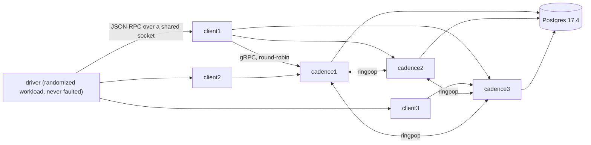

# Cadence master under Antithesis: six bugs found, three of them lose or duplicate signals around a workflow reset

**Prepared for:** Uber · **Tested:** 2026-11-18 to 2026-11-19 · **System:** Cadence master ([`572e7e2c`][c-master])
**Document version:** first edition. An update will follow once the failures listed in [Still under investigation](#still-under-investigation) are triaged.

## Summary

We ran Cadence master, built from source, as a three-node cluster on Postgres under Antithesis. Antithesis repeatedly crashed, paused and cut off servers, the database and clients while a randomized workload drove workflows through the official Go client (fault injection). The two long runs on master lasted about 12.5 hours each. Six bugs were found and each one survived an adversarial review. Five are in the Cadence server and one is in the Go client:

- [an acknowledged signal is lost when the workflow is reset while a decision is in flight](#acked-signal-lost-on-reset);
- [a reset retried by the client is applied a second time](#retried-reset-applied-twice), which discards the first reset run and the acknowledged signals it held;
- [a signal retried by the client during a reset is applied twice](#retried-signal-duplicated-after-reset);
- [a completed workflow is read back as running, with a shorter history, from a host that lost its shard](#stale-history-after-shard-steal);
- [stopping a server while it is still starting crashes it with a nil-pointer panic](#sigterm-during-startup-panics);
- in the Go client (`go.uber.org/cadence` v1.4.0): [a workflow with a long local activity stops making progress after a retried decision heartbeat](#retried-decision-heartbeat-stalls-workflow).

The first three break [Guarantee 2](#guarantee-2) (acknowledged signals exactly once), the fourth breaks [Guarantee 3](#guarantee-3) (history consistency). The test setup also caught a known Cadence bug ([PR #8595][pr8595]) on the build from before its fix. Patches are proposed for four of the server findings and pass Cadence's unit tests. They are not yet verified end to end. Several other failures from the long runs are still being analyzed and are listed separately, not as findings.

## What we tested

- **Uber's system:** Cadence is Uber's workflow orchestration engine. Services start long-running workflows, send them signals and read their results, and Cadence promises that this state survives crashes of workers and of Cadence itself. Many of Uber's services rely on it as their control plane.
- **Under test:** Cadence master ([`572e7e2c`][c-master]) from [cadence-workflow/cadence][repo], unmodified apart from Antithesis coverage instrumentation, with the Go client `go.uber.org/cadence` v1.4.0. This is Cadence itself, not a stand-in. A separate report covers the v1.4.5 release.
- **How long:** 8 test runs on master: 6 short runs to get the tests right, and 2 long runs of about 12.5 hours each ([`3e9720ca`][r-3e97] and [`c26baba5`][r-c26b]). Also 3 runs on the build from before a known bug's fix, and 3 runs checking proposed fixes. All from 2026-11-18 to 2026-11-19. [Runs](#runs) lists them all.

## Guarantees

The promises Cadence makes to the services that run workflows on it, as we checked them. Details: [guarantees.md](../antithesis/scratchbook/guarantees.md).

| Guarantee | Statement | Source | Result on master |
|---|---|---|---|
| [Guarantee 1](#guarantee-1) | At most one run of a workflow ID is open at a time; a start for an ID with an open run is rejected, and a start on a closed ID follows its reuse policy | [Workflows doc][doc-wf], [IDL][idl] | ⚠ failures [still under investigation](#still-under-investigation); no confirmed finding |
| [Guarantee 2](#guarantee-2) | A signal acknowledged to the client is applied exactly once, even when the client retries, and is never lost | [Go client signals doc][doc-sig], [IDL][idl] | ❌ broken ([signal lost on reset](#acked-signal-lost-on-reset), [reset applied twice](#retried-reset-applied-twice), [signal duplicated after reset](#retried-signal-duplicated-after-reset)) |
| [Guarantee 3](#guarantee-3) | A workflow's history is well formed and append-only: a later read returns the earlier read as a prefix | [Timers doc][doc-timers], [PR #8595][pr8595] | ❌ broken ([stale history after a shard steal](#stale-history-after-shard-steal); [signal duplicated after reset](#retried-signal-duplicated-after-reset) also records a signal twice) |
| [Guarantee 4](#guarantee-4) | Every started workflow closes with the result its inputs determine; timers never fire early; a closed run stays closed | [Workflows doc][doc-wf], [Timers doc][doc-timers] | ❌ broken in the Go client ([stalled workflow](#retried-decision-heartbeat-stalls-workflow)); server-side failures [still under investigation](#still-under-investigation) |
| [Guarantee 5](#guarantee-5) | Once faults stop, a new workflow completes within 120 s and every client is served again | [Workflows doc][doc-wf] (window inferred) | ⚠ a new workflow always completed; "every client is served again" failures [still under investigation](#still-under-investigation) |
| [Guarantee 6](#guarantee-6) | Visibility converges: once faults stop, every closed run is listed as closed | [visibility interface][vis] | ✅ held (checked in part: closed runs are listed) |

### Guarantee 1: single open run per workflow ID

"There could be only one workflow (across all workflow types) with a given ID open per domain at any time" ([Workflows doc][doc-wf]). The tests start a second run on the ID of an open workflow, which must be rejected as already started, and start new runs on closed IDs with a drawn reuse policy, which must be accepted or rejected as the policy says. Both checks failed in the long runs, and the cause is not yet established: see [Still under investigation](#still-under-investigation). Retried starts returning the same run ID were not checked separately. Commands: [test commands](#test-commands).

### Guarantee 2: acknowledged signals exactly once

"When a signal is received for a running workflow, Cadence persists the event and the payload in the workflow history ... without the risk of losing the information" ([Go client signals doc][doc-sig]). Every signal carries a unique ID. The counter workflow returns the list of signals it applied, and the tests check that every acknowledged signal appears in it exactly once, in acknowledgement order, and that nothing appears that was never sent. Workflows that were reset report through their own checks, so that each bug stays visible apart from the others. Three findings break this guarantee, all around a reset (`ResetWorkflowExecution`). Commands: [test commands](#test-commands).

### Guarantee 3: history is well formed

"Timers can have a single resolution event, either canceled or fired" ([PR #8595][pr8595]). After a workflow closes, the tests read its history and check: contiguous event IDs, exactly one close event, at most one resolution per timer, activity and child, and no signal recorded twice. A history read right after the server reported the workflow closed must contain the close event. The general well-formedness check held on master in both long runs. Two findings break the guarantee. Commands: [test commands](#test-commands).

### Guarantee 4: started workflows complete correctly

"The workflow code is completely oblivious to any failures and downtime of workers or even the Cadence service itself" ([Workflows doc][doc-wf]). Workflows are small deterministic programs (signals, activities with retries and heartbeats, local activities, timers, child workflows, continue-as-new). The tests compute each expected result from the inputs and check it, check that no timer fires early, that a closed run is still closed with the same status when read again, and, after faults stop, that every started workflow closes. The Go-client finding breaks this guarantee. The server-side failures of these checks are [still under investigation](#still-under-investigation). Commands: [test commands](#test-commands).

### Guarantee 5: recovers after faults

Cadence documents no recovery time, so the 120 s window is our inference. Once faults stop, the tests check that each client container can start a workflow again within 3 minutes, and that a fresh workflow with activities completes within 120 s. The fresh workflow completed every time on master. The "every client is served again" check failed and is [still under investigation](#still-under-investigation). Commands: [test commands](#test-commands).

### Guarantee 6: visibility converges

"This is a secondary store that is eventually consistent with the main executions store" ([visibility interface][vis]). Once faults stop, the tests list each closed workflow ID and check that every closed run they know of is listed as closed within 2 minutes. This held on master. The check does not compare close status or look for runs wrongly listed as open. Commands: [test commands](#test-commands).

## How we tested

### Environment

*Each cadence box is one `cadence-server` running all four services (frontend, history, matching, worker). Each client box is the Go client plus a workflow worker. Every client talks to all three frontends in turn (only some arrows are drawn). Postgres holds both the default store and visibility. Antithesis injects faults into every container except the driver.*

- **Software under test:**
  - **Cadence** master: [`572e7e2c`][c-master] ([cadence-workflow/cadence][repo]), built from source with Antithesis coverage instrumentation ([Dockerfile](../antithesis/server/Dockerfile)).
  - **Go client** `go.uber.org/cadence` v1.4.0 ([cadence-go-client v1.4.0][go-client]), used as a released module.
  - Every build that ran is listed in [Builds](#builds).
- **Faults:** container kills, stops and pauses, network partitions and degraded links, CPU throttling and clock jitter (Antithesis `high_availability`), on all Cadence nodes, Postgres and the client containers. A small supervisor restarts `cadence-server` after it exits, as Kubernetes would ([entrypoint.sh](../antithesis/server/entrypoint.sh)).
- **Workload:**
  - five workflow types: counter (signals, queries, continue-as-new, cancel, reset), chain (activities with retries, heartbeats, parallel and local activities), timer, parent (child workflows), and race (timers racing long local activities, with a 4 s decision timeout so the client sends decision heartbeats);
  - random concurrent operations: start, signal-with-start, signal, query, cancel, terminate, reset, a second start of an open ID, reuse of a closed ID, result and history reads;
  - every outcome is checked against a model of what was sent and acknowledged, as it arrives;
  - now and then the workload stops faults and checks recovery, completion and visibility (an "eventually" check);
  - the two long runs used different settings: [`3e9720ca`][r-3e97] the tuning below, [`c26baba5`][r-c26b] 16 shards, the default history cache and one task-list partition.

**How the tested setup differs from a default install** ([dynamicconfig.yaml](../antithesis/config-master/dynamicconfig.yaml), [cadence.yaml](../antithesis/config-master/cadence.yaml)):

| Setting | Test value | Production default | Why |
|---|---|---|---|
| `numHistoryShards` | 8 (second long run: 16) | set per cluster | small cluster |
| `history.cacheMaxSize` | 20 (second long run: default) | 512 | reload workflow state from the database often |
| `history.cacheTTL` | 30s (second long run: default) | 1h | same |
| `matching.numTasklistWritePartitions` / `ReadPartitions` | 3 (second long run: 1) | 1 | exercise task-list partition forwarding |
| `matching.idleTasklistCheckInterval`, `matching.updateAckInterval` | 20s, 5s | 5m, 1m | more frequent task-list unloading and ack writes |
| `history.shardUpdateMinInterval` | 1s | 5m | more frequent shard writes |
| `history.timerProcessorUpdateAckInterval`, `history.transferProcessorUpdateAckInterval` | 5s | 30s | more frequent queue ack writes |
| `frontend.shutdownDrainDuration`, `history.shutdownDrainDuration` | 0s | 0s (set explicitly) | a stopped node does not wait to drain traffic |
| `history.decisionHeartbeatTimeout` | 1m | 30m | added after the [Go-client finding](#retried-decision-heartbeat-stalls-workflow), which was found with the default, so one stalled workflow can't hide others |
| `system.minRetentionDays` | 0 | 1 | allow short retention in tests |
| Postgres `idle_in_transaction_session_timeout`, TCP keepalives | 30s; 10/5/3 s | off; OS default | without them, a killed server's open transaction held shard row locks for hours ([analysis](../antithesis/scratchbook/rca/shard-unavailable-after-faults.md)) |

### Test commands

The workload is one randomized driver: 11 operations (rules) that run concurrently, up to 6 at a time, while Antithesis injects faults, plus one rare rule that stops faults and checks recovery. It makes 22 checks that must hold every time (`Always` and `Unreachable` assertions: 21 in the driver, 1 in the server's supervisor script) and 19 checks that an interesting case happened at least once (`Sometimes` assertions). **How each one works, every check it makes, and where in the code: [How the tests work](speedrun-tests.md).**

| Guarantee | What the commands do | Commands |
|---|---|---|
| [Guarantee 1](#guarantee-1) | Start a second run on an open ID (must be rejected as already started); start on a closed ID with a drawn reuse policy (must follow the policy) | [`RuleDuplicateStart`](speedrun-tests.md#ruleduplicatestart), [`RuleReuseClosed`](speedrun-tests.md#rulereuseclosed) |
| [Guarantee 2](#guarantee-2) | Send uniquely numbered signals, query, reset and finish counter workflows; every acknowledged signal must be applied once, in order, and nothing unsent may appear | [`RuleStart`](speedrun-tests.md#rulestart), [`RuleSignal`](speedrun-tests.md#rulesignal), [`RuleQuery`](speedrun-tests.md#rulequery), [`RuleReset`](speedrun-tests.md#rulereset), [`RuleFinish`](speedrun-tests.md#rulefinish), [`RuleResult`](speedrun-tests.md#ruleresult) |
| [Guarantee 3](#guarantee-3) | Read the history of every closed run; it must be well formed and, when the server just reported the run closed, contain the close event | [`RuleResult`](speedrun-tests.md#ruleresult) |
| [Guarantee 4](#guarantee-4) | Read results and compare with the model; re-read closed runs; after faults stop, every started workflow must close | [`RuleResult`](speedrun-tests.md#ruleresult), [`RuleDescribeClosed`](speedrun-tests.md#ruledescribeclosed), [`RuleCancel`](speedrun-tests.md#rulecancel), [`RuleTerminate`](speedrun-tests.md#ruleterminate), [`RuleEventually`](speedrun-tests.md#ruleeventually) |
| [Guarantee 5](#guarantee-5) | After faults stop, each client must start a workflow and a fresh workflow must complete within 120 s | [`RuleEventually`](speedrun-tests.md#ruleeventually) |
| [Guarantee 6](#guarantee-6) | After faults stop, every closed run must be listed as closed | [`RuleEventually`](speedrun-tests.md#ruleeventually) |

Before any rule runs, [the driver's setup](speedrun-tests.md#setup) waits for every client, registers the domain, starts the workers and runs one workflow end to end.

## Known-bug check

To check that these tests can catch a real bug of this kind, we ran them on the build from just before a known fix. The bug: [duplicate timer resolution after decision heartbeating (PR #8595)][pr8595]. A timer that fired during a decision heartbeat, and that the same decision canceled, is later recorded as both canceled and fired once the workflow state is reloaded. It breaks [Guarantee 3](#guarantee-3). The build: [`c889f831`][c-prefix], the parent of the fix [`976d08c2`][c-fix], with the same test setup.

**Reproduced.** In run [`ccd99ed4`][r-ccd9] the check "a workflow history is well formed" failed in 201 examples, and every one in a sample of 50 had the bug's signature, "timer N resolved twice: TimerCanceled then TimerFired". One failing example is at 63 s of simulated time ([log][log-known]). An earlier run with an older version of the tests (`0dc3db5a`, cancelled, so it has no report) showed the same signature in about 19 examples. The same check never failed on master or v1.4.5, which contain the fix. While setting this up we found and fixed a gap in our history check, which at first did not record which timer a `TimerCanceled` event refers to.

## Findings

Six findings, each confirmed by root-cause analysis and an adversarial review. Five are in the Cadence server and one is in the Go client. For each, the code on master was compared with the build where the finding was first analyzed: the server findings' code paths are identical on master and v1.4.5.

**How often they were seen:** Antithesis counts the failing examples of each check. Several checks are dedicated to one finding, but a check counts every failure of its kind, so not every counted example has been individually traced to the finding. The counts below are from the second long run on master, [`c26baba5`][r-c26b]. The per-check counts for the first long run, [`3e9720ca`][r-3e97], were not available when this report was written, because the Antithesis API returned errors. Its report link shows them.

**Fix checks:** the proposed patches pass Cadence's unit tests. The fix-check runs (on v1.4.5 plus patches; master has identical code on each finding's path and the patches apply to master unchanged) still showed failures of the same checks. Those are being analyzed, so **none of the fixes is verified end to end yet**.

### An acknowledged signal is lost when the workflow is reset while a decision is in flight

**Full analysis:** [root cause](../antithesis/scratchbook/rca/signal-lost-at-reset-master.md) · [adversarial review](../antithesis/scratchbook/adversarial/acked-signal-lost-on-reset.md) · **Proposed fix:** [acked-signal-lost-on-reset.patch](../antithesis/fixes/acked-signal-lost-on-reset.patch) ([notes](../antithesis/scratchbook/rca/acked-signal-lost-on-reset-fix.md))

- **What broke:** a signal that Cadence acknowledged to the client was never applied by any run of the workflow.
- **Guarantee:** [Guarantee 2](#guarantee-2), "an acknowledged signal is never lost".
- **Impact:** an external event, such as a payment callback, is silently dropped. It needs a reset (by an operator, or by tooling such as batch reset or bad-binary auto-reset) to race live signal traffic. No faults are needed, and it happens with default configuration. Severity: medium.
- **How it happened:**
  1. A decision task is running for the workflow.
  2. A signal arrives. Cadence holds it as a buffered event, because a decision is in flight, and acknowledges it to the client.
  3. A few milliseconds later a reset of the same run starts. It notes the run's next event ID, which does not count buffered events. The reset completes about 8 ms after the signal was acknowledged.
  4. Terminating the old run fails the in-flight decision, and that writes the buffered signal into the terminated run.
  5. The reset copies signals into the new run only up to the event ID it noted, so the new run never sees the signal.
- **Seen in:** first in master run `75b0745b` (cancelled, so it has no report; workflow counter-19, signal s97; input_hash `-318482339591177353`, vtime `34.675`). The check "an acknowledged signal survives a reset of its workflow" then failed 1.0k times in [`c26baba5`][r-c26b] (an example: input_hash `3180257910619170844`, vtime `34.958`) and also failed in [`3e9720ca`][r-3e97].
- **Root cause:** the reset reads `baseNextEventID` and `currentNextEventID` before it terminates the current run ([reset_workflow_execution.go:143][m-reset143], [resetter.go:130-147][m-resetter130]). Termination fails the open decision, which flushes buffered events into the terminated run ([mutable_state_util.go:106][m-msutil106]). The reapply step reads persisted history only up to the earlier event ID ([resetter.go:487-525][m-resetter487]), so the flushed signal is skipped.
- **Proposed fix:** after terminating the current run, collect the events that termination flushed and reapply their signals to the new run when the reset chain reaches the current run. The patch adds a unit test that fails without it; it is not yet verified end to end. [How it was checked](../antithesis/scratchbook/rca/acked-signal-lost-on-reset-fix.md#results).
- **Already known upstream?** Not that we found; not yet reported.

### A reset retried by the client is applied a second time, discarding the first reset run

**Full analysis:** [root cause](../antithesis/scratchbook/rca/fixverify-reset-dup.md) · [adversarial review](../antithesis/scratchbook/adversarial/retried-reset-applied-twice.md) · **Proposed fix:** [retried-signal-duplicated-after-reset.v2.patch](../antithesis/fixes/retried-signal-duplicated-after-reset.v2.patch)

- **What broke:** one `ResetWorkflowExecution` call was committed twice. The second reset threw away the run created by the first one, together with three signals acknowledged to it.
- **Guarantee:** [Guarantee 2](#guarantee-2), "an acknowledged signal is never lost".
- **Impact:** `ResetWorkflowExecution` is not idempotent under client retry. A reset whose reply is lost, followed by the Go client's standard retry, resets the workflow again, silently losing work and acknowledged signals since the first reset, and can lead to duplicate signals. It happens with default configuration, on SQL stores, and without strong idempotency enabled. Severity: medium-high.
- **How it happened:**
  1. The client asks to reset run A to an earlier point. Cadence commits the reset and creates run B, but the reply is lost.
  2. Run B accepts and acknowledges new signals.
  3. The Go client retries the reset with the same request ID.
  4. Cadence's check for a repeated reset request never matches, so it resets run A again, creating run C and terminating run B.
  5. The second reset copies signals only from run A, so the signals acknowledged to run B are gone.
- **Seen in:** once, in fix-check run [`41bf0672`][r-41bf] (v1.4.5 plus an unrelated patch; workflow counter-182, signals s617, s620 and s621 lost) ([log][log-resetdup]). There is no check dedicated to it. The code on master is identical.
- **Root cause:** the reset deduplicates by comparing the current run's `CreateRequestID` with the reset request ID ([reset_workflow_execution.go:124-133][m-reset124]). But rebuilding the reset run always overwrites `CreateRequestID` with the original start request's ID ([mutable_state_builder_methods_started.go:192-198][m-started192]), so the check never matches. This override came in with [#5821][pr5821] ([`baac6218`][c-5821], April 2024): a regression.
- **Proposed fix:** after rebuilding the reset run, set its `CreateRequestID` to the reset request ID, which restores the behaviour from before #5821. The v2 patch includes this one-line change (and the fix for the [next finding](#retried-signal-duplicated-after-reset)), and passes `go test ./service/history/reset/`. It is not yet verified end to end. [Proposed fix](../antithesis/scratchbook/rca/fixverify-reset-dup.md#proposed-fix).
- **Already known upstream?** Not that we found; not yet reported.

### A signal retried by the client during a reset is applied twice

**Full analysis:** [root cause](../antithesis/scratchbook/rca/reset-duplicates-signal.md) ([second analysis](../antithesis/scratchbook/rca/query-shows-duplicate-signal.md)) · [adversarial review](../antithesis/scratchbook/adversarial/retried-signal-duplicated-after-reset.md) · **Proposed fix:** [retried-signal-duplicated-after-reset.patch](../antithesis/fixes/retried-signal-duplicated-after-reset.patch), superseded by [v2](../antithesis/fixes/retried-signal-duplicated-after-reset.v2.patch), which also fixes the [previous finding](#retried-reset-applied-twice)

- **What broke:** one `SignalWorkflowExecution` call was recorded twice in the same run's history, and the workflow applied it twice.
- **Guarantee:** [Guarantee 2](#guarantee-2), "applied exactly once, even when the client retries", and [Guarantee 3](#guarantee-3), which forbids a signal recorded twice.
- **Impact:** a callback or counter is applied twice, with no error to anyone. The caller can't prevent it, because the request ID is generated inside the Go client. It needs a reset to commit while a signal call is still retrying, which is likely during incident recovery. Severity: low to medium.
- **How it happened:**
  1. The client sends a signal; Cadence records it but the reply is lost, and the Go client keeps retrying with the same request ID.
  2. A reset to a point before the signal creates a new run and, as documented, copies the signal into it, but without its request ID.
  3. The client's retry reaches the new run, which has no record of that request ID, and records the signal again.
- **Seen in:** first in v1.4.5 run `89a272ed` (cancelled, so it has no report; workflow counter-34, signal s45; input_hash `-5028251366505688799`, vtime `70.427`), and on the build from before the known bug's fix. The check "a signal is applied at most once in a workflow that was reset" failed 701 times in [`c26baba5`][r-c26b] (an example: input_hash `4569408548377247411`, vtime `63.162`) and also failed in [`3e9720ca`][r-3e97]. That check also counts duplicates caused by the [previous finding](#retried-reset-applied-twice).
- **Root cause:** Cadence deduplicates signals by request ID within one run ([signal_workflow_execution.go:66-75][m-signal66]). When a reset copies signals into the new run it drops their request IDs ([resetter.go:636][m-resetter636]) and never adds them to the new run's dedup set, so a retry of a copied signal is accepted again.
- **Proposed fix:** when a reset copies a signal, add its request ID to the new run's dedup set (and do the same when rebuilding from history). The patch passes Cadence's unit tests. The fix-check runs no longer showed this mechanism in the cases analyzed, but still had failures of the same check that are being analyzed. [Proposed fix](../antithesis/scratchbook/rca/reset-duplicates-signal.md#proposed-fix-cadence).
- **Already known upstream?** Not that we found; not yet reported.

### A completed workflow is read back as running, with a shorter history, from a host that lost its shard

**Full analysis:** [root cause](../antithesis/scratchbook/rca/stale-history-v145.md) ([first analysis](../antithesis/scratchbook/rca/history-missing-close-event.md)) · [adversarial review](../antithesis/scratchbook/adversarial/stale-history-after-shard-steal.md) · **Proposed fix:** no patch written; the approach is below.

- **What broke:** a client read a workflow's result as completed, and 0.6 ms later read its history and description as running, with 5 of its 11 events and no close event.
- **Guarantee:** [Guarantee 3](#guarantee-3), "a later read returns the earlier read as a prefix", and the "a closed run stays closed" part of [Guarantee 4](#guarantee-4).
- **Impact:** for seconds to minutes after a node restart or rolling deploy, some frontends route reads to a history host that has silently lost the shard. Tools and services that poll describe or history to decide what to do next can act on a state that is already overwritten. The database stays correct and the stale host heals when its next write fails. No data is lost. Severity: medium. It was seen for about 4 s; with the default `shardUpdateMinInterval` (5 min) it could last longer.
- **How it happened:**
  1. A node restarts and rejoins. While the hash ring converges, two history hosts both believe they own the same shard.
  2. Host A loads the workflow into its cache. Host B takes the shard over and completes the workflow.
  3. Host A makes no write to the shard, so nothing tells it that it lost the shard.
  4. Two of the three frontends still route reads to host A, which answers from its stale cache.
- **Seen in:** 3 workflows in 2 runs, with two different triggers (a partition, and with no faults at all, a node rejoining): fix-check run [`41bf0672`][r-41bf] ([log][log-stale]) and the run before the known bug's fix (`22fa5e0b`, cancelled, so it has no report). On master, the check "a history read after a workflow closed includes its close event" failed 116 times in [`c26baba5`][r-c26b] (an example: input_hash `3873568898649092660`, vtime `46.731`, moments after history hosts logged a stolen shard). The master examples were not analyzed further. The code path is identical on master.
- **Root cause:** a history host answers reads from its cached workflow state without checking that it still owns the shard ([execution/context.go:357-372][m-context357], [poll_mutable_state.go:75-87][m-poll75]). The shard controller returns an existing shard without consulting membership ([shard/controller.go:301-307][m-controller301]) and never releases shards the ring no longer gives it ([acquireShards][m-controller430]). The shard's range ID fences writes, not reads.
- **Proposed fix:** check shard ownership on reads, for example by re-checking membership or the range ID on cache hits, or by releasing shards in `acquireShards` that the ring no longer assigns to this host. No patch was written, because the change is a design choice for Cadence's maintainers. [Suggested fix direction](../antithesis/scratchbook/adversarial/stale-history-after-shard-steal.md#severity-to-state-to-uber-engineers).
- **Already known upstream?** Not that we found; not yet reported. It is a separate issue from the timer bug used for the known-bug check.

### Stopping a server while it is still starting crashes it with a nil-pointer panic

**Full analysis:** [root cause](../antithesis/scratchbook/rca/node-exits.md#history-preparetostop-nil-controller--real-low-severity-v145-and-master) · [adversarial review](../antithesis/scratchbook/adversarial/sigterm-during-startup-panics.md) · **Proposed fix:** [sigterm-during-startup-panics.patch](../antithesis/fixes/sigterm-during-startup-panics.patch)

- **What broke:** a plain SIGTERM, as Kubernetes or systemd send, delivered while the history or frontend service is still starting makes `cadence-server` panic with a nil-pointer dereference and exit with code 2.
- **Guarantee:** none directly. This is a crash-safety finding.
- **Impact:** the node skips its graceful drain and shard hand-off, so peers notice it only through ringpop failure detection; noisy panics in crash loops and cancelled deploys; an unsynchronized Start/Stop data race. No data loss. Severity: low.
- **How it happened:**
  1. `cadence-server` starts its services in the background, so the signal handler is installed while a service is still starting.
  2. The service is blocked waiting for membership and the database.
  3. SIGTERM arrives, and `Stop` uses a field that `Start` has not set yet.
- **Seen in:** both master and v1.4.5, in several runs and timelines, in the history service (`handler.go:234`) and the frontend (`service.go:370`). On master, for example in iteration run `02612d74` (cancelled, so it has no report; input_hash `-8467436622163236132`, vtime `334.537`). The check "a cadence server process crashes" failed 1.1k times in [`c26baba5`][r-c26b] (an example: input_hash `5493115663274640094`, vtime `48.065`, with the frontend stack above), all while the node was being stopped, and also failed in [`3e9720ca`][r-3e97]. Other master examples were not individually analyzed.
- **Root cause:** history `Stop` calls `h.controller.PrepareToStop()` ([handler.go:234][m-handler234]) and `h.replicationTaskFetchers.Stop()` ([handler.go:224][m-handler224]) before `Start` has assigned them ([handler.go:155][m-handler155]). Frontend `stopRatelimiters` calls `OnStop` on `s.ratelimiterCollections` ([service.go:370][m-fe370]) before `Start` saves it ([service.go:220][m-fe220]), which dereferences a nil receiver ([collection.go:255][m-coll255]). The daemon starts in a goroutine ([server.go:292][m-server292]), so a stop can arrive during `Start`.
- **Proposed fix:** guard these fields against nil in `PrepareToStop`, `Stop` and `stopRatelimiters`, or make `Stop` wait for `Start` to finish. The patch passes Cadence's unit tests. The fix-check run still reported server crashes, which are being analyzed. [Recommendations](../antithesis/scratchbook/rca/node-exits.md#recommendations).
- **Already known upstream?** Not that we found; not yet reported.

### Go client: a workflow with a long local activity stops making progress after a retried decision heartbeat

**Full analysis:** [root cause](../antithesis/scratchbook/rca/race-workflow-stuck.md) · [adversarial review](../antithesis/scratchbook/adversarial/retried-decision-heartbeat-stalls-workflow.md) · **Proposed fix:** no patch written; the approach is below.

This finding is in the Go client library `go.uber.org/cadence` v1.4.0, not in the Cadence server. The server did what the client asked.

- **What broke:** after one decision-heartbeat call needed a retry, a workflow stopped making progress. It sent an empty decision heartbeat every 3.2 s, about 93 of them over 5 minutes, after all faults had stopped. With default settings the server ends the loop only after `history.decisionHeartbeatTimeout` (30 min), and the local activity then runs again.
- **Guarantee:** [Guarantee 4](#guarantee-4) (workflows complete) and [Guarantee 5](#guarantee-5) (progress resumes once faults stop).
- **Impact:** a workflow whose local activity outlives the decision timeout (a supported use) can stall for up to 30 minutes after a transient error, silently dropping the local activity's result and adding about 1,700 history events per 30 minutes. No data loss. Severity: medium-low.
- **How it happened:**
  1. A local activity runs longer than about 80% of the decision timeout, so the client sends a decision heartbeat.
  2. A database outage of about a minute makes that call fail, and the Go client retries it.
  3. The first attempt changed the shared request, so every retry asks the server not to return a new decision task.
  4. The client treats the empty reply as done and keeps a cached workflow state that is waiting for a local-activity result that will never be delivered.
  5. Each later decision only heartbeats.
- **Seen in:** once, in one workflow of v1.4.5 run `6e868ff1` (cancelled, so it has no report; workflow race-1; input_hash `5337532354675634409`, vtime `401.211`). The same client v1.4.0 ran against master. The long runs used a 1-minute heartbeat timeout and a check that flags 20 empty heartbeats in a row; that check never failed on master.
- **Root cause:** `handleDecisionTaskCompletedRequest` sets `StickyAttributes` on the shared request on the first attempt, so each `backoff.Retry` attempt takes the `else` branch and sends `ReturnNewDecisionTask=false` ([internal_task_pollers.go:507-514][gc-pollers507], [retry at :453-462][gc-pollers453]). A heartbeat reply with no decision task is treated as finished and the cached context is kept ([internal_task_pollers.go:372][gc-pollers372], [internal_task_handlers.go:857-859][gc-handlers857]); a local activity that was already dispatched is never dispatched again ([internal_task_handlers.go:1151-1173][gc-handlers1151]).
- **Proposed fix:** compute the sticky and `ReturnNewDecisionTask` fields once, outside the retry loop (or clone the request per attempt); and treat a heartbeat reply with no decision task as an error, or evict the cached context, so pending local activities are dispatched again. [Proposed fix](../antithesis/scratchbook/rca/race-workflow-stuck.md#proposed-fix--workarounds).
- **Already known upstream?** Not checked against newer client releases; not yet reported.

## Still under investigation

The long runs also showed failures whose cause is not yet established. They may be further Cadence bugs, or problems in our test code. They are not findings, and they will be triaged in the next edition of this report. The checks involved (failing examples in [`c26baba5`][r-c26b]):

- "a timer never fires before its duration" (172), [Guarantee 4](#guarantee-4);
- "a workflow ends only as completed, or as canceled or terminated on request" (42), [Guarantee 4](#guarantee-4);
- "a second start of an open workflow ID is rejected" (125), [Guarantee 1](#guarantee-1);
- "a start on a closed workflow ID follows its reuse policy" (62), [Guarantee 1](#guarantee-1);
- "signals are applied in the order they were acknowledged" (171), [Guarantee 2](#guarantee-2);
- "a workflow only applies signals that clients sent" (447) and "a completed workflow returns the result its inputs determine" (447), [Guarantee 2](#guarantee-2) and [Guarantee 4](#guarantee-4);
- "a closed workflow keeps its outcome" (62), [Guarantee 4](#guarantee-4);
- after faults stop: "every client is served again once faults stop" (207) and "every started workflow closes once faults stop" (258), [Guarantee 5](#guarantee-5) and [Guarantee 4](#guarantee-4);
- in workflows that were never reset: "an acknowledged signal is applied exactly once" (284) and "a query shows each delivered signal once" (180), [Guarantee 2](#guarantee-2).

The run reports also show our client containers, which run the test program and not Cadence, exiting with code 2 (22 times in [`c26baba5`][r-c26b]); this is not yet triaged either.

## Scope and limits

- **One cluster, one database.** Cross-cluster replication (XDC) was not tested. A two-cluster setup was built but not run in time.
- **Postgres only.** Cassandra and MySQL were not tested. The reset retry finding depends on strong idempotency being unavailable or off, which is the default and is always the case on SQL.
- **Black box.** Cadence ran unmodified apart from coverage instrumentation; we changed only configuration (see the tuning table). Some settings make events more frequent: small caches, frequent shard writes and immediate shutdowns.
- **Go client only.** The Java client and others were not tested. The client is a released module (v1.4.0).
- **Checks narrower than the guarantee text:** retried starts returning the same run ID ([Guarantee 1](#guarantee-1)) and visibility close status ([Guarantee 6](#guarantee-6)) were not checked.
- **Fix checks ran on v1.4.5**, not master, with the patches available at the time; the v2 patch, which holds the reset-retry fix, was never in a fix-check run.
- **Counts on the first long run are missing** from this edition (API errors); its report shows them.

## Appendix

### Runs

Every run that contributed to these results. Report links carry an access token: anyone with the link can open the report. Log links open the Antithesis logs explorer, and need a tenant login. Short runs that were cancelled have no report and are written without a link. Lengths are wall-clock time.

| Run | Purpose | Build | Length | Result |
|---|---|---|---|---|
| `0a677a01` | first run on master (cancelled) | [master](#builds) | 23 min | startup and harness problems found and fixed; [shutdown panic](#sigterm-during-startup-panics) seen |
| `90e135dd` | test iteration (cancelled before it started) | [master](#builds) | none | none |
| `02612d74` | test iteration (cancelled) | [master](#builds) | 4 min | [shutdown panic](#sigterm-during-startup-panics) seen with the supervisor in place |
| `815b813d` | test iteration (cancelled) | [master](#builds) | 13 min | test-code false positives found and fixed |
| `8dc5147c` | test iteration (cancelled) | [master](#builds) | 6 min | test-code fixes |
| `bc2c0321` | test iteration (cancelled) | [master](#builds) | under 1 min | replaced by the next run |
| `75b0745b` | test iteration (cancelled) | [master](#builds) | 15 min | [signal lost on reset](#acked-signal-lost-on-reset) first seen |
| [`3e9720ca`][r-3e97] | long run | [master](#builds) | 12 h 31 min | checks for three findings failed early in the run ([early results](../antithesis/scratchbook/logs/stream-hunt1-master.log)); per-check counts unavailable |
| [`c26baba5`][r-c26b] | long run, second settings | [master](#builds) (16 shards, default cache, 1 partition) | 12 h 32 min | four server findings' checks failed (counts above); [still under investigation](#still-under-investigation) |
| `22fa5e0b` | known-bug check, first try (cancelled) | [before the fix](#builds) | 18 min | [stale history](#stale-history-after-shard-steal) first seen; harness gap found |
| `fc9ee8d0` | known-bug check (cancelled before it started) | [before the fix](#builds) | none | none |
| `0dc3db5a` | known-bug check (cancelled) | [before the fix](#builds) | 48 min | known bug reproduced (~19 examples), alongside older test-code false positives |
| [`ccd99ed4`][r-ccd9] | known-bug check with the final tests | [before the fix](#builds) | 3 h 08 min | known bug reproduced (201 examples) |
| `42ce02a1` | fix check (cancelled) | [fix check 1](#builds) | 5 min | first nil-guard patch was incomplete; completed |
| `ad86b559`, `5a1ac4c2` | fix checks (cancelled before they started) | [fix check 2](#builds) | none | none |
| [`41bf0672`][r-41bf] | fix check | [fix check 2](#builds) | 3 h 08 min | [reset applied twice](#retried-reset-applied-twice) found; [stale history](#stale-history-after-shard-steal) seen |
| [`1a0d055c`][r-1a0d] | fix check, all three server patches | [fix check 3](#builds) | 8 h 21 min | failures of the same checks remain, being analyzed |
| `89a272ed` | first run on v1.4.5 (cancelled) | v1.4.5 | 24 min | [signal duplicated after reset](#retried-signal-duplicated-after-reset) first seen |
| `6e868ff1` | test iteration on v1.4.5 (cancelled) | v1.4.5 | 4 min | [Go-client stall](#retried-decision-heartbeat-stalls-workflow) seen |

### Builds

| Build | Component | Repository | Version | Commit | Changes on top |
|---|---|---|---|---|---|
| master | Cadence server | [cadence-workflow/cadence][repo] | master | [`572e7e2c`][c-master] | Antithesis coverage instrumentation only ([Dockerfile](../antithesis/server/Dockerfile)) |
| before the fix | Cadence server | same | parent of fix [`976d08c2`][c-fix] | [`c889f831`][c-prefix] | same |
| fix check 1 | Cadence server | same | v1.4.5 plus [signal dedup v1](../antithesis/fixes/retried-signal-duplicated-after-reset.patch) and a first, incomplete nil guard | [`ecd2b70c`][c-v145] | patches |
| fix check 2 | Cadence server | same | v1.4.5 plus [signal dedup v1](../antithesis/fixes/retried-signal-duplicated-after-reset.patch) and [shutdown nil guards](../antithesis/fixes/sigterm-during-startup-panics.patch) | [`ecd2b70c`][c-v145] | patches |
| fix check 3 | Cadence server | same | fix check 2 plus [signal lost on reset](../antithesis/fixes/acked-signal-lost-on-reset.patch) | [`ecd2b70c`][c-v145] | patches |
| all | Go client | [cadence-go-client][go-client] | v1.4.0 (`go.uber.org/cadence`) | release | instrumented in the client image ([client/](../antithesis/client/)) |
| all | driver | this harness ([driver/](../antithesis/driver/)) | hegel v0.9.38, Antithesis Go SDK v0.9.0 | n/a | n/a |

Image digests used by the long runs on master: `cadence-server:master@sha256:443cc99359acb44e1cdf225289749c67511bf4296bb140bd2cd81758308574e6`, `cadence-client@sha256:6c0e68923b7bc618d5a80ae852c0a3e23451bb6e79204bc4c3fb48d9787697df`, `cadence-driver@sha256:be19db941294532b2f647110cf77ba13305296a278be25ac513d566dea81f071`. Fix check 2: `cadence-server@sha256:0e8a7b1ce54a1233557001b3f9de393267a2001dd68103d9bc5ad698ea8318aa`; fix check 3: `cadence-server@sha256:56f6579167f023496762da138cb786353859c2227756fb3a4629657764a47355`; before the fix: `cadence-server@sha256:9d2f1ec651e48dddf624a20ae095b6d25bcf0d6ee1cc90f9df8e4ba34a2a21cb`. Earlier iteration runs used earlier images of the same commits, with older versions of the harness. Released components used as is: Postgres 17.4 (`postgres@sha256:d4eceb7552a57997fff2e9ceb1a624210e61b6432a2a1f7934a418c27bfe1406`), Go toolchain image `golang:1.26-trixie`.

[repo]: https://github.com/cadence-workflow/cadence
[go-client]: https://github.com/cadence-workflow/cadence-go-client/tree/v1.4.0
[c-master]: https://github.com/cadence-workflow/cadence/commit/572e7e2c786999df887f73ae46e59c72897a223b
[c-prefix]: https://github.com/cadence-workflow/cadence/commit/c889f8319b9dffa8c8638c6679e8961070e0536d
[c-fix]: https://github.com/cadence-workflow/cadence/commit/976d08c25bbbb08b6c18023139454bc5eed2476b
[c-v145]: https://github.com/cadence-workflow/cadence/commit/ecd2b70caf1fe9921aca19b00eb0b2905a3cc602
[c-5821]: https://github.com/cadence-workflow/cadence/commit/baac621842aebc54e3e06b5fc68a73015c1b7afc
[pr5821]: https://github.com/cadence-workflow/cadence/pull/5821
[pr8595]: https://github.com/cadence-workflow/cadence/pull/8595
[doc-wf]: https://cadenceworkflow.io/docs/concepts/workflows
[doc-sig]: https://cadenceworkflow.io/docs/go-client/signals/
[doc-timers]: https://cadenceworkflow.io/docs/concepts/timers/
[idl]: https://github.com/cadence-workflow/cadence-idl/blob/master/thrift/cadence.thrift
[vis]: https://github.com/cadence-workflow/cadence/blob/v1.4.5/common/persistence/visibility_manager_interfaces.go#L41
[r-3e97]: https://orbitinghail.antithesis.com/report/7hhEamcFv0jBPyIrsJWLmBsG/Jeb3agMIb7xHXvXT9nGWM_0NZ11M5mTMqfMjiaAbdGk.html?auth=v2.public.eyJuYmYiOiIyMDI2LTExLTE5VDA5OjE4OjM5LjY0Mzg3MTU2M1oiLCJzY29wZSI6eyJSZXBvcnRTY29wZVYxIjp7ImFzc2V0IjoiSmViM2FnTUliN3hIWHZYVDluR1dNXzBOWjExTTVtVE1xZk1qaWFBYmRHay5odG1sIiwicmVwb3J0X2lkIjoiN2hoRWFtY0Z2MGpCUHlJcnNKV0xtQnNHIn19fZ1gkiwU1Kl8LZsAxyfNG66cLv07jhdY92GNtsGSJAI1SIU28W6K6kcS8AjgoNsNBipANRx7JKP41_2vPOY_dAY
[r-c26b]: https://orbitinghail.antithesis.com/report/wO_En085myHQmXR9je-NrxN_/WT_OG4On7fiNT5aGtjbH1FVwOWACRBMACZwaIMrfsCI.html?auth=v2.public.eyJuYmYiOiIyMDI2LTExLTE5VDA5OjE5OjEwLjYxODM1NTkxNloiLCJzY29wZSI6eyJSZXBvcnRTY29wZVYxIjp7ImFzc2V0IjoiV1RfT0c0T243ZmlOVDVhR3RqYkgxRlZ3T1dBQ1JCTUFDWndhSU1yZnNDSS5odG1sIiwicmVwb3J0X2lkIjoid09fRW4wODVteUhRbVhSOWplLU5yeE5fIn19fZ4rU75H0q7pN8z0HJ2A211sZYt1M0VJPLrh4EJLDGOnDVBiAFIXO2_0959rLaOrdeRu-KAuVTRoe0v0ErcjMQY
[r-41bf]: https://orbitinghail.antithesis.com/report/Ie4vOZxovWROfzayOSpNtShi/eLjnz7F_vDSB3n6eaOdMzCETUOyH1cFkim3NEWOkL8c.html?auth=v2.public.eyJuYmYiOiIyMDI2LTExLTE4VDIyOjQ4OjA2LjcyNjIyNTMyNFoiLCJzY29wZSI6eyJSZXBvcnRTY29wZVYxIjp7ImFzc2V0IjoiZUxqbno3Rl92RFNCM242ZWFPZE16Q0VUVU95SDFjRmtpbTNORVdPa0w4Yy5odG1sIiwicmVwb3J0X2lkIjoiSWU0dk9aeG92V1JPZnpheU9TcE50U2hpIn19fY73Z3acMhrO0ZzQOb-lafwX7od9KnJkzAZ2ve0NgdnhMnLUjQhh2GCLmMX42OqmG7mQRxDAW6a97al9AcRZTQs
[r-ccd9]: https://orbitinghail.antithesis.com/report/399LZ1zr5hmULQAkyWMx_-B7/T3vpaYJs2OtponHSuMcZrtf4_4hvrkASDmQ8kqS3Sbs.html?auth=v2.public.eyJzY29wZSI6eyJSZXBvcnRTY29wZVYxIjp7ImFzc2V0IjoiVDN2cGFZSnMyT3Rwb25IU3VNY1pydGY0XzRodnJrQVNEbVE4a3FTM1Nicy5odG1sIiwicmVwb3J0X2lkIjoiMzk5TFoxenI1aG1VTFFBa3lXTXhfLUI3In19LCJuYmYiOiIyMDI2LTExLTE4VDIyOjU4OjEzLjE0MTUyNjA4MFoifeOTb0xfLB2TQxBFfNkK2DuetkPWcT7r0qxpaiyICeTG5XIe1EFl6b8hck0OKLBHE6yBJzt3i08L2a8ps4C9qg8
[r-1a0d]: https://orbitinghail.antithesis.com/report/xN9Vj4U-36rrB2EGnmdrfioQ/QME7BrLqb1wMUqQZ_d7YrLxBhjYAnqTP7fAgJwKsiWQ.html?auth=v2.public.eyJuYmYiOiIyMDI2LTExLTE5VDA0OjI1OjQ3LjYyNzEwODc2M1oiLCJzY29wZSI6eyJSZXBvcnRTY29wZVYxIjp7ImFzc2V0IjoiUU1FN0JyTHFiMXdNVXFRWl9kN1lyTHhCaGpZQW5xVFA3ZkFnSndLc2lXUS5odG1sIiwicmVwb3J0X2lkIjoieE45Vmo0VS0zNnJyQjJFR25tZHJmaW9RIn19favCyE4Utz3UgFQMlJMfMxrcal1_ucEel2g_f4YLh39_8wiydLxDlENLSsMIlTBGXI-s1LdcuIRGnqjm8s8CbAk
[log-known]: https://orbitinghail.antithesis.com/search?search=v6veyJxIjp7Im4iOnsiciI6eyJoIjpbeyJoIjpbeyJjIjoibW9tZW50LnZ0aW1lIiwiZiI6ImdlbmVyYWwuY3VzdG9tIiwibyI6Im1hdGNoZXMiLCJ2IjoiNjIuOTk5MjIyMzAyODA5MzYifV0sIm8iOiJvciJ9LHsiaCI6W3siYyI6Im1vbWVudC5pbnB1dF9oYXNoIiwiZiI6ImdlbmVyYWwuY3VzdG9tIiwibyI6Im1hdGNoZXMiLCJ2IjoiLTU2NTM0NTU5ODM2MDU4NTM4MjgifV0sIm8iOiJvciJ9XSwibyI6ImFuZCJ9LCJ0Ijp7ImciOmZhbHNlLCJtIjoiIn0sInkiOiJub25lIn19LCJzIjoiZmQyMDVjMmI2NGJjNGM4OTA3NGQxY2ZjNjBjMTRjMWItNjctNiJ9
[log-resetdup]: https://orbitinghail.antithesis.com/search?search=v6veyJxIjp7Im4iOnsiciI6eyJoIjpbeyJoIjpbeyJjIjoibW9tZW50LnZ0aW1lIiwiZiI6ImdlbmVyYWwuY3VzdG9tIiwibyI6Im1hdGNoZXMiLCJ2IjoiNDc0LjU2NTY4OTg5MTExMTEifV0sIm8iOiJvciJ9LHsiaCI6W3siYyI6Im1vbWVudC5pbnB1dF9oYXNoIiwiZiI6ImdlbmVyYWwuY3VzdG9tIiwibyI6Im1hdGNoZXMiLCJ2IjoiNDI3Mjg5Mzg2NDIwNzc2ODU3OSJ9XSwibyI6Im9yIn1dLCJvIjoiYW5kIn0sInQiOnsiZyI6ZmFsc2UsIm0iOiIifSwieSI6Im5vbmUifX0sInMiOiJkNTdjMTgwZmFjMTAxNGFiM2M5MDRhNTkzYmIxZjZmZi02Ny02In0
[log-stale]: https://orbitinghail.antithesis.com/search?search=v6veyJxIjp7Im4iOnsiciI6eyJoIjpbeyJoIjpbeyJjIjoibW9tZW50LnZ0aW1lIiwiZiI6ImdlbmVyYWwuY3VzdG9tIiwibyI6Im1hdGNoZXMiLCJ2IjoiOTYuNTA2MzEyMTI0MTk4MyJ9XSwibyI6Im9yIn0seyJoIjpbeyJjIjoibW9tZW50LmlucHV0X2hhc2giLCJmIjoiZ2VuZXJhbC5jdXN0b20iLCJvIjoibWF0Y2hlcyIsInYiOiItMjE3NTQ2MTg0NzM2NDAwNTc2OCJ9XSwibyI6Im9yIn1dLCJvIjoiYW5kIn0sInQiOnsiZyI6ZmFsc2UsIm0iOiIifSwieSI6Im5vbmUifX0sInMiOiJkNTdjMTgwZmFjMTAxNGFiM2M5MDRhNTkzYmIxZjZmZi02Ny02In0
[m-reset143]: https://github.com/cadence-workflow/cadence/blob/572e7e2c786999df887f73ae46e59c72897a223b/service/history/engine/engineimpl/reset_workflow_execution.go#L143
[m-reset124]: https://github.com/cadence-workflow/cadence/blob/572e7e2c786999df887f73ae46e59c72897a223b/service/history/engine/engineimpl/reset_workflow_execution.go#L124-L133
[m-resetter130]: https://github.com/cadence-workflow/cadence/blob/572e7e2c786999df887f73ae46e59c72897a223b/service/history/reset/resetter.go#L130-L147
[m-resetter487]: https://github.com/cadence-workflow/cadence/blob/572e7e2c786999df887f73ae46e59c72897a223b/service/history/reset/resetter.go#L487-L525
[m-resetter636]: https://github.com/cadence-workflow/cadence/blob/572e7e2c786999df887f73ae46e59c72897a223b/service/history/reset/resetter.go#L636
[m-msutil106]: https://github.com/cadence-workflow/cadence/blob/572e7e2c786999df887f73ae46e59c72897a223b/service/history/execution/mutable_state_util.go#L106
[m-started192]: https://github.com/cadence-workflow/cadence/blob/572e7e2c786999df887f73ae46e59c72897a223b/service/history/execution/mutable_state_builder_methods_started.go#L192-L198
[m-signal66]: https://github.com/cadence-workflow/cadence/blob/572e7e2c786999df887f73ae46e59c72897a223b/service/history/engine/engineimpl/signal_workflow_execution.go#L66-L75
[m-context357]: https://github.com/cadence-workflow/cadence/blob/572e7e2c786999df887f73ae46e59c72897a223b/service/history/execution/context.go#L357-L372
[m-poll75]: https://github.com/cadence-workflow/cadence/blob/572e7e2c786999df887f73ae46e59c72897a223b/service/history/engine/engineimpl/poll_mutable_state.go#L75-L87
[m-controller301]: https://github.com/cadence-workflow/cadence/blob/572e7e2c786999df887f73ae46e59c72897a223b/service/history/shard/controller.go#L301-L307
[m-controller430]: https://github.com/cadence-workflow/cadence/blob/572e7e2c786999df887f73ae46e59c72897a223b/service/history/shard/controller.go#L430-L480
[m-handler234]: https://github.com/cadence-workflow/cadence/blob/572e7e2c786999df887f73ae46e59c72897a223b/service/history/handler/handler.go#L234
[m-handler224]: https://github.com/cadence-workflow/cadence/blob/572e7e2c786999df887f73ae46e59c72897a223b/service/history/handler/handler.go#L224
[m-handler155]: https://github.com/cadence-workflow/cadence/blob/572e7e2c786999df887f73ae46e59c72897a223b/service/history/handler/handler.go#L155
[m-fe370]: https://github.com/cadence-workflow/cadence/blob/572e7e2c786999df887f73ae46e59c72897a223b/service/frontend/service.go#L370
[m-fe220]: https://github.com/cadence-workflow/cadence/blob/572e7e2c786999df887f73ae46e59c72897a223b/service/frontend/service.go#L220
[m-coll255]: https://github.com/cadence-workflow/cadence/blob/572e7e2c786999df887f73ae46e59c72897a223b/common/quotas/global/collection/collection.go#L255
[m-server292]: https://github.com/cadence-workflow/cadence/blob/572e7e2c786999df887f73ae46e59c72897a223b/cmd/server/cadence/server.go#L292
[gc-pollers507]: https://github.com/cadence-workflow/cadence-go-client/blob/v1.4.0/internal/internal_task_pollers.go#L507-L514
[gc-pollers453]: https://github.com/cadence-workflow/cadence-go-client/blob/v1.4.0/internal/internal_task_pollers.go#L453-L462
[gc-pollers372]: https://github.com/cadence-workflow/cadence-go-client/blob/v1.4.0/internal/internal_task_pollers.go#L372
[gc-handlers857]: https://github.com/cadence-workflow/cadence-go-client/blob/v1.4.0/internal/internal_task_handlers.go#L857-L859
[gc-handlers1151]: https://github.com/cadence-workflow/cadence-go-client/blob/v1.4.0/internal/internal_task_handlers.go#L1151-L1173
