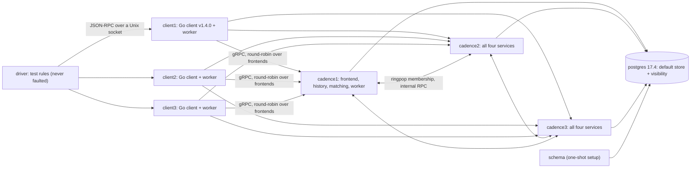

# Cadence v1.4.5 under Antithesis: acknowledged signals lost or duplicated around workflow reset, and three more findings

**Prepared for:** Uber · **Tested:** 2026-11-18 to 2026-11-19 · **System:** Cadence v1.4.5 ([`ecd2b70c`][c-v145])
**Document version:** first edition. An update will follow once the failures listed under
[Still under investigation](#still-under-investigation) are triaged.

## Summary

We ran the Cadence v1.4.5 release, built from source, as a three-node cluster on Postgres, driven by
the official Go client, while Antithesis crashed, paused and partitioned its nodes and the database
(fault injection). The two long runs used about 600 compute hours each. Antithesis found six problems,
each confirmed by a root-cause analysis and an adversarial review. Five are in the Cadence server:
[a retried reset is applied a second time and discards the signals the first reset run held](#retried-reset-applied-twice),
[a signal acknowledged while a decision is in flight is lost when the workflow is reset at that moment](#acked-signal-lost-on-reset),
[a completed workflow is read back as running from a host that lost its shard](#stale-history-after-shard-steal),
[a signal retried by the client during a reset is applied twice](#retried-signal-duplicated-after-reset), and
[stopping a server while it is still starting crashes it](#sigterm-during-startup-panics).
One is in the Go client library: [a workflow with a long local activity can stall for up to 30 minutes after a single failed decision response](#retried-decision-heartbeat-stalls-workflow).
Three of them break [Guarantee 2](#guarantee-2) (acknowledged signals are delivered exactly once).
Visibility converged in every run ([Guarantee 6](#guarantee-6)), and a known, already-fixed Cadence
bug was re-found on the version from before its fix, which shows the tests can catch this class of
problem. Patches are proposed for four of the server findings; they are not yet verified end to
end. Other failures from the long runs are [still under investigation](#still-under-investigation).

## What we tested

- **Uber's system:** Cadence is Uber's open-source workflow orchestration engine. Services write
  workflows as ordinary code; Cadence records every step in a durable event history and replays it
  on workers, so a workflow survives worker and server failures. It runs order, trip and payment
  flows, where a lost or duplicated event changes a business outcome
  ([system brief](../antithesis/scratchbook/system-brief.md)).
- **Under test:** Cadence v1.4.5 ([`ecd2b70c`][c-v145]) itself, not a stand-in: unmodified upstream
  source with Antithesis coverage instrumentation added at build time, and the official Go client
  `go.uber.org/cadence` v1.4.0.
- **How long:** 17 test runs on this version and on builds derived from it, about 2,014 compute
  hours in total, from 2026-11-18 19:13 UTC to 2026-11-19 09:23 UTC. The two main runs (long hunts)
  used 601 compute hours each, about 12.5 hours of wall-clock time:
  [`f04f3907`][run-f04f3907] (the main configuration) and [`bba4d2f0`][run-bba4d2f0] (a variant with
  more shards and default caching). The [Runs](#runs) appendix lists every run.

## Guarantees

The promises Cadence makes to the services that run workflows on it, in plain terms
([guarantees](../antithesis/scratchbook/guarantees.md)).

| Guarantee | Statement | Source | Result on v1.4.5 |
|---|---|---|---|
| [Guarantee 1](#guarantee-1) | At most one run per workflow ID is open at a time; a second start of an open ID is rejected | [Workflows doc][doc-wf], [IDL][idl] | Not settled: failures [still under investigation](#still-under-investigation); no confirmed finding |
| [Guarantee 2](#guarantee-2) | An acknowledged signal appears in the workflow exactly once, even when the client retries | [Go client signals doc][doc-sig], [IDL][idl] | Broken: [retried reset applied twice](#retried-reset-applied-twice), [signal lost on reset](#acked-signal-lost-on-reset), [retried signal applied twice](#retried-signal-duplicated-after-reset) |
| [Guarantee 3](#guarantee-3) | A workflow's history is well formed and append-only; a later read never shows less than an earlier one | [Timers doc][doc-timers], [PR #8595][pr8595] | Broken: [completed workflow read back as running](#stale-history-after-shard-steal) |
| [Guarantee 4](#guarantee-4) | Every started workflow eventually closes with the result its code determines | [Workflows doc][doc-wf] | Broken in the Go client: [workflow stalls after a retried decision heartbeat](#retried-decision-heartbeat-stalls-workflow); other failures still under investigation |
| [Guarantee 5](#guarantee-5) | Once failures stop, a fresh workflow completes within 120 s and started workflows make progress again | [Workflows doc][doc-wf] (window inferred) | Partly held: the fresh-workflow check passed in both long runs; failures of the other recovery checks are still under investigation |
| [Guarantee 6](#guarantee-6) | After failures stop, visibility lists every closed run as closed | [Visibility interface][vis] | Held in every run on v1.4.5 |

### Guarantee 1: single open run per workflow ID

For a domain and workflow ID, at most one run is open at any time. A start for an ID with an open
run is rejected with `WorkflowExecutionAlreadyStarted` unless the reuse policy says otherwise
(workflow ID uniqueness). The tests start the ID of an open workflow again and start new runs on
closed IDs under each reuse policy ([test commands](#test-commands)). Both checks failed in the long
runs; the cause is not yet established.

### Guarantee 2: acknowledged signals exactly once

A signal acknowledged to the client appears in the target workflow exactly once, even when the
client retries with the same request ID after a timeout, and is never lost when the workflow
continues (exactly-once signal delivery, request-ID deduplication). Each signal carries a unique
ID; workflows return the list of signals they applied, and the tests compare it with what was
acknowledged ([test commands](#test-commands)).

### Guarantee 3: history is well formed

Event IDs run 1..N without gaps, the history starts with `WorkflowExecutionStarted`, each timer,
activity and child resolves at most once, a closed run ends in exactly one close event, and a later
read returns the earlier read as a prefix (history consistency). The tests read the full history of
every closed run they know of ([test commands](#test-commands)).

### Guarantee 4: started workflows complete correctly

Every workflow whose start was acknowledged eventually closes with the result its code determines
from its inputs, signals and activity results; timers never fire early; a closed run stays closed
(fault-oblivious execution). All test workflows are deterministic, so the tests compute every
expected result ([test commands](#test-commands)).

### Guarantee 5: recovers after faults

Once failures stop, a fresh workflow completes within 120 seconds and every started workflow makes
progress again (availability after recovery). Cadence documents no recovery time, so the window is
our choice. Checked once per test run, after faults stop ([test commands](#test-commands)).

### Guarantee 6: visibility converges

With database visibility, list and describe calls converge to the history's truth after failures
stop: a closed run is listed closed (eventual consistency of visibility). Checked once per test
run, after faults stop ([test commands](#test-commands)).

## How we tested

### Environment

*Three Cadence nodes, each running all four services, share 8 history shards (16 in the variant)
through ringpop membership and one Postgres database. Three client containers each run the
official Go client and a worker, and serve the test driver over a Unix socket. Antithesis injects
faults into every container except the driver.*

- **Software under test:**
  - **Cadence server** v1.4.5: [`ecd2b70c`][c-v145] ([cadence-workflow/cadence][repo]), built from
    source with Antithesis coverage instrumentation
    ([Dockerfile](../antithesis/server/Dockerfile)), Go 1.26 toolchain.
  - **Cadence Go client** `go.uber.org/cadence` v1.4.0 ([`b15b1e2d`][c-goclient],
    [cadence-workflow/cadence-go-client][repo-go]), used as released.
  - Every build that ran is listed in [Builds](#builds).
- **Faults:** the Antithesis high-availability fault set on every container except the driver,
  Postgres included: container kills, stops and pauses, network partitions and slow networks, CPU
  throttling, and clock jitter. A small supervisor restarts a Cadence server that exits, as
  Kubernetes would ([entrypoint.sh](../antithesis/server/entrypoint.sh)).
- **Workload:**
  - Five workflow types: counters that take signals and queries and continue as new, activity
    chains with retries and local activities, timers, parents with children, and "race" workflows
    whose timers race long local activities (forcing decision heartbeats).
  - Random starts, signals, signal-with-start, queries, cancels, terminates, resets to a random
    earlier decision, duplicate starts of open IDs, and reuse of closed IDs.
  - Every reply is checked against a model of what was sent and acknowledged; requests whose
    outcome is unknown (a timeout) are allowed to apply at most once.
  - Each test run ends by stopping faults and checking recovery, completion of every workflow, and
    visibility.

**How the tested setup differs from a default install**
([dynamicconfig.yaml](../antithesis/config-template/dynamicconfig.yaml); defaults from
[`constants.go`][defaults] at v1.4.5):

| Setting | Test value | Variant (`-b`) | Production default | Why |
|---|---|---|---|---|
| `numHistoryShards` | 8 | 16 | set per cluster | small cluster; the variant checks results don't depend on it |
| `history.cacheMaxSize` | 20 | 512 | 512 | workflow state is reloaded from the database often |
| `history.cacheTTL` | 30s | 1h | 1h | same |
| `matching.numTasklist{Write,Read}Partitions` | 3 | 1 | 1 | exercises task-list partition forwarding |
| `matching.idleTasklistCheckInterval` | 20s | 20s | 5m | more task-list ownership churn |
| `matching.updateAckInterval` | 5s | 5s | 1m | more frequent persistence |
| `history.shardUpdateMinInterval` | 1s | 1s | 5m | more frequent shard writes |
| `history.{timer,transfer}ProcessorUpdateAckInterval` | 5s | 5s | 30s | more frequent queue persistence |
| `frontend/history.shutdownDrainDuration` | 0s | 0s | 0s | stated explicitly: stops behave like crashes |
| `history.decisionHeartbeatTimeout` | 1m | 1m | 30m | added after the [decision-heartbeat finding](#retried-decision-heartbeat-stalls-workflow), which was found with the default, so one stalled workflow cannot hide others |
| `system.minRetentionDays` | 0 | 0 | 1 | test convenience |
| Postgres `idle_in_transaction_session_timeout`, TCP keepalives | 30s; 10/5/3 s | same | off | production-like: without them, a killed Cadence process left database locks held on shard rows for hours ([analysis](../antithesis/scratchbook/rca/shard-unavailable-after-faults.md)) |

### Test commands

The workload is one driver program with 12 rules that Antithesis runs at random, up to six at a
time, while it injects faults; one of them, run rarely, stops faults and runs the after-faults
checks. A supervisor in each Cadence container adds one more check: a server process must never
panic. **How each rule works, every check it makes, and where in the code:
[How the tests work](speedrun-tests.md).**

| Guarantee | What the rules do | Rules |
|---|---|---|
| [Guarantee 1](#guarantee-1) | Start the ID of an open workflow again (must be rejected), and start new runs on closed IDs under each reuse policy (must follow the policy) | [`RuleDuplicateStart`](speedrun-tests.md#rules), [`RuleReuseClosed`](speedrun-tests.md#rules), [`RuleStart`](speedrun-tests.md#rules) |
| [Guarantee 2](#guarantee-2) | Send signals with unique IDs, reset workflows, and query them; every acknowledged signal must appear exactly once, in acknowledgement order, in the workflow's result and history, and no signal that was never sent may appear | [`RuleSignal`](speedrun-tests.md#rules), [`RuleReset`](speedrun-tests.md#rules), [`RuleQuery`](speedrun-tests.md#rules), [`RuleResult`](speedrun-tests.md#rules) |
| [Guarantee 3](#guarantee-3) | Read the full history of each closed run: contiguous IDs, one start and one close event, each timer, activity and child resolved at most once | [`RuleResult`](speedrun-tests.md#rules), [`RuleReset`](speedrun-tests.md#rules) |
| [Guarantee 4](#guarantee-4) | Finish, cancel and terminate workflows and read their results; each must close with the computed result and the requested status, timers must not fire early, and a closed run must stay closed | [`RuleFinish`](speedrun-tests.md#rules), [`RuleCancel`](speedrun-tests.md#rules), [`RuleTerminate`](speedrun-tests.md#rules), [`RuleResult`](speedrun-tests.md#rules), [`RuleDescribeClosed`](speedrun-tests.md#rules) |
| [Guarantee 5](#guarantee-5) | After faults stop: every client is served again, a fresh workflow completes within 2 minutes, every started workflow closes | [`RuleEventually`](speedrun-tests.md#eventually-phase) |
| [Guarantee 6](#guarantee-6) | After faults stop: every closed run is listed as closed within 2 minutes | [`RuleEventually`](speedrun-tests.md#eventually-phase) |

Before any rule runs, [setup](speedrun-tests.md#how-a-test-run-goes) waits for all clients,
registers the domain, starts the workers and runs one workflow end to end.

## Known-bug check

To show the tests can catch a real bug of this kind (a positive control), we ran them on the version
from just before a known, already-fixed Cadence bug was fixed: a timer recorded as both canceled
and fired after decision heartbeating ([PR #8595][pr8595]), which breaks
[Guarantee 3](#guarantee-3). The build was [`c889f831`][c-prefix], the parent of fix
[`976d08c2`][c-fix] ([details](../antithesis/scratchbook/positive-control.md)).

**Reproduced.** In [`ccd99ed4`][run-ccd99ed4], a 150-compute-hour run with the same tests used for
the long runs, "a workflow history is well formed" failed in 201 examples, and every one in a sample
of 50 had the bug's signature: "timer N resolved twice: TimerCanceled then TimerFired". One failing
example: input_hash `-5653455983605853828`, vtime `62.99922230280936`, about a minute into its
timeline. An earlier run, `0dc3db5a` (cancelled; it has no report), found the same signature about
19 times with an older version of the tests. The same check passed in both long runs on v1.4.5,
which contains the fix. On the way, we found and fixed a gap in our own checker (it did not record
which timer a `TimerCanceled` event referred to) before these runs.

## Findings

Each finding below was confirmed by a root-cause analysis and then challenged by an adversarial
review that looked for a harness, configuration or fault-model explanation; none held up. The
failing-example counts come from the property that collects each kind of failure in the two long
runs. Each property collects every failure of its kind, so not every example has been
individually root-caused. Run reports carry an access token; the moment values (input_hash, vtime)
locate one failing example in the run's logs.

### A reset retried by the client is applied a second time, discarding the first reset run and the acknowledged signals it held

**Full analysis:** [root cause](../antithesis/scratchbook/rca/fixverify-reset-dup.md) · **Proposed fix:** [retried-signal-duplicated-after-reset.v2.patch](../antithesis/fixes/retried-signal-duplicated-after-reset.v2.patch) · [adversarial review](../antithesis/scratchbook/adversarial/retried-reset-applied-twice.md)

- **Where:** Cadence server (history service, reset).
- **What broke:** one `ResetWorkflowExecution` call, retried internally by the Go client after a lost
  reply, was committed twice. The second reset threw away the first reset's new run, and with it
  three signals that had been acknowledged to clients.
- **Guarantee:** [Guarantee 2](#guarantee-2), "an acknowledged signal appears exactly once".
- **Impact:** reset is not idempotent under client retry. A timeout on a reset that committed, which
  is common for operator and batch-reset tooling under load, silently discards the first reset run
  and every signal acknowledged to it. This happens with default configuration; the only other duplicate check (strong idempotency) is off
  by default and not available on SQL stores.
- **How it happened:**
  1. The driver reset `counter-182` once. The server committed the reset (run `939f…`), but network
     partitions and Postgres timeouts kept the reply from the client.
  2. Clients sent signals s609, s617, s620 and s621 to the new run; all were acknowledged.
  3. The Go client retried the reset with the same request ID. The server's duplicate check did not
     recognise it and reset the same base run again (run `1129…`).
  4. The second reset reapplied only the base run's signals, so s617, s620 and s621 were lost; a
     later client retry of s609 then applied it twice across a continue-as-new.
- **Seen in:** one workflow, in the fix-check run [`41bf0672`][run-41bf0672] (v1.4.5 plus an
  unrelated signal patch that does not touch this path), input_hash `4272893864207768579`, vtime
  `474.5656898911111`. It has no property of its own, so it is not counted separately in the long
  runs.
- **Root cause:** the reset handler deduplicates by comparing the current run's `CreateRequestID`
  with the reset's request ID ([reset_workflow_execution.go:124-133][src-reset-dedup]). When the
  reset run's state is rebuilt from history, that field is overwritten with the original start
  event's request ID ([mutable_state_builder_methods_started.go:192-198][src-started-reqid]), so the
  check can never match. The overwrite came in with [`baac6218`][c-5821] (#5821, April 2024): this is
  a regression.
- **Proposed fix:** after the rebuild, set the reset run's `CreateRequestID` to the reset request ID,
  restoring the earlier behaviour; it passes the reset package's unit tests. It is in the second
  version of the signal-dedup patch and has not been run end to end
  ([how it was checked](../antithesis/scratchbook/rca/fixverify-reset-dup.md#proposed-fix)).
- **Already known upstream?** Not reported upstream. Master ([`572e7e2c`][c-master]) has the same
  code.

### A signal acknowledged while a decision is in flight is lost when the workflow is reset at that moment

**Full analysis:** [root cause](../antithesis/scratchbook/rca/signal-lost-at-reset-master.md), [fix notes](../antithesis/scratchbook/rca/acked-signal-lost-on-reset-fix.md) · **Proposed fix:** [acked-signal-lost-on-reset.patch](../antithesis/fixes/acked-signal-lost-on-reset.patch) · [adversarial review](../antithesis/scratchbook/adversarial/acked-signal-lost-on-reset.md)

- **Where:** Cadence server (history service, reset).
- **What broke:** a signal accepted and acknowledged while a decision was in flight was written into
  the run being reset and never reached the new run, so no run of the workflow ever applied it.
- **Guarantee:** [Guarantee 2](#guarantee-2), "an acknowledged signal is never lost".
- **Impact:** an acknowledged event (a payment callback, say) is silently dropped from the
  workflow's logical execution. It needs no faults and no special configuration, only a reset
  (manual, batch or automatic) racing live signal traffic.
- **How it happened:**
  1. A decision task for the workflow is in flight on a worker.
  2. A signal arrives. Because a decision is in flight, Cadence holds it as a buffered event and
     acknowledges it to the client.
  3. A reset of the current run starts. It notes the run's last persisted event, which does not
     include the buffered signal.
  4. Terminating the old run fails the in-flight decision, which flushes the buffered signal into the
     old run's history.
  5. The reset reapplies only the signals it read from persisted history, so the new run never gets
     the signal.
- **Seen in:** 666 failing examples in [`f04f3907`][run-f04f3907] (one: input_hash
  `-7563240092365204529`, vtime `18.993259294657037`) and 787 in [`bba4d2f0`][run-bba4d2f0] (one:
  input_hash `3715485177105310966`, vtime `14.820514708058909`), of the property "an acknowledged
  signal survives a reset of its workflow". The case analysed step by step came from a run on master
  (`75b0745b`, an iteration run that was cancelled and has no report; input_hash
  `-318482339591177353`, vtime `34.675`). Master and v1.4.5 have identical code on this path.
- **Root cause:** the reset reads the next event ID before terminating the current run
  ([reset_workflow_execution.go:143][src-reset-base], [resetter.go:130-131][src-resetter-130]).
  Terminating it ([resetter.go:138-147][src-resetter-138]) fails the in-flight decision, and
  `FailDecision` flushes buffered events ([mutable_state_util.go:106][src-flush]) with IDs above that
  bound. The reapply step then pages persisted history only up to the bound
  ([resetter.go:487-525][src-reapply]), so the flushed signals are never reapplied.
- **Proposed fix:** after terminating the current run, collect the events its termination flushed
  and reapply their signals to the new run, keeping the original request IDs for deduplication. Two
  new unit tests fail without it and pass with it, and the Cadence reset, execution and engine
  package tests pass ([how it was checked](../antithesis/scratchbook/rca/acked-signal-lost-on-reset-fix.md#results)).
  The end-to-end fix check still showed failures of this property; see [Fix checks](#fix-checks).
- **Already known upstream?** Not reported upstream. Master ([`572e7e2c`][c-master]) has the same
  code.

### A completed workflow is read back as running with a shorter history from a host that lost its shard

**Full analysis:** [root cause on v1.4.5](../antithesis/scratchbook/rca/stale-history-v145.md), [earlier case on the pre-fix build](../antithesis/scratchbook/rca/history-missing-close-event.md) · **Proposed fix:** none written yet · [adversarial review](../antithesis/scratchbook/adversarial/stale-history-after-shard-steal.md)

- **Where:** Cadence server (history service, shard ownership).
- **What broke:** right after a client was told a workflow had completed, a history read of the same
  run returned the workflow as running, with 5 of its 11 events and no close event.
- **Guarantee:** [Guarantee 3](#guarantee-3), "a later read returns the earlier read as a prefix".
- **Impact:** for a few seconds after a node restarts or rejoins (every rolling deploy), two of three
  frontends can route reads to a history host that has silently lost a shard. That host reports
  already-completed workflows as running, with a truncated history. Callers that poll describe or
  history to decide what to do next can act on stale state. No data is lost: the database is
  correct, and the stale host heals when its next write to the shard fails. With the default
  `history.shardUpdateMinInterval` (5 minutes, against 1 second in our tests), an idle shard could
  serve stale reads for longer.
- **How it happened:**
  1. A node restarted and rejoined the cluster after faults had stopped.
  2. While membership converged, the rejoining host took shard 3 and cached a running workflow.
  3. Another host, whose view did not yet include the rejoining host, took the shard back and
     completed the workflow.
  4. The rejoining host made no write to the shard, so it never learned it had lost it, and kept
     serving reads from its cache.
  5. A result read went to the current owner (completed); the history read 0.6 ms later went to the
     stale host (running, 5 events).
- **Seen in:** 68 failing examples in [`f04f3907`][run-f04f3907] (one: input_hash
  `2114059415789563007`, vtime `64.21569897816516`) and 88 in [`bba4d2f0`][run-bba4d2f0] (one:
  input_hash `-89621319360768082`, vtime `47.44355515087955`), of the property "a history read after
  a workflow closed includes its close event". The case analysed step by step was in
  [`41bf0672`][run-41bf0672] (input_hash `-2175461847364005768`, vtime about `96.5063`), with no
  faults injected at the time; two earlier cases were on the pre-fix build.
- **Root cause:** the history read takes its upper bound and running state from `PollMutableState`
  ([poll_mutable_state.go:75-87][src-poll]), which is answered from the host's cached state with no
  check of the shard's current owner ([context.go:359][src-context]). A host returns any shard it
  already holds without consulting membership ([controller.go:301-307][src-controller]), and the
  periodic acquire pass only adds shards, never drops them. Only a failed write fences a host that
  lost a shard; reads are never fenced.
- **Proposed fix:** no patch was written; this is a design change. The direction from the analysis:
  check shard ownership on reads (re-check membership or the shard's range ID when a cached shard
  or workflow is used), or release shards in the acquire pass that the ring no longer assigns to
  this host ([fix direction](../antithesis/scratchbook/adversarial/stale-history-after-shard-steal.md#severity-to-state-to-uber-engineers)).
- **Already known upstream?** Not reported upstream. Master ([`572e7e2c`][c-master]) has identical
  code on this path. Cadence does not document monotonic reads across shard movement, which is why
  the review rates it medium, not high.

### A signal retried by the client during a reset is applied twice

**Full analysis:** [root cause](../antithesis/scratchbook/rca/reset-duplicates-signal.md), [the query view of the same case](../antithesis/scratchbook/rca/query-shows-duplicate-signal.md) · **Proposed fix:** [retried-signal-duplicated-after-reset.patch](../antithesis/fixes/retried-signal-duplicated-after-reset.patch) (first version) and [retried-signal-duplicated-after-reset.v2.patch](../antithesis/fixes/retried-signal-duplicated-after-reset.v2.patch) (also fixes the [retried reset](#retried-reset-applied-twice)) · [adversarial review](../antithesis/scratchbook/adversarial/retried-signal-duplicated-after-reset.md)

- **Where:** Cadence server (history service, reset and signal deduplication).
- **What broke:** one `SignalWorkflowExecution` call was recorded twice in the same run: once
  reapplied by a reset, and once more when the Go client's own retry of the same request reached
  the new run.
- **Guarantee:** [Guarantee 2](#guarantee-2), "exactly once, even when the client retries with the same
  request ID"; the duplicate also shows in the history ([Guarantee 3](#guarantee-3)).
- **Impact:** a signal (a payment callback, a counter increment) is applied twice in one run, with no
  error to anyone. The caller cannot prevent it, because the request ID is generated inside the
  client. It needs a reset to commit while a signal call is still retrying, which is likely during
  incident recovery.
- **How it happened:**
  1. A client sent signal s45; Cadence recorded it, but a network fault lost the reply, so the Go
     client kept retrying with the same request ID.
  2. A reset to a point before s45 created a new run and reapplied s45, without its request ID.
  3. The client's retry reached the new run. That run's deduplication set did not contain the
     request ID, so s45 was recorded a second time.
- **Seen in:** 196 failing examples in [`f04f3907`][run-f04f3907] (one: input_hash
  `5673641315105240353`, vtime `72.79605940612964`) and 280 in [`bba4d2f0`][run-bba4d2f0] (one:
  input_hash `-7439342475537478313`, vtime `184.10105724004097`), of the property "a signal is
  applied at most once in a workflow that was reset". The case analysed step by step was in the
  first iteration run, `89a272ed` (cancelled; it has no report), input_hash `-5028251366505688799`,
  vtime `70.4274695077911`.
- **Root cause:** signal deduplication uses a per-run set of request IDs
  ([signal_workflow_execution.go:66-75][src-signal-dedup]). A reset reapplies signals with an empty
  request ID ([resetter.go:636][src-resetter-636]) and never adds the original ID to the new run's
  set, and rebuilding a run from history does not restore it either
  ([mutable_state_builder_methods_signal.go:76-88][src-signal-replicate]).
- **Proposed fix:** when a reset reapplies a signal, or a run is rebuilt from history, add the
  signal's original request ID to the new run's deduplication set. The patch does both; the second
  version also fixes the [retried reset](#retried-reset-applied-twice) and passes the reset
  package's unit tests ([how it was checked](../antithesis/scratchbook/rca/reset-duplicates-signal.md#proposed-fix-cadence)).
  The end-to-end fix check still showed failures of this property; see [Fix checks](#fix-checks).
- **Already known upstream?** Not reported upstream. Master ([`572e7e2c`][c-master]) has the same
  code.

### A workflow with a long local activity stops making progress and heartbeats empty decisions until the server times it out

**Full analysis:** [root cause](../antithesis/scratchbook/rca/race-workflow-stuck.md) · **Proposed fix:** none written (the fix belongs in the Go client) · [adversarial review](../antithesis/scratchbook/adversarial/retried-decision-heartbeat-stalls-workflow.md)

- **Where:** the Go client library `go.uber.org/cadence` v1.4.0, not the server. The server behaved
  as the client asked.
- **What broke:** after one failed attempt to report a decision while a long local activity was
  running, the workflow stopped making progress. It sent an empty decision every 3.2 seconds (about
  93 in 5 minutes) and never closed while we watched.
- **Guarantee:** [Guarantee 4](#guarantee-4) and [Guarantee 5](#guarantee-5), "started workflows make
  progress again once failures stop".
- **Impact:** any transient failure of that one call (a database blip, shard movement, a frontend
  timeout) can stall a workflow for up to `history.decisionHeartbeatTimeout`, 30 minutes by default,
  after the system is healthy again. The local activity's result is dropped and it runs again
  afterwards, and the stall adds about 1,700 history events per 30 minutes. No data is lost.
- **How it happened:**
  1. A local activity ran past 80% of the 4-second decision timeout, so the client heartbeated the
     decision and asked the server for the next decision task in the reply.
  2. A Postgres outage made that call fail; the client retried it with the same request object.
  3. The first attempt had already modified the shared request, so every retry asked for no next
     decision task.
  4. A retry succeeded, and with no decision task in the reply, the client treated the heartbeat as
     done, closed the task and dropped the local activity's result when it arrived.
  5. Every later decision found the activity still pending but never restarted it, and heartbeated
     empty decisions until the server's timeout.
- **Seen in:** one workflow, in iteration run `6e868ff1` (cancelled; it has no report), input_hash
  `5337532354675634409`, vtime `401.2113032224588`, with the default 30-minute timeout. The long runs
  used a 1-minute timeout and a detector that flags 20 empty decision cycles in a row; the detector
  passed, so the long runs give no count.
- **Root cause:** `handleDecisionTaskCompletedRequest` sets sticky attributes on the shared request
  on its first attempt, so every retry takes the other branch and sends
  `ReturnNewDecisionTask=false` ([internal_task_pollers.go:507-514][go-pollers-507]). The heartbeat
  path treats a reply with no decision task as "done" ([internal_task_pollers.go:372-374][go-pollers-372],
  [internal_task_handlers.go:857-859][go-handlers-857]), and a local activity that already started
  is never dispatched again ([internal_task_handlers.go:1151-1173][go-handlers-1151]).
- **Proposed fix:** compute the sticky and `ReturnNewDecisionTask` fields once, before the retry
  loop (or copy the request per attempt), and treat a heartbeat reply with no decision task as an
  error or evict the cached workflow, so pending local activities are dispatched again
  ([fix direction](../antithesis/scratchbook/rca/race-workflow-stuck.md#proposed-fix--workarounds)).
- **Already known upstream?** Not reported upstream. We did not check whether a newer client
  release fixes it.

### Stopping a server while it is still starting crashes it with a nil-pointer panic

**Full analysis:** [root cause](../antithesis/scratchbook/rca/node-exits.md) · **Proposed fix:** [sigterm-during-startup-panics.patch](../antithesis/fixes/sigterm-during-startup-panics.patch) · [adversarial review](../antithesis/scratchbook/adversarial/sigterm-during-startup-panics.md)

- **Where:** Cadence server (history and frontend service shutdown).
- **What broke:** a stop signal (SIGTERM) delivered while a history or frontend service was still
  inside `Start()` made `Stop()` dereference a field that `Start()` had not yet set. The process
  panicked and exited with code 2 instead of draining.
- **Guarantee:** none of the six guarantees promises a graceful shutdown; this is a crash-safety
  finding, closest to [Guarantee 5](#guarantee-5).
- **Impact:** low. The process was stopping anyway and no data is lost. It skips the orderly hand-off
  of its shards, so peers notice only through membership failure detection, and Start and Stop race
  on the same fields without synchronisation (a data race). It shows up as noisy panics during
  cancelled rollouts, pod evictions and crash loops.
- **How it happened:**
  1. A server starts while the database or its peers are slow, so `Start()` blocks for seconds.
  2. The stop-signal handler is already installed, because the service starts in a background
     goroutine.
  3. A stop signal arrives; `Stop()` calls into a controller (history) or rate-limiter collection
     (frontend) that does not exist yet, and the process panics.
- **Seen in:** the property "a cadence server process crashes" failed in about 1.4k examples in
  each long run, all during a stop ([`f04f3907`][run-f04f3907], one: input_hash
  `-436440139682652554`, vtime `30.29681889573112`; [`bba4d2f0`][run-bba4d2f0], one: input_hash
  `-3788081404701449829`, vtime `22.51161000621505`). The stack traces analysed in detail came from
  the first iteration runs on v1.4.5 and master and from the pre-fix build.
- **Root cause:** history `Stop()` calls `h.controller.PrepareToStop()` while `h.controller` is still
  nil ([handler.go:234][src-handler-234]); frontend `Stop()` calls `OnStop` on a rate-limiter
  collection that is still nil ([service.go:356][src-fe-356], which dereferences it at
  [collection.go:255][src-collection-255]).
- **Proposed fix:** nil guards in history `PrepareToStop`/`Stop` and frontend `stopRatelimiters`
  (or have `Stop` wait for `Start` to finish). The patch adds the guards; it has no unit test of its
  own. The end-to-end fix check still showed crash reports; see [Fix checks](#fix-checks)
  ([fix direction](../antithesis/scratchbook/adversarial/sigterm-during-startup-panics.md#severity-to-state-to-uber)).
- **Already known upstream?** Not reported upstream. Master ([`572e7e2c`][c-master]) has the same
  code.

### Fix checks

We built v1.4.5 with the proposed patches and ran the same tests against it (fix checks). The
patches pass the Cadence unit tests recorded in their root-cause files. The fixes are **not yet
verified end to end**:

- [`1a0d055c`][run-1a0d055c] (400 compute hours): v1.4.5 plus the first version of the
  [signal-dedup patch](../antithesis/fixes/retried-signal-duplicated-after-reset.patch), the
  [lost-signal patch](../antithesis/fixes/acked-signal-lost-on-reset.patch) and the
  [shutdown patch](../antithesis/fixes/sigterm-during-startup-panics.patch). The dedicated properties
  still failed: "an acknowledged signal survives a reset of its workflow" 373 times, "a signal is
  applied at most once in a workflow that was reset" 168 times, "a cadence server process crashes"
  119 times, and "a history read after a workflow closed includes its close event" 54 times (no
  patch addresses the last one). These residual failures are being analysed
  (`rca/fixverify-residuals.md`, not yet written). Each property collects every failure of its kind,
  so a residual may be the same bug, a different one, or a test-code issue. The second version of
  the signal-dedup patch, which also fixes the [retried reset](#retried-reset-applied-twice), was not
  in this build.
- [`41bf0672`][run-41bf0672] (150 compute hours): v1.4.5 plus the first signal-dedup patch and the
  shutdown nil guards. It found the [retried reset](#retried-reset-applied-twice) and a v1.4.5 case of
  the [stale history read](#stale-history-after-shard-steal).
- Three shorter fix checks (`42ce02a1`, `ad86b559`, `5a1ac4c2`, all cancelled, without reports);
  the first showed that an early version of the shutdown nil guards missed one field.

## Still under investigation

These checks also failed in the long runs, and their cause is not yet established. They may be
further bugs in Cadence or problems in our test code. None of them is presented as a finding; an
update to this report will follow once they are triaged. The run reports linked above show their
counts.

- "a timer never fires before its duration" ([Guarantee 4](#guarantee-4)). It never failed on the
  pre-fix build.
- "a workflow ends only as completed, or as canceled or terminated on request"
  ([Guarantee 4](#guarantee-4)).
- "a second start of an open workflow ID is rejected" ([Guarantee 1](#guarantee-1)).
- "a start on a closed workflow ID follows its reuse policy" ([Guarantee 1](#guarantee-1)).
- "signals are applied in the order they were acknowledged" ([Guarantee 2](#guarantee-2)).
- "a workflow only applies signals that clients sent" and "a completed workflow returns the result
  its inputs determine" ([Guarantee 2](#guarantee-2), [Guarantee 4](#guarantee-4)).
- "a closed workflow keeps its outcome" ([Guarantee 4](#guarantee-4)).
- "every client is served again once faults stop" and "every started workflow closes once faults
  stop" ([Guarantee 5](#guarantee-5), [Guarantee 4](#guarantee-4)).
- "an acknowledged signal is applied exactly once" and "a query shows each delivered signal once",
  for workflows that were never reset ([Guarantee 2](#guarantee-2)).
- Antithesis's "No unexpected container exits" for the client containers (exit code 2). These
  containers run our test client, not Cadence.

## Scope and limits

- **One cluster, Postgres only.** Cross-cluster replication and the Cassandra store were not tested.
- **Go client only,** v1.4.0. The Java client and direct API callers were not tested.
- **Some checks are narrower than the guarantee they serve:** for [Guarantee 1](#guarantee-1) we
  check rejection of duplicate starts and reuse policies, not the open intervals of every run; for
  [Guarantee 6](#guarantee-6), that closed runs are listed closed, not that they are never listed
  open again ([details](speedrun-tests.md#where-the-checks-are-narrower-than-the-guarantees)).
- **Tuning.** Small caches, more task-list partitions and frequent ack and shard writes make reloads
  and ownership changes more frequent ([table](#environment)). The variant run used the default cache
  and one partition and showed the same failures. `history.decisionHeartbeatTimeout` was shortened
  to 1 minute after the [decision-heartbeat finding](#retried-decision-heartbeat-stalls-workflow).
- **The recovery window** in [Guarantee 5](#guarantee-5) (120 seconds) is our choice; Cadence
  documents none.
- **Failing-example counts** are counts of a property, and a property collects every failure of
  its kind. Each finding's mechanism was established on the case analysed step by step.
- **Master** ([`572e7e2c`][c-master]) is covered by a separate report; it shares the
  [known-bug check](#known-bug-check).

## Appendix

### Runs

Every run that contributed to these results. Report links carry an access token: anyone with the
link can open the report. Cancelled iteration runs have no report. Length is in compute hours.

| Run | Purpose | Build | Length | Result |
|---|---|---|---|---|
| `89a272ed` | Test iteration 1: first run, full fault set | [v1.4.5](#builds) | 19.3 | Cancelled after harness fixes; first case of the [retried signal applied twice](#retried-signal-duplicated-after-reset) and of the [shutdown panic](#sigterm-during-startup-panics) |
| `7f0adefd` | Test iteration 2: server supervisor, worker auto-start, checker fixes | [v1.4.5](#builds) | 0.1 | Cancelled at once: a checker gap was found |
| `6e868ff1` | Test iteration 3: canceled-timer check, liveness fixes | [v1.4.5](#builds) | 3.2 | Cancelled after checker fixes; found the [Go-client stall](#retried-decision-heartbeat-stalls-workflow) |
| `7955602f` | Test iteration 4: run attribution and cancel checker fixes | [v1.4.5](#builds) | 7.8 | Cancelled after checker fixes |
| `90246acc` | Test iteration 5: Postgres timeouts, reset and reuse checker fixes, heartbeat-loop detector | [v1.4.5](#builds) | 9.9 | Cancelled after checker fixes |
| `f3f92737` | Test iteration 7: same images as the matching master and fix-check runs | [v1.4.5](#builds) | 12.2 | Cancelled after checker fixes |
| [`f04f3907`][run-f04f3907] | Long hunt, final tests | [v1.4.5](#builds) | 601.1 | Full budget used (report marked incomplete); the properties tied to four findings failed; see [Findings](#findings) and [Still under investigation](#still-under-investigation) |
| [`bba4d2f0`][run-bba4d2f0] | Long hunt, variant: 16 shards, default cache, 1 task-list partition | [v1.4.5 variant](#builds) | 601.1 | Same as above |
| `22fa5e0b` | Known-bug check 1 | [before the fix](#builds) | 14.6 | Cancelled after harness fixes; first cases of the [stale history read](#stale-history-after-shard-steal) |
| `fc9ee8d0` | Known-bug check 2 | [before the fix](#builds) | 0 | Cancelled before it started |
| `0dc3db5a` | Known-bug check 3, with the canceled-timer check | [before the fix](#builds) | 38.1 | Known bug reproduced (about 19 examples); older tests, not clean |
| [`ccd99ed4`][run-ccd99ed4] | Known-bug check 4, final tests | [before the fix](#builds) | 150.6 | [Known bug reproduced](#known-bug-check) (201 examples) |
| `42ce02a1` | Fix check 1 | [fix check, first patches](#builds) | 4.0 | Cancelled; showed the first nil guards were incomplete |
| `ad86b559` | Fix check 2 | [fix check, first patches](#builds) | 0 | Cancelled before it started |
| `5a1ac4c2` | Fix check 3, complete nil guards | [fix check, first patches](#builds) | 0 | Cancelled before it started |
| [`41bf0672`][run-41bf0672] | Fix check (test iteration 7) | [fix check, first patches](#builds) | 150.7 | Found the [retried reset](#retried-reset-applied-twice) and a v1.4.5 [stale history read](#stale-history-after-shard-steal) |
| [`1a0d055c`][run-1a0d055c] | Fix check 4: all three server patches, final tests | [fix check, three patches](#builds) | 401.1 | Residual failures under analysis; see [Fix checks](#fix-checks) |

### Builds

| Build | Component | Repository | Version | Commit | Changes on top |
|---|---|---|---|---|---|
| v1.4.5 | Cadence server | [cadence-workflow/cadence][repo] | v1.4.5 | [`ecd2b70c`][c-v145] | Antithesis coverage instrumentation only ([Dockerfile](../antithesis/server/Dockerfile)); config [config-v1.4.5](../antithesis/config-v1.4.5/) |
| v1.4.5 variant | Cadence server | same | v1.4.5 | [`ecd2b70c`][c-v145] | same image; config [config-v1.4.5-b](../antithesis/config-v1.4.5-b/): 16 shards, default history cache, 1 task-list partition |
| before the fix | Cadence server | same | parent of fix [`976d08c2`][c-fix] | [`c889f831`][c-prefix] | instrumentation only; config [config-prefix](../antithesis/config-prefix/) |
| fix check, first patches | Cadence server | same | v1.4.5 plus patches | based on [`ecd2b70c`][c-v145] (local build) | [signal-dedup patch, first version](../antithesis/fixes/retried-signal-duplicated-after-reset.patch) and the [shutdown nil guards](../antithesis/fixes/sigterm-during-startup-panics.patch) (incomplete in the first fix check); config [config-fixverify](../antithesis/config-fixverify/) |
| fix check, three patches | Cadence server | same | v1.4.5 plus patches | based on [`ecd2b70c`][c-v145] (local build) | [signal-dedup patch, first version](../antithesis/fixes/retried-signal-duplicated-after-reset.patch), [lost-signal patch](../antithesis/fixes/acked-signal-lost-on-reset.patch), [shutdown nil guards](../antithesis/fixes/sigterm-during-startup-panics.patch); config [config-fixverify2](../antithesis/config-fixverify2/) |
| all | Cadence Go client | [cadence-workflow/cadence-go-client][repo-go] | v1.4.0 (`go.uber.org/cadence`) | [`b15b1e2d`][c-goclient] | none; used by the [client program](../antithesis/client/main.go), instrumented in its container |

Released components used as is: Postgres 17.4 (`postgres:17.4`,
`sha256:304ab813518754228f9f792f79d6da36359b82d8ecf418096c636725f8c930ad`); Go 1.26 toolchain
(`golang:1.26-trixie`); hegel v0.9.38 and the Antithesis Go SDK v0.9.0 in the test driver.

[c-v145]: https://github.com/cadence-workflow/cadence/commit/ecd2b70caf1fe9921aca19b00eb0b2905a3cc602
[c-master]: https://github.com/cadence-workflow/cadence/commit/572e7e2c786999df887f73ae46e59c72897a223b
[c-prefix]: https://github.com/cadence-workflow/cadence/commit/c889f8319b9dffa8c8638c6679e8961070e0536d
[c-fix]: https://github.com/cadence-workflow/cadence/commit/976d08c25bbbb08b6c18023139454bc5eed2476b
[c-5821]: https://github.com/cadence-workflow/cadence/commit/baac621842aebc54e3e06b5fc68a73015c1b7afc
[c-goclient]: https://github.com/cadence-workflow/cadence-go-client/commit/b15b1e2d03286de85b9ab1a724cb5368d1deda39
[repo]: https://github.com/cadence-workflow/cadence
[repo-go]: https://github.com/cadence-workflow/cadence-go-client
[pr8595]: https://github.com/cadence-workflow/cadence/pull/8595
[doc-wf]: https://cadenceworkflow.io/docs/concepts/workflows
[doc-sig]: https://cadenceworkflow.io/docs/go-client/signals/
[doc-timers]: https://cadenceworkflow.io/docs/concepts/timers/
[idl]: https://github.com/cadence-workflow/cadence-idl/blob/master/thrift/cadence.thrift
[vis]: https://github.com/cadence-workflow/cadence/blob/v1.4.5/common/persistence/visibility_manager_interfaces.go#L41
[defaults]: https://github.com/cadence-workflow/cadence/blob/ecd2b70caf1fe9921aca19b00eb0b2905a3cc602/common/dynamicconfig/dynamicproperties/constants.go
[src-reset-dedup]: https://github.com/cadence-workflow/cadence/blob/ecd2b70caf1fe9921aca19b00eb0b2905a3cc602/service/history/engine/engineimpl/reset_workflow_execution.go#L124-L133
[src-started-reqid]: https://github.com/cadence-workflow/cadence/blob/ecd2b70caf1fe9921aca19b00eb0b2905a3cc602/service/history/execution/mutable_state_builder_methods_started.go#L192-L198
[src-reset-base]: https://github.com/cadence-workflow/cadence/blob/ecd2b70caf1fe9921aca19b00eb0b2905a3cc602/service/history/engine/engineimpl/reset_workflow_execution.go#L143
[src-resetter-130]: https://github.com/cadence-workflow/cadence/blob/ecd2b70caf1fe9921aca19b00eb0b2905a3cc602/service/history/reset/resetter.go#L130-L131
[src-resetter-138]: https://github.com/cadence-workflow/cadence/blob/ecd2b70caf1fe9921aca19b00eb0b2905a3cc602/service/history/reset/resetter.go#L138-L147
[src-flush]: https://github.com/cadence-workflow/cadence/blob/ecd2b70caf1fe9921aca19b00eb0b2905a3cc602/service/history/execution/mutable_state_util.go#L106
[src-reapply]: https://github.com/cadence-workflow/cadence/blob/ecd2b70caf1fe9921aca19b00eb0b2905a3cc602/service/history/reset/resetter.go#L487-L525
[src-poll]: https://github.com/cadence-workflow/cadence/blob/ecd2b70caf1fe9921aca19b00eb0b2905a3cc602/service/history/engine/engineimpl/poll_mutable_state.go#L75-L87
[src-context]: https://github.com/cadence-workflow/cadence/blob/ecd2b70caf1fe9921aca19b00eb0b2905a3cc602/service/history/execution/context.go#L359
[src-controller]: https://github.com/cadence-workflow/cadence/blob/ecd2b70caf1fe9921aca19b00eb0b2905a3cc602/service/history/shard/controller.go#L301-L307
[src-signal-dedup]: https://github.com/cadence-workflow/cadence/blob/ecd2b70caf1fe9921aca19b00eb0b2905a3cc602/service/history/engine/engineimpl/signal_workflow_execution.go#L66-L75
[src-resetter-636]: https://github.com/cadence-workflow/cadence/blob/ecd2b70caf1fe9921aca19b00eb0b2905a3cc602/service/history/reset/resetter.go#L623-L645
[src-signal-replicate]: https://github.com/cadence-workflow/cadence/blob/ecd2b70caf1fe9921aca19b00eb0b2905a3cc602/service/history/execution/mutable_state_builder_methods_signal.go#L76-L88
[src-handler-234]: https://github.com/cadence-workflow/cadence/blob/ecd2b70caf1fe9921aca19b00eb0b2905a3cc602/service/history/handler/handler.go#L234
[src-fe-356]: https://github.com/cadence-workflow/cadence/blob/ecd2b70caf1fe9921aca19b00eb0b2905a3cc602/service/frontend/service.go#L356
[src-collection-255]: https://github.com/cadence-workflow/cadence/blob/ecd2b70caf1fe9921aca19b00eb0b2905a3cc602/common/quotas/global/collection/collection.go#L255
[go-pollers-507]: https://github.com/cadence-workflow/cadence-go-client/blob/v1.4.0/internal/internal_task_pollers.go#L507-L514
[go-pollers-372]: https://github.com/cadence-workflow/cadence-go-client/blob/v1.4.0/internal/internal_task_pollers.go#L372-L374
[go-handlers-857]: https://github.com/cadence-workflow/cadence-go-client/blob/v1.4.0/internal/internal_task_handlers.go#L857-L859
[go-handlers-1151]: https://github.com/cadence-workflow/cadence-go-client/blob/v1.4.0/internal/internal_task_handlers.go#L1151-L1173
[run-1a0d055c]: https://orbitinghail.antithesis.com/report/xN9Vj4U-36rrB2EGnmdrfioQ/QME7BrLqb1wMUqQZ_d7YrLxBhjYAnqTP7fAgJwKsiWQ.html?auth=v2.public.eyJuYmYiOiIyMDI2LTExLTE5VDA0OjI1OjQ3LjYyNzEwODc2M1oiLCJzY29wZSI6eyJSZXBvcnRTY29wZVYxIjp7ImFzc2V0IjoiUU1FN0JyTHFiMXdNVXFRWl9kN1lyTHhCaGpZQW5xVFA3ZkFnSndLc2lXUS5odG1sIiwicmVwb3J0X2lkIjoieE45Vmo0VS0zNnJyQjJFR25tZHJmaW9RIn19favCyE4Utz3UgFQMlJMfMxrcal1_ucEel2g_f4YLh39_8wiydLxDlENLSsMIlTBGXI-s1LdcuIRGnqjm8s8CbAk
[run-41bf0672]: https://orbitinghail.antithesis.com/report/Ie4vOZxovWROfzayOSpNtShi/eLjnz7F_vDSB3n6eaOdMzCETUOyH1cFkim3NEWOkL8c.html?auth=v2.public.eyJuYmYiOiIyMDI2LTExLTE4VDIyOjQ4OjA2LjcyNjIyNTMyNFoiLCJzY29wZSI6eyJSZXBvcnRTY29wZVYxIjp7ImFzc2V0IjoiZUxqbno3Rl92RFNCM242ZWFPZE16Q0VUVU95SDFjRmtpbTNORVdPa0w4Yy5odG1sIiwicmVwb3J0X2lkIjoiSWU0dk9aeG92V1JPZnpheU9TcE50U2hpIn19fY73Z3acMhrO0ZzQOb-lafwX7od9KnJkzAZ2ve0NgdnhMnLUjQhh2GCLmMX42OqmG7mQRxDAW6a97al9AcRZTQs
[run-bba4d2f0]: https://orbitinghail.antithesis.com/report/mhssSs1i5EkMNSQHcVCPTzP9/Zrc1EgScZT43yY45AVfd0u4JP_Cg9AiF8TUs4qwzcIw.html?auth=v2.public.eyJuYmYiOiIyMDI2LTExLTE5VDA5OjE4OjA5LjA2MDA2MDg0MFoiLCJzY29wZSI6eyJSZXBvcnRTY29wZVYxIjp7ImFzc2V0IjoiWnJjMUVnU2NaVDQzeVk0NUFWZmQwdTRKUF9DZzlBaUY4VFVzNHF3emNJdy5odG1sIiwicmVwb3J0X2lkIjoibWhzc1NzMWk1RWtNTlNRSGNWQ1BUelA5In19fRUBQvQ0iEjvyDFSQPGt83_js26ZyPXhhfdjAh7tx-njZmKtDic_lxU0jQ_VkPs_Hc_antm4HlZJV7nX8zr57g8
[run-ccd99ed4]: https://orbitinghail.antithesis.com/report/399LZ1zr5hmULQAkyWMx_-B7/T3vpaYJs2OtponHSuMcZrtf4_4hvrkASDmQ8kqS3Sbs.html?auth=v2.public.eyJzY29wZSI6eyJSZXBvcnRTY29wZVYxIjp7ImFzc2V0IjoiVDN2cGFZSnMyT3Rwb25IU3VNY1pydGY0XzRodnJrQVNEbVE4a3FTM1Nicy5odG1sIiwicmVwb3J0X2lkIjoiMzk5TFoxenI1aG1VTFFBa3lXTXhfLUI3In19LCJuYmYiOiIyMDI2LTExLTE4VDIyOjU4OjEzLjE0MTUyNjA4MFoifeOTb0xfLB2TQxBFfNkK2DuetkPWcT7r0qxpaiyICeTG5XIe1EFl6b8hck0OKLBHE6yBJzt3i08L2a8ps4C9qg8
[run-f04f3907]: https://orbitinghail.antithesis.com/report/utHYY91d38r96H5gf-sYaMDe/vPClAGzQ3Uq2Kx0N6Wl0k3kHpcBDAfaTe5taQDtno8s.html?auth=v2.public.eyJuYmYiOiIyMDI2LTExLTE5VDA5OjE3OjUwLjg0MjcxODU1NFoiLCJzY29wZSI6eyJSZXBvcnRTY29wZVYxIjp7ImFzc2V0IjoidlBDbEFHelEzVXEyS3gwTjZXbDBrM2tIcGNCREFmYVRlNXRhUUR0bm84cy5odG1sIiwicmVwb3J0X2lkIjoidXRIWVk5MWQzOHI5Nkg1Z2Ytc1lhTURlIn19fVmwK1MIUiq4aD8_CS2kC16GH_eRoW1B7-PfkeakUA1GmOqmWR4jr3C7cB0V6Ce2SsjzSoQF9vtZVUWvi1ENqQU
