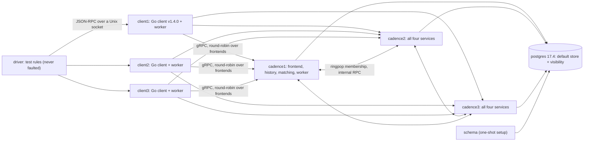

# Cadence v1.4.5 under Antithesis: ten findings, led by acknowledged signals lost, duplicated or reordered around reset and continue-as-new

**Prepared for:** Uber · **Tested:** 2026-11-18 to 2026-11-19 · **System:** Cadence v1.4.5 ([`ecd2b70c`][c-v145])
**Document version:** third edition, written on 2026-11-19 after the deadline. It replaces the second
edition, adding the results of its two confirmation runs: the
[decision-heartbeat stall](#retried-decision-heartbeat-stalls-workflow) is confirmed in four more
workflows, and the complete-patch-set fix check turned out not to test the reset patches, because one
of our own patches broke every reset ([Fix checks](#fix-checks)). A fix check with the corrected
patches was still running when it was written; its results are not in it ([Runs](#runs)).
Every failing property from the long runs has been triaged, except one about our own test client
containers.

## Summary

We ran the Cadence v1.4.5 release, built from source, as a three-node cluster on Postgres, driven by
the official Go client, while Antithesis crashed, paused and partitioned its nodes and the database
(fault injection). The two long runs used about 600 compute hours each. Antithesis found ten
problems, each confirmed by a root-cause analysis and an adversarial review. Eight are in the Cadence
server:
[a retried reset is applied a second time and discards the signals the first reset run held](#retried-reset-applied-twice),
[a signal acknowledged while a decision is in flight is lost when the workflow is reset at that moment](#acked-signal-lost-on-reset),
[signals buffered during a decision are written to history out of order after a reload from Postgres](#buffered-signals-reordered-on-reload),
[a signal retried by the client across a continue-as-new is applied twice](#retried-signal-duplicated-after-continue-as-new),
[a completed workflow is read back as running from a host that lost its shard](#stale-history-after-shard-steal),
[a signal retried by the client during a reset is applied twice](#retried-signal-duplicated-after-reset),
[stopping a server while it is still starting crashes it](#sigterm-during-startup-panics), and
[a server crashes at startup when closing its schema-check database connection fails](#sql-admin-conn-close-panic).
Two are in the Go client library:
[a parent that cancels its children can stay stuck until its execution timeout](#child-cancel-ack-after-close), and
[a workflow with a long local activity can stall for up to 30 minutes after a single failed decision response](#retried-decision-heartbeat-stalls-workflow).
Five of them break [Guarantee 2](#guarantee-2) (acknowledged signals are delivered exactly once).
Visibility converged in every run ([Guarantee 6](#guarantee-6)), no Cadence failure was found
against [Guarantee 1](#guarantee-1) (one open run per workflow ID), and a known, already-fixed Cadence
bug was re-found on the version from before its fix, which shows the tests can catch this class of
problem. The other failures in the long runs came from these findings, from our own test code or
from the test environment; one more problem, seen once in a master run and not on v1.4.5, is
[unconfirmed](#lost-activity-task-after-shard-move)
([What the long runs showed](#what-the-long-runs-showed)). A confirmation run with Cadence's default
decision-heartbeat timeout found the Go-client stall in four more workflows, two of them still stuck
when the run ended. A run with three of the proposed patches
confirmed the fix for the shutdown crash at the places it guards, found none of the lost signal's
mechanism in a sample of its remaining failures (weaker evidence than a clean run), and partly
confirmed the signal-deduplication patch. The next fix check, with the complete patch set, did not
test the reset patches: one of our own patches made every reset fail, and the run caught that
mistake. It also found three more places where the shutdown crash happens. A corrected patch set
is still running.

## What we tested

- **Uber's system:** Cadence is Uber's open-source workflow orchestration engine. Services write
  workflows as ordinary code; Cadence records every step in a durable event history and replays it
  on workers, so a workflow survives worker and server failures. It runs order, trip and payment
  flows, where a lost or duplicated event changes a business outcome
  ([system brief](../antithesis/scratchbook/system-brief.md)).
- **Under test:** Cadence v1.4.5 ([`ecd2b70c`][c-v145]) itself, not a stand-in: unmodified upstream
  source with Antithesis coverage instrumentation added at build time, and the official Go client
  `go.uber.org/cadence` v1.4.0.
- **How long:** 19 finished or cancelled test runs, about 2,717 compute hours in total: on this
  version, on patched builds of it, and on the commit before the known bug's upstream fix (16 used
  compute; 3 were cancelled before they started): 17 from 2026-11-18 19:13 UTC to 2026-11-19
  09:23 UTC, and two confirmation runs on 2026-11-19 after the deadline (16:01 to 20:12 UTC). One
  more fix check, started at 20:57 UTC, was still running when this edition was written. The two
  main runs (long hunts) used 601 compute hours each, about 12.5 hours of wall-clock time: [`f04f3907`][run-f04f3907] (the main
  configuration) and [`bba4d2f0`][run-bba4d2f0] (a variant with more shards and default caching).
  The [Runs](#runs) appendix lists every run.

## Guarantees

The promises Cadence makes to the services that run workflows on it, in plain terms
([guarantees](../antithesis/scratchbook/guarantees.md)).

| Guarantee | Statement | Source | Result on v1.4.5 |
|---|---|---|---|
| [Guarantee 1](#guarantee-1) | At most one run per workflow ID is open at a time; a second start of an open ID is rejected | [Workflows doc][doc-wf], [IDL][idl] | No Cadence failure found: both checks failed, but every failure examined traced to our own test code; the corrected checks have not been rerun ([details](#what-the-long-runs-showed)) |
| [Guarantee 2](#guarantee-2) | An acknowledged signal appears in the workflow exactly once, even when the client retries | [Go client signals doc][doc-sig], [IDL][idl] | Broken: [retried reset applied twice](#retried-reset-applied-twice), [signal lost on reset](#acked-signal-lost-on-reset), [signals reordered](#buffered-signals-reordered-on-reload), [signal duplicated across continue-as-new](#retried-signal-duplicated-after-continue-as-new), [retried signal applied twice after a reset](#retried-signal-duplicated-after-reset) |
| [Guarantee 3](#guarantee-3) | A workflow's history is well formed and append-only; a later read never shows less than an earlier one | [Timers doc][doc-timers], [PR #8595][pr8595] | Broken: [completed workflow read back as running](#stale-history-after-shard-steal) |
| [Guarantee 4](#guarantee-4) | Every started workflow eventually closes with the result its code determines | [Workflows doc][doc-wf] | Broken in the Go client: [parent stuck after cancelling its children](#child-cancel-ack-after-close), [workflow stalls after a retried decision heartbeat](#retried-decision-heartbeat-stalls-workflow); in the server, the [stale read](#stale-history-after-shard-steal) shows a closed workflow as running |
| [Guarantee 5](#guarantee-5) | Once failures stop, a fresh workflow completes within 120 s and started workflows make progress again | [Workflows doc][doc-wf] (window inferred) | Partly held: the fresh-workflow check passed in both long runs; workflows that did not recover are explained by a Go client finding and our own test code. One more [unconfirmed problem](#lost-activity-task-after-shard-move) was seen in a master run only |
| [Guarantee 6](#guarantee-6) | After failures stop, visibility lists every closed run as closed | [Visibility interface][vis] | Held in every run on v1.4.5 |

### Guarantee 1: single open run per workflow ID

For a domain and workflow ID, at most one run is open at any time. A start for an ID with an open
run is rejected with `WorkflowExecutionAlreadyStarted` unless the reuse policy says otherwise
(workflow ID uniqueness). The tests start the ID of an open workflow again and start new runs on
closed IDs under each reuse policy ([test commands](#test-commands)). Both checks failed in the long
runs. Every failure examined was a race in our own test driver around reused workflow IDs, not a
Cadence problem ([What the long runs showed](#what-the-long-runs-showed)).

### Guarantee 2: acknowledged signals exactly once

A signal acknowledged to the client appears in the target workflow exactly once, even when the
client retries with the same request ID after a timeout, and is never lost when the workflow
continues (exactly-once signal delivery, request-ID deduplication). Each signal carries a unique
ID; workflows return the list of signals they applied, and the tests compare it with what was
acknowledged ([test commands](#test-commands)). The tests also check that signals sent one after
another are applied in that order; Cadence keeps arrival order on its normal path, but its
documentation does not state it as a guarantee.

### Guarantee 3: history is well formed

Event IDs run 1..N without gaps, the history starts with `WorkflowExecutionStarted`, each timer,
activity and child resolves at most once, a closed run ends in exactly one close event, and a later
read returns the earlier read as a prefix (history consistency). The tests read the full history of
every closed run they know of ([test commands](#test-commands)).

### Guarantee 4: started workflows complete correctly

Every workflow whose start was acknowledged eventually closes with the result its code determines
from its inputs, signals and activity results; timers never fire early; a closed run stays closed
(fault-oblivious execution). All test workflows are deterministic, so the tests compute every
expected result ([test commands](#test-commands)).

### Guarantee 5: recovers after faults

Once failures stop, a fresh workflow completes within 120 seconds and every started workflow makes
progress again (availability after recovery). Cadence documents no recovery time, so the window is
our choice. Checked once per test run, after faults stop ([test commands](#test-commands)).

### Guarantee 6: visibility converges

With database visibility, list and describe calls converge to the history's truth after failures
stop: a closed run is listed closed (eventual consistency of visibility). Checked once per test
run, after faults stop ([test commands](#test-commands)).

## How we tested

### Environment

*Three Cadence nodes, each running all four services, share 8 history shards (16 in the variant)
through ringpop membership and one Postgres database. Three client containers each run the
official Go client and a worker, and serve the test driver over a Unix socket. Antithesis injects
faults into every container except the driver.*

- **Software under test:**
  - **Cadence server** v1.4.5: [`ecd2b70c`][c-v145] ([cadence-workflow/cadence][repo]), built from
    source with Antithesis coverage instrumentation
    ([Dockerfile](../antithesis/server/Dockerfile)), Go 1.26 toolchain.
  - **Cadence Go client** `go.uber.org/cadence` v1.4.0 ([`b15b1e2d`][c-goclient],
    [cadence-workflow/cadence-go-client][repo-go]), used as released.
  - Every build that ran is listed in [Builds](#builds).
- **Faults:** the Antithesis high-availability fault set on every container except the driver,
  Postgres included: container kills, stops and pauses, network partitions and slow networks, CPU
  throttling, and clock jitter. A small supervisor restarts a Cadence server that exits, as
  Kubernetes would ([entrypoint.sh](../antithesis/server/entrypoint.sh)).
- **Workload:**
  - Five workflow types: counters that take signals and queries and continue as new, activity
    chains with retries and local activities, timers, parents with children, and "race" workflows
    whose timers race long local activities (forcing decision heartbeats).
  - Random starts, signals, signal-with-start, queries, cancels, terminates, resets to a random
    earlier decision, duplicate starts of open IDs, and reuse of closed IDs.
  - Every reply is checked against a model of what was sent and acknowledged; requests whose
    outcome is unknown (a timeout) are allowed to apply at most once.
  - Each test run ends by stopping faults and checking recovery, completion of every workflow, and
    visibility.

**How the tested setup differs from a default install**
([dynamicconfig.yaml](../antithesis/config-template/dynamicconfig.yaml); defaults from
[`constants.go`][defaults] at v1.4.5):

| Setting | Test value | Variant (`-b`) | Production default | Why |
|---|---|---|---|---|
| `numHistoryShards` | 8 | 16 | set per cluster | small cluster; the variant checks results don't depend on it |
| `history.cacheMaxSize` | 20 | 512 | 512 | workflow state is reloaded from the database often |
| `history.cacheTTL` | 30s | 1h | 1h | same |
| `matching.numTasklist{Write,Read}Partitions` | 3 | 1 | 1 | exercises task-list partition forwarding |
| `matching.idleTasklistCheckInterval` | 20s | 20s | 5m | more task-list ownership churn |
| `matching.updateAckInterval` | 5s | 5s | 1m | more frequent persistence |
| `history.shardUpdateMinInterval` | 1s | 1s | 5m | more frequent shard writes |
| `history.{timer,transfer}ProcessorUpdateAckInterval` | 5s | 5s | 30s | more frequent queue persistence |
| `frontend/history.shutdownDrainDuration` | 0s | 0s | 0s | stated explicitly: stops behave like crashes |
| `history.decisionHeartbeatTimeout` | 1m | 1m | 30m | added after the [decision-heartbeat finding](#retried-decision-heartbeat-stalls-workflow), which was found with the default, so one stalled workflow cannot hide others; the confirmation run `37b22144` uses the default again |
| `system.minRetentionDays` | 0 | 0 | 1 | test convenience |
| Postgres `idle_in_transaction_session_timeout`, TCP keepalives | 30s; 10/5/3 s | same | off | production-like: without them, a killed Cadence process left database locks held on shard rows for hours ([analysis](../antithesis/scratchbook/rca/shard-unavailable-after-faults.md)) |

### Test commands

The workload is one driver program with 12 rules that Antithesis runs at random, up to six at a
time, while it injects faults; one of them, run rarely, stops faults and runs the after-faults
checks. A supervisor in each Cadence container adds one more check: a server process must never
panic. **How each rule works, every check it makes, and where in the code:
[How the tests work](speedrun-tests.md).**

| Guarantee | What the rules do | Rules |
|---|---|---|
| [Guarantee 1](#guarantee-1) | Start the ID of an open workflow again (must be rejected), and start new runs on closed IDs under each reuse policy (must follow the policy) | [`RuleDuplicateStart`](speedrun-tests.md#rules), [`RuleReuseClosed`](speedrun-tests.md#rules), [`RuleStart`](speedrun-tests.md#rules) |
| [Guarantee 2](#guarantee-2) | Send signals with unique IDs, reset workflows, and query them; every acknowledged signal must appear exactly once, in acknowledgement order, in the workflow's result and history, and no signal that was never sent may appear | [`RuleSignal`](speedrun-tests.md#rules), [`RuleReset`](speedrun-tests.md#rules), [`RuleQuery`](speedrun-tests.md#rules), [`RuleResult`](speedrun-tests.md#rules) |
| [Guarantee 3](#guarantee-3) | Read the full history of each closed run: contiguous IDs, one start and one close event, each timer, activity and child resolved at most once | [`RuleResult`](speedrun-tests.md#rules), [`RuleReset`](speedrun-tests.md#rules) |
| [Guarantee 4](#guarantee-4) | Finish, cancel and terminate workflows and read their results; each must close with the computed result and the requested status, timers must not fire early, and a closed run must stay closed | [`RuleFinish`](speedrun-tests.md#rules), [`RuleCancel`](speedrun-tests.md#rules), [`RuleTerminate`](speedrun-tests.md#rules), [`RuleResult`](speedrun-tests.md#rules), [`RuleDescribeClosed`](speedrun-tests.md#rules) |
| [Guarantee 5](#guarantee-5) | After faults stop: every client is served again, a fresh workflow completes within 2 minutes, every started workflow closes | [`RuleEventually`](speedrun-tests.md#eventually-phase) |
| [Guarantee 6](#guarantee-6) | After faults stop: every closed run is listed as closed within 2 minutes | [`RuleEventually`](speedrun-tests.md#eventually-phase) |

Before any rule runs, [setup](speedrun-tests.md#how-a-test-run-goes) waits for all clients,
registers the domain, starts the workers and runs one workflow end to end.

## Known-bug check

To show the tests can catch a real bug of this kind (a positive control), we ran them on the version
from just before a known, already-fixed Cadence bug was fixed: a timer recorded as both canceled
and fired after decision heartbeating ([PR #8595][pr8595]), which breaks
[Guarantee 3](#guarantee-3). The build was [`c889f831`][c-prefix], the parent of fix
[`976d08c2`][c-fix] ([details](../antithesis/scratchbook/positive-control.md)).

**Reproduced.** In [`ccd99ed4`][run-ccd99ed4], a 150-compute-hour run with the same tests used for
the long runs, "a workflow history is well formed" failed in 201 examples, and every one in a sample
of 50 had the bug's signature: "timer N resolved twice: TimerCanceled then TimerFired". One failing
example: input_hash `-5653455983605853828`, vtime `62.99922230280936`, about a minute into its
timeline. An earlier run, `0dc3db5a` (cancelled; it has no report), found the same signature about
19 times with an older version of the tests. The same check passed in both long runs on v1.4.5,
which contains the fix. On the way, we found and fixed a gap in our own checker (it did not record
which timer a `TimerCanceled` event referred to) before these runs.

## Findings

Each finding below was confirmed by a root-cause analysis and then challenged by an adversarial
review that looked for a harness, configuration or fault-model explanation; none held up. They are
ordered by the severity the review assigned. Counts are failing examples in the two long runs,
[`f04f3907`][run-f04f3907] and [`bba4d2f0`][run-bba4d2f0], and in the fix-check run
[`1a0d055c`][run-1a0d055c] (v1.4.5 plus three patches, see [Fix checks](#fix-checks)). A property
collects every failure of its kind, so where a property mixes causes, the entry says so; for the
four findings added in this edition, counts are those of the finding's own signature, separated
from other causes during triage. One failure is often repeated on many later branches of the same
timeline, so counts measure how much a run explored around a failure, not how many separate times
it happened. Run reports carry an access token; the moment values (input_hash, vtime) locate one
failing example in the run's logs.

| Finding | Where | Severity | Guarantee |
|---|---|---|---|
| [Retried reset applied twice](#retried-reset-applied-twice) | server | medium-high | [Guarantee 2](#guarantee-2) |
| [Signal lost on reset](#acked-signal-lost-on-reset) | server | medium | [Guarantee 2](#guarantee-2) |
| [Signals reordered after a reload](#buffered-signals-reordered-on-reload) | server (Postgres store) | medium | [Guarantee 2](#guarantee-2) |
| [Signal duplicated across continue-as-new](#retried-signal-duplicated-after-continue-as-new) | server | medium | [Guarantee 2](#guarantee-2) |
| [Stale history read](#stale-history-after-shard-steal) | server | medium | [Guarantee 3](#guarantee-3), [Guarantee 4](#guarantee-4) |
| [Parent stuck after cancelling its children](#child-cancel-ack-after-close) | Go client | medium (liveness only) | [Guarantee 4](#guarantee-4), [Guarantee 5](#guarantee-5) |
| [Retried signal applied twice after a reset](#retried-signal-duplicated-after-reset) | server | low-medium | [Guarantee 2](#guarantee-2) |
| [Decision-heartbeat stall](#retried-decision-heartbeat-stalls-workflow) | Go client | medium-low | [Guarantee 4](#guarantee-4), [Guarantee 5](#guarantee-5) |
| [Shutdown during startup panics](#sigterm-during-startup-panics) | server | low | crash safety |
| [Schema-check connection close panics](#sql-admin-conn-close-panic) | server | low | crash safety |

### A reset retried by the client is applied a second time, discarding the first reset run and the acknowledged signals it held

**Full analysis:** [root cause](../antithesis/scratchbook/rca/fixverify-reset-dup.md), [second case, on unpatched v1.4.5](../antithesis/scratchbook/rca/retried-reset-applied-twice-2nd.md) · **Proposed fix:** [retried-signal-duplicated-after-reset.v2.patch](../antithesis/fixes/retried-signal-duplicated-after-reset.v2.patch) plus [reset-dedup-across-can.diff](../antithesis/fixes/reset-dedup-across-can.diff) · [adversarial review](../antithesis/scratchbook/adversarial/retried-reset-applied-twice.md)

- **Where:** Cadence server (history service, reset). **Severity:** medium-high.
- **What broke:** one `ResetWorkflowExecution` call, retried internally by the Go client after a lost
  reply, was committed twice. The second reset threw away the first reset's new run, and with it
  the signals that had been acknowledged to clients on that run.
- **Guarantee:** [Guarantee 2](#guarantee-2), "an acknowledged signal appears exactly once".
- **Impact:** reset is not idempotent under client retry. A timeout on a reset that committed, which
  is common for operator and batch-reset tooling under load, silently discards the first reset run
  and every signal acknowledged to it. This happens with default configuration; the only other
  duplicate check (strong idempotency) is off by default and not available on SQL stores.
- **How it happened** (`counter-182`, the first case):
  1. The driver reset `counter-182` once. The server committed the reset (run `939f…`), but network
     partitions and Postgres timeouts kept the reply from the client.
  2. Clients sent signals s609, s617, s620 and s621 to the new run. s617, s620 and s621 were
     acknowledged; the reply to s609 was lost, so its client kept retrying it.
  3. The Go client retried the reset with the same request ID. The server's duplicate check did not
     recognise it and reset the same base run again (run `1129…`).
  4. The second reset reapplied only the base run's signals, so s617, s620 and s621 were lost; a
     later client retry of s609 then applied it twice across a continue-as-new.
- **Seen in:** first in the fix-check run [`41bf0672`][run-41bf0672] (v1.4.5 plus an unrelated signal
  patch that does not touch this path), input_hash `4272893864207768579`, vtime
  `474.5656898911111`. Since then confirmed from the workflow histories on unpatched v1.4.5: in
  [`bba4d2f0`][run-bba4d2f0] (counter-115, input_hash `-1266433295011687029`, vtime
  `622.3960968970787`: two reset runs with the same reset request ID, the second discarding signal
  act-s286) and in [`f04f3907`][run-f04f3907] (counter-6, input_hash `3558643188807945681`, vtime
  `98.726`: signal s5 lost). It has no property of its own: its failures are counted under "an
  acknowledged signal survives a reset of its workflow", together with the
  [signal lost on reset](#acked-signal-lost-on-reset). In the fix-check run
  [`1a0d055c`][run-1a0d055c], which did not patch it, it accounts for all 362 sampled examples of
  that property's 373 (6 incidents). A log search found dozens of candidate cases in each long run;
  only the ones above were checked by hand.
- **Root cause:** the reset handler deduplicates by comparing the current run's `CreateRequestID`
  with the reset's request ID ([reset_workflow_execution.go:124-133][src-reset-dedup]). When the
  reset run's state is rebuilt from history, that field is overwritten with the original start
  event's request ID ([mutable_state_builder_methods_started.go:192-198][src-started-reqid]), so the
  check can never match. The overwrite came in with [`baac6218`][c-5821] (#5821, April 2024): this is
  a regression.
- **Proposed fix:** after the rebuild, set the reset run's `CreateRequestID` to the reset request ID,
  restoring the earlier behaviour (in the second version of the signal-dedup patch; it passes the
  reset package's unit tests). One fix-check incident showed a further case: the first reset run had
  already continued as new when the retry arrived. A small addition walks back up to 10
  continue-as-new links to find the reset run; its new unit test fails without it and passes with it
  ([how it was checked](../antithesis/scratchbook/rca/fixverify-residuals.md#patch-verdicts)). A
  retry that arrives after the reset run was itself reset again is still not covered.
- **Fix check:** not yet run end to end. Both changes were in fix check 5, but no reset succeeded
  there because of a mistake in another of our patches, so they were not exercised; they are in the
  corrected fix check still running ([Fix checks](#fix-checks)).
- **Already known upstream?** Not reported upstream. Master ([`572e7e2c`][c-master]) has the same
  code.

### A signal acknowledged while a decision is in flight is lost when the workflow is reset at that moment

**Full analysis:** [root cause](../antithesis/scratchbook/rca/signal-lost-at-reset-master.md), [case on v1.4.5](../antithesis/scratchbook/rca/acked-signal-lost-on-reset-v145.md), [fix notes](../antithesis/scratchbook/rca/acked-signal-lost-on-reset-fix.md) · **Proposed fix:** [acked-signal-lost-on-reset.patch](../antithesis/fixes/acked-signal-lost-on-reset.patch) · [adversarial review](../antithesis/scratchbook/adversarial/acked-signal-lost-on-reset.md)

- **Where:** Cadence server (history service, reset). **Severity:** medium.
- **What broke:** a signal accepted and acknowledged while a decision was in flight was written into
  the run being reset and never reached the new run, so no run of the workflow ever applied it.
- **Guarantee:** [Guarantee 2](#guarantee-2), "an acknowledged signal is never lost".
- **Impact:** an acknowledged event (a payment callback, say) is silently dropped from the
  workflow's logical execution. It needs no faults and no special configuration, only a reset
  (manual, batch or automatic) racing live signal traffic.
- **How it happened:**
  1. A decision task for the workflow is in flight on a worker.
  2. A signal arrives. Because a decision is in flight, Cadence holds it as a buffered event and
     acknowledges it to the client.
  3. A reset of the current run starts. It notes the run's last persisted event, which does not
     include the buffered signal.
  4. Terminating the old run fails the in-flight decision, which flushes the buffered signal into the
     old run's history.
  5. The reset reapplies only the signals it read from persisted history, so the new run never gets
     the signal.
- **Seen in:** the property "an acknowledged signal survives a reset of its workflow" failed in 666
  examples in [`f04f3907`][run-f04f3907] and 787 in [`bba4d2f0`][run-bba4d2f0]. **These counts mix
  two findings:** this one and the [retried reset applied twice](#retried-reset-applied-twice), which
  also loses acknowledged signals around a reset. A timing check of six more v1.4.5 examples points
  to this finding for most of them, but the split was not measured. The case analysed step by step
  on v1.4.5 is counter-35 in [`f04f3907`][run-f04f3907] (input_hash `-924893256983270391`, vtime
  `165.343`): signal s134 was buffered just after a decision started, acknowledged, flushed into the
  terminated base run by the reset, and never reapplied, with no faults on the path. The first case
  was on master (`75b0745b`, an iteration run that was cancelled and has no report; input_hash
  `-318482339591177353`, vtime `34.675`). Master and v1.4.5 have identical code on this path.
- **Root cause:** the reset reads the next event ID before terminating the current run
  ([reset_workflow_execution.go:143][src-reset-base], [resetter.go:130-131][src-resetter-130]).
  Terminating it ([resetter.go:138-147][src-resetter-138]) fails the in-flight decision, and
  `FailDecision` flushes buffered events ([mutable_state_util.go:106][src-flush]) with IDs above that
  bound. The reapply step then pages persisted history only up to the bound
  ([resetter.go:487-525][src-reapply]), so the flushed signals are never reapplied.
- **Proposed fix:** after terminating the current run, collect the events its termination flushed
  and reapply their signals to the new run, keeping the original request IDs for deduplication. A
  new unit test fails without it and passes with it, a second new test checks that flushed events
  are ignored when the run chain does not reach the current run, and the Cadence reset, execution
  and engine package tests pass ([how it was checked](../antithesis/scratchbook/rca/acked-signal-lost-on-reset-fix.md#results)).
- **Fix check:** verified for its own mechanism. In [`1a0d055c`][run-1a0d055c] the property still
  failed 373 times, but none of the 362 sampled failures was a buffered signal flushed by a reset:
  all were the [retried reset](#retried-reset-applied-twice), which that build did not patch. The
  absence of a mechanism in a sample is weaker evidence than a positive result. Fix check 5 could not
  test it, since no reset succeeded there ([Fix checks](#fix-checks)); it is in the corrected fix
  check still running.
- **Already known upstream?** Not reported upstream. Master ([`572e7e2c`][c-master]) has the same
  code.

### Signals that arrive while a decision is in flight are written to history out of arrival order after the workflow's state is reloaded from Postgres

**Full analysis:** [root cause](../antithesis/scratchbook/rca/hunt-signal-order.md) · **Proposed fix:** a one-line `ORDER BY id`, given in the [root cause](../antithesis/scratchbook/rca/hunt-signal-order.md) (no patch file) · [adversarial review](../antithesis/scratchbook/adversarial/buffered-signals-reordered-on-reload.md)

- **Where:** Cadence server (history service, SQL persistence; in practice Postgres only).
  **Severity:** medium.
- **What broke:** signals that were acknowledged one after another were recorded in the workflow's
  history in a different order, so the workflow received them out of order.
- **Guarantee:** [Guarantee 2](#guarantee-2), as the tests check it: "signals are applied in the
  order they were acknowledged". Cadence keeps arrival order on its normal path and its own code
  treats reordering as a defect, but its documentation does not state signal order as a guarantee.
- **Impact:** workflow logic that depends on signal order (state machines, last-writer-wins updates,
  "finish" after data) can compute a wrong result with no error, because replay agrees with the
  reordered history. It needs no faults: an ordinary failed decision, shard move, decision timeout or
  cache eviction is enough. MySQL in practice returns the rows in order, and Cassandra stores the
  buffer as an ordered list.
- **How it happened** (counter-70 in [`bba4d2f0`][run-bba4d2f0]):
  1. A decision task was in flight, so signals s617 … s622 and then s623 were buffered, one database
     row each, and acknowledged.
  2. The decision failed, which makes Cadence reload the workflow's state from Postgres.
  3. The reload read the buffered rows with no ordering. Postgres returned them in physical order,
     and s623, the newest, sat in a slot freed by an earlier flush, so it came first.
  4. The flush wrote them to history in that order: s623 before s617.
- **Seen in:** 169 failing examples in [`f04f3907`][run-f04f3907] (12 workflows; one: counter-104,
  input_hash `-6321992211471165745`, vtime `469.37`) and 175 in [`bba4d2f0`][run-bba4d2f0] (5
  workflows; the case above: input_hash `9004181159347822236`, vtime `412.9155`), and 67 in the
  fix-check run [`1a0d055c`][run-1a0d055c], whose patches do not touch this path. Every history
  inspected showed the inversion inside one block of signals flushed together, and two cases were
  checked directly in Postgres before the flush.
- **Root cause:** the Postgres query that reads buffered events has no `ORDER BY`
  ([execution.go:151][src-pg-buffered], read by [workflow_state_non_maps.go:149-171][src-buffered-read]),
  and the flush writes them in the order read ([mutable_state_builder.go:466-505][src-flush-buffered]).
  The rows are deleted on every flush, so new rows reuse freed slots and a table scan returns them
  out of insertion order. A comment in the same file ([mutable_state_builder.go:2440][src-reorder-comment])
  notes that buffered events come back out of order from the database; the code there corrects the
  order only for activity events.
- **Proposed fix:** add `ORDER BY id` to the buffered-events query for Postgres (and MySQL, for
  safety). Not yet run end to end.
- **Already known upstream?** Not reported upstream. Master ([`572e7e2c`][c-master]) has the same
  query.

### A signal retried by the client across a continue-as-new is applied twice

**Full analysis:** [root cause](../antithesis/scratchbook/rca/hunt-signal-once-nonreset.md) · **Proposed fix:** [signal-dedup-across-can.diff](../antithesis/fixes/signal-dedup-across-can.diff) (a semantics change; see below) · [adversarial review](../antithesis/scratchbook/adversarial/retried-signal-duplicated-after-continue-as-new.md)

- **Where:** Cadence server (history service, signal deduplication). **Severity:** medium.
- **What broke:** one acknowledged `SignalWorkflowExecution` call was recorded twice: once in a run,
  and once more, with the same request ID, in the run that continued it as new. No reset was
  involved.
- **Guarantee:** [Guarantee 2](#guarantee-2), "exactly once, even when the client retries with the same
  request ID".
- **Impact:** a non-idempotent handler (a counter, a payment, a state transition) applies one signal
  twice, with no error to anyone. The request ID is generated inside the Go client, so callers cannot
  work around it. Workflows that continue as new often and receive many signals (entity-style
  workflows) are the most exposed. **The rates in our runs overstate production frequency:** our test
  workflows continue as new every 3 or every 10 signals (a third of them never do), far more often
  than a typical production workflow.
- **How it happened** (counter-4 on master, analysed from the histories):
  1. Signal s19 was recorded in run `5f641059` with request ID `8d9f77ff…`, but the reply was lost to a
     frontend timeout, so the Go client retried.
  2. The workflow continued as new into run `e4b257b1`, carrying s19 in its state.
  3. The retry, with an empty run ID, went to the current run, `e4b257b1`. Its deduplication set was
     empty, so s19 was recorded again with the same request ID.
- **Seen in:** 41 failing examples in [`f04f3907`][run-f04f3907] (one: counter-69, input_hash
  `3651770994228528517`, vtime `283.1587579736952`) and 79 in [`bba4d2f0`][run-bba4d2f0] (one:
  counter-24, input_hash `7717577421291024984`, vtime `442.5627213662956`), and 22 in the fix-check
  run [`1a0d055c`][run-1a0d055c]. Every one involves two or more runs linked by continue-as-new and
  no reset. They are counted under "an acknowledged signal is applied exactly once", which also
  collects failures from our own test code ([What the long runs showed](#what-the-long-runs-showed)).
  The same mechanism was also the main cause of the remaining duplicates in the fix-check run (94 of
  131 sampled examples), counted under the reset property because the driver had also reset those
  workflows; only one of its five incidents went through a reset. The case analysed step by step was on master
  ([`3e9720ca`][run-3e9720ca], input_hash `5552845235527353960`, vtime `24.357`).
- **Root cause:** signal deduplication checks and records request IDs per run
  ([signal_workflow_execution.go:66-75][src-signal-dedup], [:113][src-signal-dedup-add]).
  `AddContinueAsNewEvent` ([mutable_state_builder.go:1223][src-can]) builds the successor with a fresh
  state ([:1287][src-can-new]) and copies none of them. The code's own comment at the dedup check says
  retries should be deduplicated even after the run has closed; continue-as-new defeats that.
- **Proposed fix:** copy the predecessor's signal request IDs into the successor on continue-as-new.
  This changes Cadence's semantics and needs a bound (for example, only IDs within the client's retry
  window), and the replication path needs the same change. Existing tests pass with the diff; it has
  no dedicated test. It was not in fix check 5, where every duplicate examined was this finding; it
  is in the corrected fix check still running ([Fix checks](#fix-checks)). Documenting the
  limitation is the alternative.
- **Already known upstream?** Not reported upstream. Master ([`572e7e2c`][c-master]) has the same
  code.

### A completed workflow is read back as running with a shorter history from a host that lost its shard

**Full analysis:** [root cause on v1.4.5](../antithesis/scratchbook/rca/stale-history-v145.md), [earlier case on the pre-fix build](../antithesis/scratchbook/rca/history-missing-close-event.md), [the same bug seen through describe](../antithesis/scratchbook/rca/hunt-closed-keeps-outcome.md) · **Proposed fix:** none written yet · [adversarial review](../antithesis/scratchbook/adversarial/stale-history-after-shard-steal.md)

- **Where:** Cadence server (history service, shard ownership). **Severity:** medium.
- **What broke:** right after a client was told a workflow had completed, a history read of the same
  run returned the workflow as running, with 5 of its 11 events and no close event. Describe calls
  showed the same stale state.
- **Guarantee:** [Guarantee 3](#guarantee-3), "a later read returns the earlier read as a prefix",
  and [Guarantee 4](#guarantee-4), "a closed run stays closed".
- **Impact:** after a node restarts, rejoins or resumes from a pause, frontends can route reads to a
  history host that has silently lost a shard. That host reports already-completed workflows as
  running, with a truncated history. Callers that poll describe or history to decide what to do next
  can act on stale state. The window is usually seconds, but it lasts as long as the stale host has
  nothing to write to that shard: in [`bba4d2f0`][run-bba4d2f0] a host paused for 47 seconds served
  a completed workflow as running for at least 140 seconds after it resumed. No data is lost: the
  database is correct, and the stale host heals when its next write to the shard fails.
- **How it happened:**
  1. A node restarted and rejoined the cluster after faults had stopped.
  2. While membership converged, the rejoining host took shard 3 and cached a running workflow.
  3. Another host, whose view did not yet include the rejoining host, took the shard back and
     completed the workflow.
  4. The rejoining host made no write to the shard, so it never learned it had lost it, and kept
     serving reads from its cache.
  5. A result read went to the current owner (completed); the history read 0.6 ms later went to the
     stale host (running, 5 events).
- **Seen in:** "a history read after a workflow closed includes its close event" failed in 68
  examples in [`f04f3907`][run-f04f3907] (one: input_hash `2114059415789563007`, vtime
  `64.21569897816516`) and 88 in [`bba4d2f0`][run-bba4d2f0] (one: input_hash `-89621319360768082`,
  vtime `47.44355515087955`), and 54 in [`1a0d055c`][run-1a0d055c]; these counts were not triaged
  one by one, but 17 of the 30 workflows that failed the describe check below also failed this one
  with the stale-read signature. "A closed workflow keeps its outcome" (describe) failed 44, 82 and
  31 times in the same three runs, all with this cause. The
  case analysed step by step was in [`41bf0672`][run-41bf0672] (input_hash `-2175461847364005768`,
  vtime about `96.5063`), with no faults injected at the time; the long-window case is parent-4 in
  [`bba4d2f0`][run-bba4d2f0] (input_hash `-6618152698056279952`, vtime `258.8111`).
- **Root cause:** the history read takes its upper bound and running state from `PollMutableState`
  ([poll_mutable_state.go:75-87][src-poll]), which is answered from the host's cached state with no
  check of the shard's current owner ([context.go:359][src-context]). A host returns any shard it
  already holds without consulting membership ([controller.go:301-307][src-controller]), and the
  periodic acquire pass only adds shards, never drops them. Only a failed write fences a host that
  lost a shard; reads are never fenced.
- **Proposed fix:** no patch was written; this is a design change. The direction from the analysis:
  check shard ownership on reads (re-check membership or the shard's range ID when a cached shard
  or workflow is used), or release shards in the acquire pass that the ring no longer assigns to
  this host ([fix direction](../antithesis/scratchbook/adversarial/stale-history-after-shard-steal.md#severity-to-state-to-uber-engineers)).
- **Already known upstream?** Not reported upstream. Master ([`572e7e2c`][c-master]) has identical
  code on this path. Cadence does not document monotonic reads across shard movement, which is why
  the review rates it medium, not high.

### A parent workflow that cancels its children gets stuck when a child closes as canceled before the parent's cancel acknowledgement is recorded

**Full analysis:** [root cause](../antithesis/scratchbook/rca/hunt-liveness.md#c2-new-real-go-client-child-cancel-ack-after-close) · **Proposed fix:** none written (the fix belongs in the Go client) · [adversarial review](../antithesis/scratchbook/adversarial/child-cancel-ack-after-close.md)

- **Where:** the Go client library `go.uber.org/cadence` v1.4.0. The server's event order is
  legitimate. **Severity:** medium, liveness only.
- **What broke:** a cancelled parent workflow never closed. Every decision task failed with
  "unknown decision … ChildWorkflow … nondeterministic" on all three workers, and the parent stayed
  open until its execution timeout (2 hours in our tests).
- **Guarantee:** [Guarantee 4](#guarantee-4) and [Guarantee 5](#guarantee-5), "every started workflow
  closes".
- **Impact:** any workflow that cancels a started child, including a cancelled parent with started
  children (a common pattern), can wedge permanently when the server's cancel call times out after
  it committed or a history host restarts mid-task. No data is lost; recovery needs a manual reset or
  terminate. With the default non-determinism policy the workflow blocks rather than fails, so
  nothing surfaces it.
- **How it happened** (parent-26 in [`f04f3907`][run-f04f3907]):
  1. The parent was cancelled; the Go client asked the server to cancel each started child.
  2. The server's cancel call to child c0 committed but timed out under faults, so the server retried
     the task later.
  3. Meanwhile c0 closed as canceled and the parent recorded `ChildWorkflowExecutionCanceled`; the Go
     client then deleted its state for that child.
  4. The retry found c0 already canceled with the same request ID, succeeded as a no-op, and recorded
     `ExternalWorkflowExecutionCancelRequested` in the parent, after the child's close event.
  5. The Go client found no state for c0, panicked, and failed every later decision task.
- **Seen in:** "every started workflow closes once faults stop" listed parents stuck this way in 66
  failing examples in [`f04f3907`][run-f04f3907] (parent-26: input_hash `9190701013436246952`, vtime
  `600.93`) and 27 in [`bba4d2f0`][run-bba4d2f0], and 2 in [`1a0d055c`][run-1a0d055c]. The client logs
  "unknown decision DecisionType: ChildWorkflow" in every run, on both server versions.
- **Root cause:** in the client's decision state machine, a `ChildWorkflowExecutionCanceled` event in
  state "cancellation decision sent" moves the child to completed
  ([internal_decision_state_machine.go:415-422][go-dsm-415]), and moving to completed deletes the
  state machine ([:313-323][go-dsm-313]). The later acknowledgement is looked up by child ID
  ([:901-913][go-dsm-901]), which panics when the machine is gone ([:689-695][go-dsm-689]). A
  completion event in the same state keeps the machine and waits for the cancel outcome
  ([:385-394][go-dsm-385]); a canceled event does not. On the server, the retry is the cancel transfer
  task ([transfer_active_task_executor.go:603-633][src-xfer-cancel]), and the no-op success is
  [request_cancel_workflow_execution.go:57-63][src-cancel-noop].
- **Proposed fix:** in the Go client, keep the child's state machine after a canceled event until the
  cancel outcome arrives (as for completion), or ignore an acknowledgement for a child that is
  already closed. A server-side guard, skipping the acknowledgement when the parent no longer has
  that child pending, would also avoid it.
- **Already known upstream?** Not reported upstream. The analysis found the same code on the Go
  client's master branch; the review did not re-check that.

### A signal retried by the client during a reset is applied twice

**Full analysis:** [root cause](../antithesis/scratchbook/rca/reset-duplicates-signal.md), [the query view of the same case](../antithesis/scratchbook/rca/query-shows-duplicate-signal.md) · **Proposed fix:** [retried-signal-duplicated-after-reset.patch](../antithesis/fixes/retried-signal-duplicated-after-reset.patch) (first version), [retried-signal-duplicated-after-reset.v2.patch](../antithesis/fixes/retried-signal-duplicated-after-reset.v2.patch) (also fixes the [retried reset](#retried-reset-applied-twice)) and [reset-copies-base-dedup-set.diff](../antithesis/fixes/reset-copies-base-dedup-set.diff) · [adversarial review](../antithesis/scratchbook/adversarial/retried-signal-duplicated-after-reset.md)

- **Where:** Cadence server (history service, reset and signal deduplication). **Severity:**
  low-medium.
- **What broke:** one `SignalWorkflowExecution` call was recorded twice in the same run: once
  reapplied by a reset, and once more when the Go client's own retry of the same request reached
  the new run.
- **Guarantee:** [Guarantee 2](#guarantee-2), "exactly once, even when the client retries with the same
  request ID"; the duplicate also shows in the history ([Guarantee 3](#guarantee-3)).
- **Impact:** a signal (a payment callback, a counter increment) is applied twice in one run, with no
  error to anyone. The caller cannot prevent it, because the request ID is generated inside the
  client. It needs a reset to commit while a signal call is still retrying, which is likely during
  incident recovery.
- **How it happened:**
  1. A client sent signal s45; Cadence recorded it, but a network fault lost the reply, so the Go
     client kept retrying with the same request ID.
  2. A reset to a point before s45 created a new run and reapplied s45, without its request ID.
  3. The client's retry reached the new run. That run's deduplication set did not contain the
     request ID, so s45 was recorded a second time.
- **Seen in:** 196 failing examples in [`f04f3907`][run-f04f3907] (one: input_hash
  `2992591194688045504`, vtime `378.16502781794406`) and 280 in [`bba4d2f0`][run-bba4d2f0] (one:
  input_hash `-7439342475537478313`, vtime `184.10105724004097`), of the property "a signal is
  applied at most once in a workflow that was reset". That property also catches the
  [continue-as-new duplicate](#retried-signal-duplicated-after-continue-as-new) in a workflow that
  was also reset; in the long runs the split was not measured. The case analysed step by step was in
  the first iteration run, `89a272ed` (cancelled; it has no report), input_hash
  `-5028251366505688799`, vtime `70.4274695077911`.
- **Root cause:** signal deduplication uses a per-run set of request IDs
  ([signal_workflow_execution.go:66-75][src-signal-dedup]). A reset reapplies signals with an empty
  request ID ([resetter.go:636][src-resetter-636]) and never adds the original ID to the new run's
  set, and rebuilding a run from history does not restore it either
  ([mutable_state_builder_methods_signal.go:76-88][src-signal-replicate]).
- **Proposed fix:** when a reset reapplies a signal, or a run is rebuilt from history, add the
  signal's original request ID to the new run's deduplication set. The first version does both; the
  second version also fixes the [retried reset](#retried-reset-applied-twice) and passes the reset
  package's unit tests ([how it was checked](../antithesis/scratchbook/rca/fixverify-reset-dup.md#proposed-fix)).
  The fix check showed one more gap: when a second reset copies a signal that the first reset had
  reapplied, the copy carries no request ID in history, so the ID is lost again. A further change
  copies the base run's deduplication set into the reset run; the reset, execution and engine
  package tests pass with it.
- **Fix check:** partially verified. In [`1a0d055c`][run-1a0d055c] (first version) the property
  failed 168 times. Of 131 sampled examples, 94 were the
  [continue-as-new duplicate](#retried-signal-duplicated-after-continue-as-new), which no patch in
  that build addresses, and 37 were the second-reset gap above; none showed the original mechanism
  ([details](../antithesis/scratchbook/rca/fixverify-residuals.md#patch-verdicts)). The second version
  and the further change were in fix check 5 but not exercised, since no reset succeeded there
  ([Fix checks](#fix-checks)); they are in the corrected fix check still running.
- **Already known upstream?** Not reported upstream. Master ([`572e7e2c`][c-master]) has the same
  code.

### A workflow with a long local activity stops making progress and heartbeats empty decisions until the server times it out

**Full analysis:** [root cause](../antithesis/scratchbook/rca/race-workflow-stuck.md), [search for a second case](../antithesis/scratchbook/rca/heartbeat-stall-2nd.md), [four more cases with the default timeout](../antithesis/scratchbook/rca/heartbeat-stall-hb1.md) · **Proposed fix:** none written (the fix belongs in the Go client) · [adversarial review](../antithesis/scratchbook/adversarial/retried-decision-heartbeat-stalls-workflow.md)

- **Where:** the Go client library `go.uber.org/cadence` v1.4.0, not the server. The server behaved
  as the client asked. **Severity:** medium-low.
- **What broke:** after one failed attempt to report a decision while a long local activity was
  running, the workflow stopped making progress. It sent an empty decision every 3.2 seconds (about
  93 in 5 minutes) and never closed while we watched.
- **Guarantee:** [Guarantee 4](#guarantee-4) and [Guarantee 5](#guarantee-5), "started workflows make
  progress again once failures stop".
- **Impact:** any transient failure of that one call (a database blip, shard movement, a frontend
  timeout) can stall a workflow for up to `history.decisionHeartbeatTimeout`, 30 minutes by default,
  after the system is healthy again. The local activity's result is dropped and it runs again
  afterwards, and the stall adds about 1,700 history events per 30 minutes. No data is lost.
- **How it happened:**
  1. A local activity ran past 80% of the 4-second decision timeout, so the client heartbeated the
     decision and asked the server for the next decision task in the reply.
  2. A Postgres outage made that call fail; the client retried it with the same request object.
  3. The first attempt had already modified the shared request, so every retry asked for no next
     decision task.
  4. A retry succeeded, and with no decision task in the reply, the client treated the heartbeat as
     done, closed the task and dropped the local activity's result when it arrived.
  5. Every later decision found the activity still pending but never restarted it, and heartbeated
     empty decisions until the server's timeout.
- **Seen in:** five workflows in two runs with the default 30-minute timeout. First in iteration run
  `6e868ff1` (cancelled; it has no report), input_hash `5337532354675634409`, vtime
  `401.2113032224588`. Then in four more workflows in the confirmation run
  [`37b22144`][run-37b22144] (v1.4.5 with the default timeout), where the detector of 20 empty
  decision cycles in a row failed in 230 examples (one: input_hash `8357354436728454509`, vtime
  `241.4759`). Each of the four followed the same steps: a decision response failed or timed out at
  the frontend, the client's retry succeeded without a next decision task, and only empty decisions
  followed, every 3.2 seconds. Two stalled for about a minute until a node stop or the test's own
  terminate ended them; the other two were still stuck after 95 and 97 empty cycles (over 5
  minutes) when the run checked that every started workflow had closed. The long runs used a
  1-minute timeout, which cuts this path off (the delayed heartbeat retries found there hit the
  timeout and recovered, as designed), and their detector passed.
- **Root cause:** `handleDecisionTaskCompletedRequest` sets sticky attributes on the shared request
  on its first attempt, so every retry takes the other branch and sends
  `ReturnNewDecisionTask=false` ([internal_task_pollers.go:507-514][go-pollers-507]). The heartbeat
  path treats a reply with no decision task as "done" ([internal_task_pollers.go:372-374][go-pollers-372],
  [internal_task_handlers.go:857-859][go-handlers-857]), and a local activity that already started
  is never dispatched again ([internal_task_handlers.go:1151-1173][go-handlers-1151]).
- **Proposed fix:** compute the sticky and `ReturnNewDecisionTask` fields once, before the retry
  loop (or copy the request per attempt), and treat a heartbeat reply with no decision task as an
  error or evict the cached workflow, so pending local activities are dispatched again
  ([fix direction](../antithesis/scratchbook/rca/race-workflow-stuck.md#proposed-fix--workarounds)).
- **Already known upstream?** Not reported upstream. We did not check whether a newer client
  release fixes it.

### Stopping a server while it is still starting crashes it with a nil-pointer panic

**Full analysis:** [root cause](../antithesis/scratchbook/rca/node-exits.md) · **Proposed fix:** [sigterm-during-startup-panics.patch](../antithesis/fixes/sigterm-during-startup-panics.patch) · [adversarial review](../antithesis/scratchbook/adversarial/sigterm-during-startup-panics.md)

- **Where:** Cadence server (history, frontend and matching service shutdown, and the RPC factory).
  **Severity:** low.
- **What broke:** a stop signal (SIGTERM) delivered while a history, frontend or matching service
  was still inside `Start()` made `Stop()` dereference a field that `Start()` had not yet set. The process
  panicked and exited with code 2 instead of draining.
- **Guarantee:** none of the six guarantees promises a graceful shutdown; this is a crash-safety
  finding, closest to [Guarantee 5](#guarantee-5).
- **Impact:** low. The process was stopping anyway and no data is lost. It skips the orderly hand-off
  of its shards, so peers notice only through membership failure detection, and Start and Stop race
  on the same fields without synchronisation (a data race). It shows up as noisy panics during
  cancelled rollouts, pod evictions and crash loops.
- **How it happened:**
  1. A server starts while the database or its peers are slow, so `Start()` blocks for seconds.
  2. The stop-signal handler is already installed, because the service starts in a background
     goroutine.
  3. A stop signal arrives; `Stop()` calls into a controller (history) or rate-limiter collection
     (frontend) that does not exist yet, and the process panics.
- **Seen in:** the property "a cadence server process crashes" failed in about 1.4k examples in
  each long run, almost all during a stop ([`f04f3907`][run-f04f3907], one: input_hash
  `-2980147589376330513`, vtime `300.41704890760593`; [`bba4d2f0`][run-bba4d2f0], one: input_hash
  `-3788081404701449829`, vtime `22.51161000621505`). In a 999-example sample from each run, 990 and
  999 were this nil-pointer panic; 8 in [`f04f3907`][run-f04f3907] were the
  [schema-check panic](#sql-admin-conn-close-panic). The stack traces analysed in detail came from
  the first iteration runs on v1.4.5 and master and from the pre-fix build.
- **Root cause:** history `Stop()` calls `h.controller.PrepareToStop()` while `h.controller` is still
  nil ([handler.go:234][src-handler-234]); frontend `Stop()` calls `OnStop` on a rate-limiter
  collection that is still nil ([service.go:356][src-fe-356], which dereferences it at
  [collection.go:255][src-collection-255]). Three more `Stop()` calls panic the same way, found by
  fix check 5 once the first ones were guarded: frontend `s.adminHandler.Stop()`
  ([service.go:341][src-fe-341]), matching `s.handler.Stop()` ([service.go:153][src-match-153]) and
  the RPC factory's `d.peerLister.Unsubscribe` ([factory.go:206][src-rpc-206]). They also crash in
  the unpatched long runs, less often than the first two sites.
- **Proposed fix:** nil guards in history `PrepareToStop`/`Stop`, frontend `stopRatelimiters`, and,
  for the three further sites, frontend and matching `Stop` and the RPC factory's `Stop` (or have
  `Stop` wait for `Start` to finish). The [patch](../antithesis/fixes/sigterm-during-startup-panics.patch)
  adds the first guards and [combined-fixverify4.patch](../antithesis/fixes/combined-fixverify4.patch)
  the rest; neither has a unit test of its own
  ([fix direction](../antithesis/scratchbook/adversarial/sigterm-during-startup-panics.md#severity-to-state-to-uber)).
- **Fix check:** verified at the places it guards. [`1a0d055c`][run-1a0d055c] had no nil-pointer
  panic at all, against about 1.4k crash reports in each long run; its 119 remaining crash reports
  are one incident of the [schema-check panic](#sql-admin-conn-close-panic). In the next fix check,
  [`fc87ca1b`][run-fc87ca1b], the guarded sites stayed clean, but 25 of its 27 crash reports were the
  three further sites above. The extended guards are in the fix check still running.
- **Already known upstream?** Not reported upstream. Master ([`572e7e2c`][c-master]) has the same
  code.

### A server crashes at startup when closing its schema-check database connection fails

**Full analysis:** [root cause](../antithesis/scratchbook/rca/fixverify-residuals.md#patch-verdicts) · **Proposed fix:** [sql-conn-close-no-panic.diff](../antithesis/fixes/sql-conn-close-no-panic.diff) · [adversarial review](../antithesis/scratchbook/adversarial/sql-admin-conn-close-panic.md)

- **Where:** Cadence server (startup schema check, SQL tools). **Severity:** low.
- **What broke:** a server that had just restarted checked the database schema version, and closing
  the one-off admin connection afterwards returned an error under network latency. Cadence turns that
  error into `panic: cannot close connection`, which killed all four services on the node, including
  one whose own check had just succeeded.
- **Guarantee:** none; a crash-safety finding.
- **Impact:** one extra process restart per occurrence, which can become a crash loop while a database
  link stays flaky during a rollout. When the check itself failed, the panic also hides the real
  error behind "cannot close connection". No data is lost.
- **How it happened:**
  1. cadence3 restarted while it and Postgres were behind a slow network link (about 0.8 s latency).
  2. At startup, each service opens an admin connection to verify the schema version, then closes it.
  3. The close returned an error; `Connection.Close` panics on any close error, and the process
     exited with code 2. No stop was in progress.
- **Seen in:** one incident in the fix-check run [`1a0d055c`][run-1a0d055c] (cadence3, input_hash
  `6152778289480475374`, vtime `404.6955`), repeated in all 119 failing examples of "a cadence server
  process crashes" there; and 8 examples in a 999-example sample of [`f04f3907`][run-f04f3907], on all
  three nodes (from the analysis; that raw sample was not kept).
- **Root cause:** `Connection.Close` panics when the admin connection's close fails
  ([conn.go:117-123][src-sql-close]); the schema check that `verifySchema` runs on every start
  ([fx.go:163][src-fx-163]) defers that close.
- **Proposed fix:** ignore or log the close error instead of panicking. In fix check 5
  ([`fc87ca1b`][run-fc87ca1b]) this panic did not appear at all; that is weak evidence, since it was
  seen only once before. The fix is also in the fix check still running.
- **Already known upstream?** Not reported upstream. Master ([`572e7e2c`][c-master]) has the same
  code.

### Fix checks

We built v1.4.5 with the proposed patches and ran the same tests against it (fix checks). The
patches pass the Cadence unit tests recorded in their root-cause files.

[`1a0d055c`][run-1a0d055c] (400 compute hours) ran v1.4.5 plus the first version of the
[signal-dedup patch](../antithesis/fixes/retried-signal-duplicated-after-reset.patch), the
[lost-signal patch](../antithesis/fixes/acked-signal-lost-on-reset.patch) and the
[shutdown patch](../antithesis/fixes/sigterm-during-startup-panics.patch). Its remaining failures
were sampled and traced through the workflow histories
([analysis](../antithesis/scratchbook/rca/fixverify-residuals.md)):

| Patch | Result | What the remaining failures were |
|---|---|---|
| [Shutdown nil guards](#sigterm-during-startup-panics) | **Verified** at the places it guards | No nil-pointer panic (about 1.4k crash reports per long run before). The 119 remaining crash reports are one incident of the [schema-check panic](#sql-admin-conn-close-panic) |
| [Lost-signal patch](#acked-signal-lost-on-reset) | **Verified** for its own mechanism | All 362 sampled failures of the property (of 373) were the [retried reset](#retried-reset-applied-twice), not patched in this build |
| [Signal-dedup patch](#retried-signal-duplicated-after-reset), first version | **Partially verified** | Of 131 sampled examples, 94 were the [continue-as-new duplicate](#retried-signal-duplicated-after-continue-as-new) and 37 a gap when a second reset copies a reapplied signal, now addressed by a further change |

About 11 of the 373 lost-signal examples and 37 of the 168 duplicate examples, mostly single
examples, were not sampled. The run also showed the [signal reordering](#buffered-signals-reordered-on-reload)
(67), the [stale read](#stale-history-after-shard-steal) (54) and the
[parent stuck after cancelling its children](#child-cancel-ack-after-close) (2), as expected: no
patch in that build touches them.

**Fix check 5 did not test the reset patches.** [`fc87ca1b`][run-fc87ca1b] (402 compute hours) ran
v1.4.5 with the complete patch set: the
[second version](../antithesis/fixes/retried-signal-duplicated-after-reset.v2.patch) of the
signal-dedup patch, the lost-signal patch and the shutdown nil guards, plus
[combined-fixverify3.patch](../antithesis/fixes/combined-fixverify3.patch), which adds the
[base-run dedup copy](../antithesis/fixes/reset-copies-base-dedup-set.diff), the
[reset dedup across continue-as-new](../antithesis/fixes/reset-dedup-across-can.diff) and the
[schema-check close fix](../antithesis/fixes/sql-conn-close-no-panic.diff). Our base-run dedup copy
read the base run without a shard ID, which the SQL store rejects, so every reset in the run failed
and "a workflow reset succeeds" was never reached. That is a mistake in our patch, not in Cadence,
and the run caught it. Because no reset was applied, none of the reset patches was exercised, and
"an acknowledged signal survives a reset" passed only because nothing was reset
([analysis](../antithesis/scratchbook/rca/fixverify5-results.md)). The run did show three more
places where the [shutdown crash](#sigterm-during-startup-panics) happens, and no
[schema-check panic](#sql-admin-conn-close-panic) (weak evidence: one incident before).

**Still running when this edition was written:** `68cc2e9d` (fix check 6, 400 compute hours,
started 2026-11-19 20:57 UTC) runs v1.4.5 with the corrected patch set,
[combined-fixverify4.patch](../antithesis/fixes/combined-fixverify4.patch): it reads the base run
through the shard, adds the three further shutdown guards, and adds the
[signal deduplication across continue-as-new](../antithesis/fixes/signal-dedup-across-can.diff). Its
results will be in the next edition.

Earlier fix checks: [`41bf0672`][run-41bf0672] (150 compute hours: v1.4.5 plus the first signal-dedup
patch and the shutdown nil guards) found the [retried reset](#retried-reset-applied-twice) and a
v1.4.5 case of the [stale history read](#stale-history-after-shard-steal). Three shorter fix checks
(`42ce02a1`, `ad86b559`, `5a1ac4c2`, all cancelled, without reports); the first showed that an early
version of the shutdown nil guards missed one field.

## What the long runs showed

Every property that failed in the two long runs was triaged, except the client-container exit
property in the last row, using the long runs, the two master runs and the fix-check run. Each
failure has one of two explanations: one of the findings above, or an error in our own test code or
test environment; the master runs added one unconfirmed problem. Our own
errors were checks stricter than Cadence's documented behaviour, mostly races in the test driver
when it reused a workflow ID while an earlier request for that ID was still in flight; Cadence
correctly applied such a request to the run that was current when it arrived. The corrections are
identified, but the long runs used the test code as it was, so their reports still show these
failures.

| Property (failing examples in `f04f3907` / `bba4d2f0`) | What explains it |
|---|---|
| an acknowledged signal survives a reset of its workflow (666 / 787) | Findings: [signal lost on reset](#acked-signal-lost-on-reset) and [retried reset applied twice](#retried-reset-applied-twice), mixed |
| a signal is applied at most once in a workflow that was reset (196 / 280) | Findings: [retried signal applied twice after a reset](#retried-signal-duplicated-after-reset), and the [continue-as-new duplicate](#retried-signal-duplicated-after-continue-as-new) in workflows that were also reset |
| signals are applied in the order they were acknowledged (169 / 175) | Finding: [signals reordered after a reload](#buffered-signals-reordered-on-reload) |
| an acknowledged signal is applied exactly once (177 / 216) | Finding: [continue-as-new duplicate](#retried-signal-duplicated-after-continue-as-new) (41 / 79). The rest: our test code (a signal sent to a workflow ID landed on a newer run that the driver itself had started on that ID) |
| a query shows each delivered signal once (186 / 228) | Our test code (the same reused-ID race); on master the [continue-as-new duplicate](#retried-signal-duplicated-after-continue-as-new) also shows here |
| a workflow only applies signals that clients sent, and a completed workflow returns the result its inputs determine (364 / 421 each, the same examples) | Our test code (the same reused-ID race, seen in the result) |
| a history read after a workflow closed includes its close event (68 / 88) | Most likely the finding [stale history read](#stale-history-after-shard-steal): not triaged on its own, but most workflows that failed the describe check below also failed this one with the stale-read signature |
| a closed workflow keeps its outcome (44 / 82) | Finding: [stale history read](#stale-history-after-shard-steal), seen through describe |
| a second start of an open workflow ID is rejected (125 / 163) | Our test code: a late finish, cancel or terminate meant for the previous run of a reused ID closed the new run first |
| a start on a closed workflow ID follows its reuse policy (76 / 75) | Our test code: two concurrent reuse attempts on the same ID, or a start still in flight |
| a workflow ends only as completed, or as canceled or terminated on request (199 / 187) | Our test code: a late cancel or terminate for the previous run of a reused ID |
| a timer never fires before its duration (143 / 126) | Our test code: the check allowed no tolerance for the clock jitter Antithesis injects, and every failure examined coincided with a clock step. Cadence timers use the host's wall clock by design, so a backward clock step can fire a timer early by the size of the step |
| every client is served again once faults stop (173 / 346) | Test environment: at the end of some timelines every container was shut down, and the check then ran against stopped containers |
| every started workflow closes once faults stop (230 / 255) | Finding: [parent stuck after cancelling its children](#child-cancel-ack-after-close) (66 / 27). The rest: our test code (reset and reused-ID bookkeeping); on master, also the [unconfirmed lost activity task](#lost-activity-task-after-shard-move) |
| a cadence server process crashes (1.4k / 1.4k) | Findings: [shutdown during startup](#sigterm-during-startup-panics), and a few [schema-check panics](#sql-admin-conn-close-panic) |
| Antithesis's "No unexpected container exits" for the client containers, exit code 2 (94 / 21) | Not triaged individually. These containers run our test client, not Cadence |

The checks that passed in both long runs: visibility, a fresh workflow completing after faults
stop, well-formed histories (the known bug's check), and the decision-heartbeat detector.

### Unconfirmed: a retried activity task is never delivered after a shard moves

- **What was seen:** in one master run ([`c26baba5`][run-c26baba5], the variant configuration, 7
  failing examples from one timeline), an activity workflow stayed open for more than 5 minutes after
  faults stopped. Its retried activity attempt was scheduled and its task handed on by the history
  service, but no worker ever started it, although all workers were polling and other workflows made
  progress. It happened right after the workflow's shard moved twice. It would recover only at the
  activity's schedule-to-start timeout, 1 hour in our tests.
- **The doubt:** the task may have been matched to a worker whose start call then failed, and
  dropped. Cadence recovers such a task by its schedule-to-start timeout, which is documented
  behaviour. The evidence cannot rule that out yet, and it was seen once, on master only.
- **What would settle it:** a run with matching debug logging, or a short schedule-to-start timeout
  to see whether recovery happens by timeout
  ([analysis](../antithesis/scratchbook/rca/hunt-liveness.md#c5-chain-57-master-b-only-7-examples-one-origin-suspect)).

## Scope and limits

- **One cluster, Postgres only.** Cross-cluster replication and the Cassandra store were not tested.
  The [signal reordering](#buffered-signals-reordered-on-reload) is specific to SQL persistence.
- **Go client only,** v1.4.0. The Java client and direct API callers were not tested.
- **Some checks are narrower than the guarantee they serve:** for [Guarantee 1](#guarantee-1) we
  check rejection of duplicate starts and reuse policies, not the open intervals of every run; for
  [Guarantee 6](#guarantee-6), that closed runs are listed closed, not that they are never listed
  open again ([details](speedrun-tests.md#where-the-checks-are-narrower-than-the-guarantees)).
- **Some checks were stricter than Cadence's semantics** and failed on our own test code; they are
  listed in [What the long runs showed](#what-the-long-runs-showed)
  ([details](speedrun-tests.md#checks-that-were-stricter-than-cadence)). The corrected checks have
  not been run yet.
- **Tuning.** Small caches, more task-list partitions and frequent ack and shard writes make reloads
  and ownership changes more frequent ([table](#environment)). The variant run used the default cache
  and one partition and showed the same failures. `history.decisionHeartbeatTimeout` was shortened
  to 1 minute after the [decision-heartbeat finding](#retried-decision-heartbeat-stalls-workflow).
- **Rates.** Our test workflows continue as new every 3 or every 10 signals (a third of them never
  do) and are reset often, so the
  rates of the reset and continue-as-new findings are far higher than a production workload would
  see.
- **The recovery window** in [Guarantee 5](#guarantee-5) (120 seconds) is our choice; Cadence
  documents none.
- **Failing-example counts** are counts of a property, and a property collects every failure of
  its kind. Each finding's mechanism was established on the cases analysed step by step, and the
  other causes of each property were separated by sampling.
- **Master** ([`572e7e2c`][c-master]) is covered by a separate report; it shares the
  [known-bug check](#known-bug-check). Master runs appear here only where they hold a case analysed
  for a finding.

## Appendix

### Runs

Every run that contributed to these results. Report links carry an access token: anyone with the
link can open the report. Cancelled iteration runs have no report, and the run still running
has none yet. Length is in compute hours.

| Run | Purpose | Build | Length | Result |
|---|---|---|---|---|
| `89a272ed` | Test iteration 1: first run, full fault set | [v1.4.5](#builds) | 19.3 | Cancelled after harness fixes; first case of the [retried signal applied twice](#retried-signal-duplicated-after-reset) and of the [shutdown panic](#sigterm-during-startup-panics) |
| `7f0adefd` | Test iteration 2: server supervisor, worker auto-start, checker fixes | [v1.4.5](#builds) | 0.1 | Cancelled at once: a checker gap was found |
| `6e868ff1` | Test iteration 3: canceled-timer check, liveness fixes | [v1.4.5](#builds) | 3.2 | Cancelled after checker fixes; found the [Go-client stall](#retried-decision-heartbeat-stalls-workflow) |
| `7955602f` | Test iteration 4: run attribution and cancel checker fixes | [v1.4.5](#builds) | 7.8 | Cancelled after checker fixes |
| `90246acc` | Test iteration 5: Postgres timeouts, reset and reuse checker fixes, heartbeat-loop detector | [v1.4.5](#builds) | 9.9 | Cancelled after checker fixes |
| `f3f92737` | Test iteration 7: same images as the matching master and fix-check runs | [v1.4.5](#builds) | 12.2 | Cancelled after checker fixes |
| [`f04f3907`][run-f04f3907] | Long hunt, final tests | [v1.4.5](#builds) | 601.1 | Full budget used (report marked incomplete); see [What the long runs showed](#what-the-long-runs-showed) |
| [`bba4d2f0`][run-bba4d2f0] | Long hunt, variant: 16 shards, default cache, 1 task-list partition | [v1.4.5 variant](#builds) | 601.1 | Same as above; second case of the [retried reset](#retried-reset-applied-twice) |
| `22fa5e0b` | Known-bug check 1 | [before the fix](#builds) | 14.6 | Cancelled after harness fixes; first cases of the [stale history read](#stale-history-after-shard-steal) |
| `fc9ee8d0` | Known-bug check 2 | [before the fix](#builds) | 0 | Cancelled before it started |
| `0dc3db5a` | Known-bug check 3, with the canceled-timer check | [before the fix](#builds) | 38.1 | Known bug reproduced (about 19 examples); older tests, not clean |
| [`ccd99ed4`][run-ccd99ed4] | Known-bug check 4, final tests | [before the fix](#builds) | 150.6 | [Known bug reproduced](#known-bug-check) (201 examples) |
| `42ce02a1` | Fix check 1 | [fix check, first patches](#builds) | 4.0 | Cancelled; showed the first nil guards were incomplete |
| `ad86b559` | Fix check 2 | [fix check, first patches](#builds) | 0 | Cancelled before it started |
| `5a1ac4c2` | Fix check 3, complete nil guards | [fix check, first patches](#builds) | 0 | Cancelled before it started |
| [`41bf0672`][run-41bf0672] | Fix check (test iteration 7) | [fix check, first patches](#builds) | 150.7 | Found the [retried reset](#retried-reset-applied-twice) and a v1.4.5 [stale history read](#stale-history-after-shard-steal) |
| [`1a0d055c`][run-1a0d055c] | Fix check 4: three server patches, final tests | [fix check, three patches](#builds) | 401.1 | Shutdown patch verified; lost-signal patch verified for its own mechanism only (absent from a 362-example sample); signal-dedup patch partly; found the [schema-check panic](#sql-admin-conn-close-panic); see [Fix checks](#fix-checks) |
| [`fc87ca1b`][run-fc87ca1b] | Fix check 5: complete patch set, final tests | [fix check, complete patch set](#builds) | 402.0 | Not a valid check of the reset patches: our base-run dedup copy made every reset fail, so none was exercised; found three more [shutdown panic](#sigterm-during-startup-panics) sites; no [schema-check panic](#sql-admin-conn-close-panic); see [Fix checks](#fix-checks) |
| [`37b22144`][run-37b22144] | Confirmation of the [Go-client stall](#retried-decision-heartbeat-stalls-workflow), with the default 30-minute decision-heartbeat timeout | [v1.4.5, default heartbeat timeout](#builds) | 301.2 | Stall confirmed in four more workflows |
| `68cc2e9d` | Fix check 6: corrected patch set | [fix check, corrected patch set](#builds) | 400 committed | Still running when this edition was written |

Master runs cited for analysed cases ([`3e9720ca`][run-3e9720ca], [`c26baba5`][run-c26baba5],
`75b0745b`) belong to the master report.

### Builds

| Build | Component | Repository | Version | Commit | Changes on top |
|---|---|---|---|---|---|
| v1.4.5 | Cadence server | [cadence-workflow/cadence][repo] | v1.4.5 | [`ecd2b70c`][c-v145] | Antithesis coverage instrumentation only ([Dockerfile](../antithesis/server/Dockerfile)); config [config-v1.4.5](../antithesis/config-v1.4.5/) |
| v1.4.5 variant | Cadence server | same | v1.4.5 | [`ecd2b70c`][c-v145] | same image; config [config-v1.4.5-b](../antithesis/config-v1.4.5-b/): 16 shards, default history cache, 1 task-list partition |
| v1.4.5, default heartbeat timeout | Cadence server | same | v1.4.5 | [`ecd2b70c`][c-v145] | same image; config [config-v1.4.5-hb](../antithesis/config-v1.4.5-hb/): `history.decisionHeartbeatTimeout` left at its 30-minute default |
| before the fix | Cadence server | same | parent of fix [`976d08c2`][c-fix] | [`c889f831`][c-prefix] | instrumentation only; config [config-prefix](../antithesis/config-prefix/) |
| fix check, first patches | Cadence server | same | v1.4.5 plus patches | based on [`ecd2b70c`][c-v145] (local build) | [signal-dedup patch, first version](../antithesis/fixes/retried-signal-duplicated-after-reset.patch) and the [shutdown nil guards](../antithesis/fixes/sigterm-during-startup-panics.patch) (incomplete in the first fix check); config [config-fixverify](../antithesis/config-fixverify/) |
| fix check, three patches | Cadence server | same | v1.4.5 plus patches | based on [`ecd2b70c`][c-v145] (local build) | [signal-dedup patch, first version](../antithesis/fixes/retried-signal-duplicated-after-reset.patch), [lost-signal patch](../antithesis/fixes/acked-signal-lost-on-reset.patch), [shutdown nil guards](../antithesis/fixes/sigterm-during-startup-panics.patch); config [config-fixverify2](../antithesis/config-fixverify2/) |
| fix check, complete patch set | Cadence server | same | v1.4.5 plus patches | based on [`ecd2b70c`][c-v145] (local build) | [signal-dedup patch, second version](../antithesis/fixes/retried-signal-duplicated-after-reset.v2.patch), [lost-signal patch](../antithesis/fixes/acked-signal-lost-on-reset.patch), [shutdown nil guards](../antithesis/fixes/sigterm-during-startup-panics.patch), plus [combined-fixverify3.patch](../antithesis/fixes/combined-fixverify3.patch) (the [base-run dedup copy](../antithesis/fixes/reset-copies-base-dedup-set.diff), the [reset dedup across continue-as-new](../antithesis/fixes/reset-dedup-across-can.diff) and the [schema-check close fix](../antithesis/fixes/sql-conn-close-no-panic.diff)); config [config-fixverify3](../antithesis/config-fixverify3/) |
| fix check, corrected patch set | Cadence server | same | v1.4.5 plus patches | based on [`ecd2b70c`][c-v145] (local build) | the complete patch set, corrected in [combined-fixverify4.patch](../antithesis/fixes/combined-fixverify4.patch): the base run read through the shard, three more shutdown nil guards, and [signal deduplication across continue-as-new](../antithesis/fixes/signal-dedup-across-can.diff); config [config-fixverify4](../antithesis/config-fixverify4/) |
| all | Cadence Go client | [cadence-workflow/cadence-go-client][repo-go] | v1.4.0 (`go.uber.org/cadence`) | [`b15b1e2d`][c-goclient] | none; used by the [client program](../antithesis/client/main.go), instrumented in its container |

Released components used as is: Postgres 17.4 (`postgres:17.4`,
`sha256:304ab813518754228f9f792f79d6da36359b82d8ecf418096c636725f8c930ad`); Go 1.26 toolchain
(`golang:1.26-trixie`); hegel v0.9.38 and the Antithesis Go SDK v0.9.0 in the test driver.

[c-v145]: https://github.com/cadence-workflow/cadence/commit/ecd2b70caf1fe9921aca19b00eb0b2905a3cc602
[c-master]: https://github.com/cadence-workflow/cadence/commit/572e7e2c786999df887f73ae46e59c72897a223b
[c-prefix]: https://github.com/cadence-workflow/cadence/commit/c889f8319b9dffa8c8638c6679e8961070e0536d
[c-fix]: https://github.com/cadence-workflow/cadence/commit/976d08c25bbbb08b6c18023139454bc5eed2476b
[c-5821]: https://github.com/cadence-workflow/cadence/commit/baac621842aebc54e3e06b5fc68a73015c1b7afc
[c-goclient]: https://github.com/cadence-workflow/cadence-go-client/commit/b15b1e2d03286de85b9ab1a724cb5368d1deda39
[repo]: https://github.com/cadence-workflow/cadence
[repo-go]: https://github.com/cadence-workflow/cadence-go-client
[pr8595]: https://github.com/cadence-workflow/cadence/pull/8595
[doc-wf]: https://cadenceworkflow.io/docs/concepts/workflows
[doc-sig]: https://cadenceworkflow.io/docs/go-client/signals/
[doc-timers]: https://cadenceworkflow.io/docs/concepts/timers/
[idl]: https://github.com/cadence-workflow/cadence-idl/blob/master/thrift/cadence.thrift
[vis]: https://github.com/cadence-workflow/cadence/blob/v1.4.5/common/persistence/visibility_manager_interfaces.go#L41
[defaults]: https://github.com/cadence-workflow/cadence/blob/ecd2b70caf1fe9921aca19b00eb0b2905a3cc602/common/dynamicconfig/dynamicproperties/constants.go
[src-reset-dedup]: https://github.com/cadence-workflow/cadence/blob/ecd2b70caf1fe9921aca19b00eb0b2905a3cc602/service/history/engine/engineimpl/reset_workflow_execution.go#L124-L133
[src-started-reqid]: https://github.com/cadence-workflow/cadence/blob/ecd2b70caf1fe9921aca19b00eb0b2905a3cc602/service/history/execution/mutable_state_builder_methods_started.go#L192-L198
[src-reset-base]: https://github.com/cadence-workflow/cadence/blob/ecd2b70caf1fe9921aca19b00eb0b2905a3cc602/service/history/engine/engineimpl/reset_workflow_execution.go#L143
[src-resetter-130]: https://github.com/cadence-workflow/cadence/blob/ecd2b70caf1fe9921aca19b00eb0b2905a3cc602/service/history/reset/resetter.go#L130-L131
[src-resetter-138]: https://github.com/cadence-workflow/cadence/blob/ecd2b70caf1fe9921aca19b00eb0b2905a3cc602/service/history/reset/resetter.go#L138-L147
[src-flush]: https://github.com/cadence-workflow/cadence/blob/ecd2b70caf1fe9921aca19b00eb0b2905a3cc602/service/history/execution/mutable_state_util.go#L106
[src-reapply]: https://github.com/cadence-workflow/cadence/blob/ecd2b70caf1fe9921aca19b00eb0b2905a3cc602/service/history/reset/resetter.go#L487-L525
[src-poll]: https://github.com/cadence-workflow/cadence/blob/ecd2b70caf1fe9921aca19b00eb0b2905a3cc602/service/history/engine/engineimpl/poll_mutable_state.go#L75-L87
[src-context]: https://github.com/cadence-workflow/cadence/blob/ecd2b70caf1fe9921aca19b00eb0b2905a3cc602/service/history/execution/context.go#L359
[src-controller]: https://github.com/cadence-workflow/cadence/blob/ecd2b70caf1fe9921aca19b00eb0b2905a3cc602/service/history/shard/controller.go#L301-L307
[src-signal-dedup]: https://github.com/cadence-workflow/cadence/blob/ecd2b70caf1fe9921aca19b00eb0b2905a3cc602/service/history/engine/engineimpl/signal_workflow_execution.go#L66-L75
[src-resetter-636]: https://github.com/cadence-workflow/cadence/blob/ecd2b70caf1fe9921aca19b00eb0b2905a3cc602/service/history/reset/resetter.go#L623-L645
[src-signal-replicate]: https://github.com/cadence-workflow/cadence/blob/ecd2b70caf1fe9921aca19b00eb0b2905a3cc602/service/history/execution/mutable_state_builder_methods_signal.go#L76-L88
[src-handler-234]: https://github.com/cadence-workflow/cadence/blob/ecd2b70caf1fe9921aca19b00eb0b2905a3cc602/service/history/handler/handler.go#L234
[src-fe-356]: https://github.com/cadence-workflow/cadence/blob/ecd2b70caf1fe9921aca19b00eb0b2905a3cc602/service/frontend/service.go#L356
[src-collection-255]: https://github.com/cadence-workflow/cadence/blob/ecd2b70caf1fe9921aca19b00eb0b2905a3cc602/common/quotas/global/collection/collection.go#L255
[src-fe-341]: https://github.com/cadence-workflow/cadence/blob/ecd2b70caf1fe9921aca19b00eb0b2905a3cc602/service/frontend/service.go#L341
[src-match-153]: https://github.com/cadence-workflow/cadence/blob/ecd2b70caf1fe9921aca19b00eb0b2905a3cc602/service/matching/service.go#L153
[src-rpc-206]: https://github.com/cadence-workflow/cadence/blob/ecd2b70caf1fe9921aca19b00eb0b2905a3cc602/common/rpc/factory.go#L206
[go-pollers-507]: https://github.com/cadence-workflow/cadence-go-client/blob/v1.4.0/internal/internal_task_pollers.go#L507-L514
[go-pollers-372]: https://github.com/cadence-workflow/cadence-go-client/blob/v1.4.0/internal/internal_task_pollers.go#L372-L374
[go-handlers-857]: https://github.com/cadence-workflow/cadence-go-client/blob/v1.4.0/internal/internal_task_handlers.go#L857-L859
[go-handlers-1151]: https://github.com/cadence-workflow/cadence-go-client/blob/v1.4.0/internal/internal_task_handlers.go#L1151-L1173
[run-fc87ca1b]: https://orbitinghail.antithesis.com/report/DTscNsuhSUVFM_Qdi1bMI6fQ/Tw7yJFhciYbFVDtTyPExBqLyYmOvMPUnC6eTvnC_eeI.html?auth=v2.public.eyJzY29wZSI6eyJSZXBvcnRTY29wZVYxIjp7ImFzc2V0IjoiVHc3eUpGaGNpWWJGVkR0VHlQRXhCcUx5WW1Pdk1QVW5DNmVUdm5DX2VlSS5odG1sIiwicmVwb3J0X2lkIjoiRFRzY05zdWhTVVZGTV9RZGkxYk1JNmZRIn19LCJuYmYiOiIyMDI2LTExLTE5VDE5OjI1OjA0LjczNjExODA3N1oifX1CRXJPixytqD7JRDDfi0LUT94rSGtUizAJVytAZHT1EiY_yfzUMwWz3_MDSp_moH7SbzAzem8dIDJUzrBBwQo
[run-37b22144]: https://orbitinghail.antithesis.com/report/9zqT5qsDKT8wCLgBeP7M22qD/k-avt8ndPRXAsuQ2OvF_8J9ZVGf6LXK9VdWdHwC9DvE.html?auth=v2.public.eyJuYmYiOiIyMDI2LTExLTE5VDE4OjIzOjQ0Ljc4NDY2MDI4MloiLCJzY29wZSI6eyJSZXBvcnRTY29wZVYxIjp7ImFzc2V0Ijoiay1hdnQ4bmRQUlhBc3VRMk92Rl84SjlaVkdmNkxYSzlWZFdkSHdDOUR2RS5odG1sIiwicmVwb3J0X2lkIjoiOXpxVDVxc0RLVDh3Q0xnQmVQN00yMnFEIn19fQG0yT3HZWDsY7qruTeczfQ2pKTjndyNt2Ulz9QzP_0_tBcMOMwsP1GB2uNm4QJC-Snve71nVppZxBcwnxRcYgE
[run-1a0d055c]: https://orbitinghail.antithesis.com/report/xN9Vj4U-36rrB2EGnmdrfioQ/QME7BrLqb1wMUqQZ_d7YrLxBhjYAnqTP7fAgJwKsiWQ.html?auth=v2.public.eyJuYmYiOiIyMDI2LTExLTE5VDA0OjI1OjQ3LjYyNzEwODc2M1oiLCJzY29wZSI6eyJSZXBvcnRTY29wZVYxIjp7ImFzc2V0IjoiUU1FN0JyTHFiMXdNVXFRWl9kN1lyTHhCaGpZQW5xVFA3ZkFnSndLc2lXUS5odG1sIiwicmVwb3J0X2lkIjoieE45Vmo0VS0zNnJyQjJFR25tZHJmaW9RIn19favCyE4Utz3UgFQMlJMfMxrcal1_ucEel2g_f4YLh39_8wiydLxDlENLSsMIlTBGXI-s1LdcuIRGnqjm8s8CbAk
[run-41bf0672]: https://orbitinghail.antithesis.com/report/Ie4vOZxovWROfzayOSpNtShi/eLjnz7F_vDSB3n6eaOdMzCETUOyH1cFkim3NEWOkL8c.html?auth=v2.public.eyJuYmYiOiIyMDI2LTExLTE4VDIyOjQ4OjA2LjcyNjIyNTMyNFoiLCJzY29wZSI6eyJSZXBvcnRTY29wZVYxIjp7ImFzc2V0IjoiZUxqbno3Rl92RFNCM242ZWFPZE16Q0VUVU95SDFjRmtpbTNORVdPa0w4Yy5odG1sIiwicmVwb3J0X2lkIjoiSWU0dk9aeG92V1JPZnpheU9TcE50U2hpIn19fY73Z3acMhrO0ZzQOb-lafwX7od9KnJkzAZ2ve0NgdnhMnLUjQhh2GCLmMX42OqmG7mQRxDAW6a97al9AcRZTQs
[run-bba4d2f0]: https://orbitinghail.antithesis.com/report/mhssSs1i5EkMNSQHcVCPTzP9/Zrc1EgScZT43yY45AVfd0u4JP_Cg9AiF8TUs4qwzcIw.html?auth=v2.public.eyJuYmYiOiIyMDI2LTExLTE5VDA5OjE4OjA5LjA2MDA2MDg0MFoiLCJzY29wZSI6eyJSZXBvcnRTY29wZVYxIjp7ImFzc2V0IjoiWnJjMUVnU2NaVDQzeVk0NUFWZmQwdTRKUF9DZzlBaUY4VFVzNHF3emNJdy5odG1sIiwicmVwb3J0X2lkIjoibWhzc1NzMWk1RWtNTlNRSGNWQ1BUelA5In19fRUBQvQ0iEjvyDFSQPGt83_js26ZyPXhhfdjAh7tx-njZmKtDic_lxU0jQ_VkPs_Hc_antm4HlZJV7nX8zr57g8
[run-ccd99ed4]: https://orbitinghail.antithesis.com/report/399LZ1zr5hmULQAkyWMx_-B7/T3vpaYJs2OtponHSuMcZrtf4_4hvrkASDmQ8kqS3Sbs.html?auth=v2.public.eyJzY29wZSI6eyJSZXBvcnRTY29wZVYxIjp7ImFzc2V0IjoiVDN2cGFZSnMyT3Rwb25IU3VNY1pydGY0XzRodnJrQVNEbVE4a3FTM1Nicy5odG1sIiwicmVwb3J0X2lkIjoiMzk5TFoxenI1aG1VTFFBa3lXTXhfLUI3In19LCJuYmYiOiIyMDI2LTExLTE4VDIyOjU4OjEzLjE0MTUyNjA4MFoifeOTb0xfLB2TQxBFfNkK2DuetkPWcT7r0qxpaiyICeTG5XIe1EFl6b8hck0OKLBHE6yBJzt3i08L2a8ps4C9qg8
[run-f04f3907]: https://orbitinghail.antithesis.com/report/utHYY91d38r96H5gf-sYaMDe/vPClAGzQ3Uq2Kx0N6Wl0k3kHpcBDAfaTe5taQDtno8s.html?auth=v2.public.eyJuYmYiOiIyMDI2LTExLTE5VDA5OjE3OjUwLjg0MjcxODU1NFoiLCJzY29wZSI6eyJSZXBvcnRTY29wZVYxIjp7ImFzc2V0IjoidlBDbEFHelEzVXEyS3gwTjZXbDBrM2tIcGNCREFmYVRlNXRhUUR0bm84cy5odG1sIiwicmVwb3J0X2lkIjoidXRIWVk5MWQzOHI5Nkg1Z2Ytc1lhTURlIn19fVmwK1MIUiq4aD8_CS2kC16GH_eRoW1B7-PfkeakUA1GmOqmWR4jr3C7cB0V6Ce2SsjzSoQF9vtZVUWvi1ENqQU
[src-pg-buffered]: https://github.com/cadence-workflow/cadence/blob/ecd2b70caf1fe9921aca19b00eb0b2905a3cc602/common/persistence/sql/sqlplugin/postgres/execution.go#L151
[src-buffered-read]: https://github.com/cadence-workflow/cadence/blob/ecd2b70caf1fe9921aca19b00eb0b2905a3cc602/common/persistence/sql/workflow_state_non_maps.go#L149-L171
[src-flush-buffered]: https://github.com/cadence-workflow/cadence/blob/ecd2b70caf1fe9921aca19b00eb0b2905a3cc602/service/history/execution/mutable_state_builder.go#L466-L505
[src-reorder-comment]: https://github.com/cadence-workflow/cadence/blob/ecd2b70caf1fe9921aca19b00eb0b2905a3cc602/service/history/execution/mutable_state_builder.go#L2440
[src-signal-dedup-add]: https://github.com/cadence-workflow/cadence/blob/ecd2b70caf1fe9921aca19b00eb0b2905a3cc602/service/history/engine/engineimpl/signal_workflow_execution.go#L113
[src-can]: https://github.com/cadence-workflow/cadence/blob/ecd2b70caf1fe9921aca19b00eb0b2905a3cc602/service/history/execution/mutable_state_builder.go#L1223
[src-can-new]: https://github.com/cadence-workflow/cadence/blob/ecd2b70caf1fe9921aca19b00eb0b2905a3cc602/service/history/execution/mutable_state_builder.go#L1287
[src-xfer-cancel]: https://github.com/cadence-workflow/cadence/blob/ecd2b70caf1fe9921aca19b00eb0b2905a3cc602/service/history/task/transfer_active_task_executor.go#L603-L633
[src-cancel-noop]: https://github.com/cadence-workflow/cadence/blob/ecd2b70caf1fe9921aca19b00eb0b2905a3cc602/service/history/engine/engineimpl/request_cancel_workflow_execution.go#L57-L63
[src-sql-close]: https://github.com/cadence-workflow/cadence/blob/ecd2b70caf1fe9921aca19b00eb0b2905a3cc602/tools/sql/conn.go#L117-L123
[src-fx-163]: https://github.com/cadence-workflow/cadence/blob/ecd2b70caf1fe9921aca19b00eb0b2905a3cc602/cmd/server/cadence/fx.go#L163
[go-dsm-313]: https://github.com/cadence-workflow/cadence-go-client/blob/v1.4.0/internal/internal_decision_state_machine.go#L313-L323
[go-dsm-385]: https://github.com/cadence-workflow/cadence-go-client/blob/v1.4.0/internal/internal_decision_state_machine.go#L385-L394
[go-dsm-415]: https://github.com/cadence-workflow/cadence-go-client/blob/v1.4.0/internal/internal_decision_state_machine.go#L415-L422
[go-dsm-689]: https://github.com/cadence-workflow/cadence-go-client/blob/v1.4.0/internal/internal_decision_state_machine.go#L689-L695
[go-dsm-901]: https://github.com/cadence-workflow/cadence-go-client/blob/v1.4.0/internal/internal_decision_state_machine.go#L901-L913
[run-3e9720ca]: https://orbitinghail.antithesis.com/report/7hhEamcFv0jBPyIrsJWLmBsG/Jeb3agMIb7xHXvXT9nGWM_0NZ11M5mTMqfMjiaAbdGk.html?auth=v2.public.eyJuYmYiOiIyMDI2LTExLTE5VDA5OjE4OjM5LjY0Mzg3MTU2M1oiLCJzY29wZSI6eyJSZXBvcnRTY29wZVYxIjp7ImFzc2V0IjoiSmViM2FnTUliN3hIWHZYVDluR1dNXzBOWjExTTVtVE1xZk1qaWFBYmRHay5odG1sIiwicmVwb3J0X2lkIjoiN2hoRWFtY0Z2MGpCUHlJcnNKV0xtQnNHIn19fZ1gkiwU1Kl8LZsAxyfNG66cLv07jhdY92GNtsGSJAI1SIU28W6K6kcS8AjgoNsNBipANRx7JKP41_2vPOY_dAY
[run-c26baba5]: https://orbitinghail.antithesis.com/report/wO_En085myHQmXR9je-NrxN_/WT_OG4On7fiNT5aGtjbH1FVwOWACRBMACZwaIMrfsCI.html?auth=v2.public.eyJuYmYiOiIyMDI2LTExLTE5VDA5OjE5OjEwLjYxODM1NTkxNloiLCJzY29wZSI6eyJSZXBvcnRTY29wZVYxIjp7ImFzc2V0IjoiV1RfT0c0T243ZmlOVDVhR3RqYkgxRlZ3T1dBQ1JCTUFDWndhSU1yZnNDSS5odG1sIiwicmVwb3J0X2lkIjoid09fRW4wODVteUhRbVhSOWplLU5yeE5fIn19fZ4rU75H0q7pN8z0HJ2A211sZYt1M0VJPLrh4EJLDGOnDVBiAFIXO2_0959rLaOrdeRu-KAuVTRoe0v0ErcjMQY
